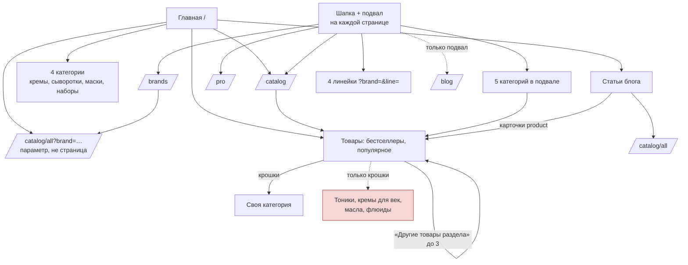
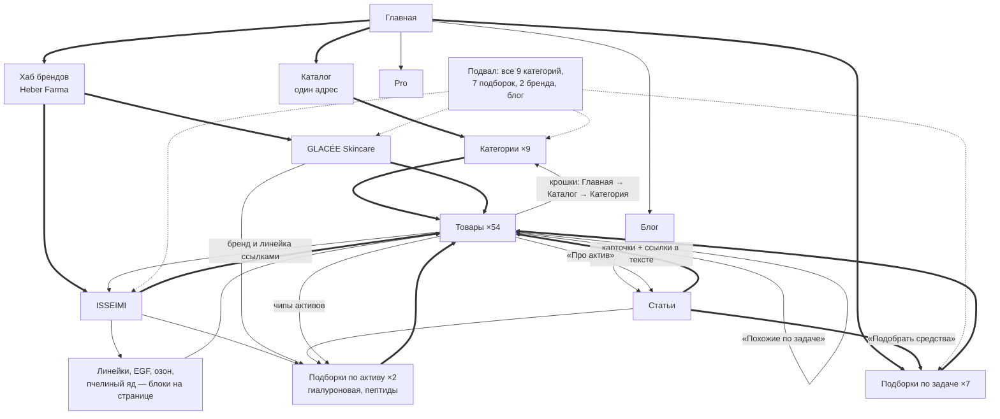

# Perfect Skin — структура страниц и перелинковка

Дата: 24.10.2026, приоритеты пересчитаны по частотам Wordstat (расчёт — в `README.md` и листе
«Страницы» в `core.xlsx`). Основа — код `projects/perfect-skin/client/src` (проверены реальные ссылки
в компонентах) и каталог: 46 товаров в `client/public/snapshot/catalog.json` + 8 новых
в `server/assets/retail-products.json` = 54 розничных товара. Код сайта не менялся.

**Ссылочный вес** — условная «важность», которую страница передаёт тем, на кого ссылается.
Хоккейная аналогия: передача шайбы. Чем больше пасов получает игрок (страница) и чем
ближе он к воротам (к главной), тем чаще бросает. Ссылка из шапки или подвала — пас
с каждой страницы сайта, ссылка из одной статьи — один пас.

---

## 1. Как сейчас (факты из кода)

| Блок | Куда ведёт | Где в коде |
|---|---|---|
| Шапка (десктоп) | Каталог `/catalog`, Бренды, Специалистам, О компании. **Блога нет** | `components/layout/Header.tsx:23-26` |
| Мобильное меню | Каталог, Мои заказы, Бренды, Специалистам, О компании, Контакты. **Блога нет** | `components/layout/MobileMenu.tsx:12-17` |
| Подвал: каталог | 5 категорий из 9 непустых (кремы, сыворотки, маски, очищение, наборы) + 4 линейки **через параметры** `?brand=&line=` | `components/layout/Footer.tsx:4-13` |
| Подвал: прочее | Бренды, Pro, О компании, Блог, `/#faq`, Оферта, Политика, Отследить заказ | `Footer.tsx:37-85, 139` |
| Главная | Hero → `/catalog`; категории — 4 (кремы, сыворотки, маски, наборы); бренды → `/catalog/all?brand=`; 4 бестселлера → товар; популярное, видеоотзывы → товары; блог и новости → статьи; FAQ → `/orders`, `/pro`, `/contacts` | `components/home/*.tsx`, `CategoryAccordion.tsx:5-34` |
| Каталог | Крошки «Главная → Каталог → категория» только на страницах категорий; фильтры (бренд, линейка, потребность, тип кожи) — **галочки, а не ссылки**; «Показать ещё» — кнопка | `pages/CatalogPage.tsx:189-193`, `catalog/Filters.tsx` |
| Товар | Крошки «Каталог → первая категория → товар» (без «Главной»); **бренд и линейка — простой текст, не ссылки**; «Другие товары раздела» — до 3 из той же категории | `product/ProductDetail.tsx:96-112, 135-150, 287`; `product/RelatedProducts.tsx` |
| Бренды `/brands` | Бренд → `/catalog/all?brand=…`, линейка → `?brand=&line=` — отдельных страниц брендов нет | `pages/BrandsPage.tsx:110, 133` |
| Статья | Карточки `[[product:slug]]` → `/product/slug` (обычная ссылка `<a href>`); кнопка «Смотреть в каталоге» → `/catalog/all`; «← Все статьи» — **кнопка, не ссылка**; крошек и «читайте также» нет | `lib/markdown.tsx:40-41, 70-80`; `pages/BlogPostPage.tsx:71-76, 108-116, 120-125` |
| Ссылки внутри текста статей | Ни одной `[текст](/url)` во всех трёх статьях | `server/assets/posts/*.md` |

Кто сколько «пасов» получает сейчас:

- **Сильные** (ссылка с каждой страницы): `/catalog`, `/brands`, `/pro`, `/about`, `/blog`
  (только подвал), 5 категорий из подвала.
- **Слабые**: `/catalog/toniki`, `/catalog/kremy-dlya-vek`, `/catalog/masla`, `/catalog/flyuidy` — на них
  ведут только крошки их же товаров (3, 2, 3 и 1 товар). По сути сироты.
- **Брендов нет как страниц.** Весь вес, который должен копиться на ISSEIMI и GLACÉE,
  уходит на адреса с параметрами `?brand=`. Если параметры потом закрыть от индексации
  (а для фильтров это стандарт), вес брендов пропадёт целиком.
- **Статьи → товары** связаны только карточками: «коллаген» → COLLAGEN BOOSTER, «дыхание
  кожи» → 3 товара, «яблоко» → **ни одного товара**, хотя DINAMIZANTE (стволовые клетки
  яблока + EGF) — ровно про это.
- **Товары → статьи**: обратных ссылок нет совсем.

---

## 2. Целевая структура

### Уровни (глубина от главной — не больше 3 кликов до любого товара)

| Уровень | Страницы | Сколько | Откуда получают ссылки |
|---|---|---|---|
| 0 | Главная `/` | 1 | — |
| 1 | Каталог (один канонический адрес), хаб брендов `/brands`, Pro, Блог | 4 | Шапка + подвал |
| 2 | Категории (9 непустых) | 9 | Подвал (все), главная, хаб каталога, крошки |
| 2 | Бренды `/brands/isseimi`, `/brands/glacee-skincare` | 2 | Шапка (выпадающее меню «Бренды»), подвал, главная, каждый товар бренда |
| 2 | Подборки по задаче, в порядке очереди: антивозраст, пигментация, сухая, проблемная, шея и декольте, чувствительная кожа, мужской уход | 7 | Главная (блок «По задаче»), подвал, каталог, статьи по теме |
| 2 | Подборки по активу: гиалуроновая (17 товаров), пептиды (14). EGF и озон — не страницы, а блоки на страницах брендов: спроса нет | 2 | Страницы брендов, статьи, карточка товара (чипы активов) |
| 3 | Товары | 54 | Категория, бренд, подборки, статьи, «похожие» |
| 3 | Линейки (ISSEIMI Base, MD, Nat Collection, GLACÉE Man Line) — Wordstat: спроса нет, отдельных страниц не делать, только блоки на странице бренда | 0 | — |
| 2–3 | Статьи блога | 3 + 13 новых (очередь — в README) | Блог, главная, товары («Читать про актив»), подборки |

Подборка — это страница с отфильтрованным списком товаров **на постоянном адресе**
(`/catalog/ot-pigmentacii`), своим заголовком H1 и текстом. Отличие от нынешних фильтров:
фильтр-галочка не создаёт адреса, который робот может проиндексировать.

Правило против каннибализации (когда две страницы сайта бьются за один запрос
и обе проигрывают): у каждого запроса в `core.csv` ровно один URL. Коммерческий
запрос («крем от пигментных пятен») — на подборку, информационный («пигментация
на лице причины») — на статью, и статья ссылается на подборку, а не наоборот
соревнуется с ней.

### Схема перетока веса

Толстые стрелки — главный поток: вес идёт сверху вниз и копится на товарах и
коммерческих подборках. Статьи — «доноры»: на информационные запросы ссылки
приходят извне и из ИИ-ответов, а статья передаёт их товарам и подборкам.

---

## 3. Блоки перелинковки по типам страниц

| Страница | Обязательные ссылки | Чего сейчас нет |
|---|---|---|
| **Главная** | Все 9 категорий; 7 подборок по задаче; 2 бренда (на страницы, не на `?brand=`); 3–4 свежие статьи; Pro | Подборок, страниц брендов, 5 из 9 категорий |
| **Категория** | Крошки; товары; чипы-ссылки на подборки, пересекающиеся с категорией («Сыворотки от пигментации»); 1–2 статьи по теме; соседние категории | Чипов, статей, соседних категорий |
| **Бренд** | Линейки и активы бренда (EGF, озон, пчелиный яд) — блоками; хиты; подборки по активам; FAQ «как отличить оригинал»; статьи с товарами бренда | Страницы целиком |
| **Подборка** | Крошки «Главная → Каталог → подборка»; товары; связанная статья; соседние подборки | Страницы целиком |
| **Товар** | Крошки с «Главной»; бренд и линейка ссылками; «Похожие по задаче» (общая потребность из `needs`), а не только по категории; «Дополнят уход» (другая категория той же линейки); «Читать про актив» → статья; чипы активов → подборки | Ссылки на бренд и линейку, кросс-категорийных блоков, ссылок на статьи |
| **Статья** | Крошки «Блог → статья»; 2–4 ссылки в тексте на подборки и категории; карточки товаров; «Читайте также» — 3 статьи; «← Все статьи» ссылкой | Почти всего, кроме карточек |
| **Подвал** | Все 9 категорий, 7 подборок, 2 бренда, Блог, FAQ | 4 категорий, подборок, брендов; линейки ведут на параметры |
| **Шапка** | Добавить «Блог» (или «Журнал»); «Бренды» с выпадающим ISSEIMI / GLACÉE | Блога, брендов как пунктов |

Тексты ссылок (анкоры) — разные и по смыслу: «сыворотки с EGF», «уход после 35», а не
«подробнее» и не один и тот же точный запрос на всех страницах.

---

## 4. Приоритеты

### КРИТИЧНО

1. **Перелинковка работает, только если робот видит ссылки.** Сайт — SPA (одностраничное
   приложение: страница собирается в браузере скриптом), у всех страниц один `<title>` из
   `client/index.html`, sitemap и robots.txt нет — это зона `seo-specialist`, передать до
   запуска. Без этого схема выше останется на бумаге.

### ВАЖНО

2. **Подборок нет как страниц, а спрос — именно там.** Задачи и активы, под которые есть
   товар: антивозраст (достижимо ~40,7 тыс. показов в месяц), гиалуроновая кислота (~22,4 тыс.),
   пептиды (~21,7 тыс.), пигментация (~19 тыс.), сухая кожа (~9,9 тыс.). Это главный рычаг против
   маркетплейсов: головы («крем для лица», «сыворотка») недостижимы, средние хвосты по задаче —
   достижимы. Один шаблон подборки, первыми — эти четыре. EGF и озон из списка подборок
   убраны: по Wordstat спроса нет (EGF — 67 показов, «крем с озоном» — маркетплейс Ozon).
3. **Четыре категории — сироты** (тоники, кремы для век, масла, флюиды): ссылок из шапки,
   подвала и с главной нет — добавить все 9 непустых категорий в подвал
   (`Footer.tsx:4-13`) и в блок категорий главной (`CategoryAccordion.tsx:5-34`).
4. **На карточке товара бренд и линейка — простой текст** (`ProductDetail.tsx:135-150`):
   54 страницы не передают вес брендам — сделать ссылками.
5. **Страниц брендов `/brands/isseimi` и `/brands/glacee-skincare` нет** — вес уходит на адреса
   `?brand=`, а на старом WordPress эти страницы отдают 404. Раньше это стояло в КРИТИЧНО;
   Wordstat понизил: брендового спроса почти нет (ISSEIMI — 9 показов, GLACÉE — 0). Страницы
   всё равно нужны — для 301 со старого сайта, доверия и GEO (источник для ИИ-ответа про
   бренд), туда же блоки линеек, EGF, озона, пчелиного яда. Трафика с них не ждать.
6. **Статья «Яблоко, которое не стареет» не ссылается на товары** — добавить
   `[[product:dinamizante-vosstanavlivayushhij-krem]]` и ссылку на подборку антивозраста.
   Контент — правка текста в `server/assets/posts/`, не кода.
7. **Дубли адресов каталога**: живут `/catalog` и `/catalog/all`, а бренд встречается как
   `/catalog?brand=` (`home/BestsellerScene.tsx:800, 885`) и как `/catalog/all?brand=`
   (`BrandsSection.tsx`, `BrandsPage.tsx`, подвал) — выбрать один адрес, второй
   перенаправлять 301.
8. **SPF-категория пустая** (0 товаров) — пустая индексируемая страница вредит; закрыть
   от индексации, пока нет товара.

### КАЧЕСТВО

9. Крошки товара начинаются с «Каталог», без «Главной» (`ProductDetail.tsx:96-112`), а на
   странице категории — с «Главной». Свести к одному шаблону и добавить разметку
   BreadcrumbList (`seo-specialist`).
10. «Другие товары раздела» запрашивает 3 товара и уже потом убирает текущий
    (`RelatedProducts.tsx:17-26`) — если текущий среди первых трёх, показывается 2.
    Запрашивать 4 и обрезать до 3.
11. В статье «← Все статьи» — кнопка `navigate()` (`BlogPostPage.tsx:71-76, 120-125`), робот
    по ней не пройдёт — заменить ссылкой; добавить «Читайте также».
12. Блог есть только в подвале — добавить в шапку и мобильное меню.
