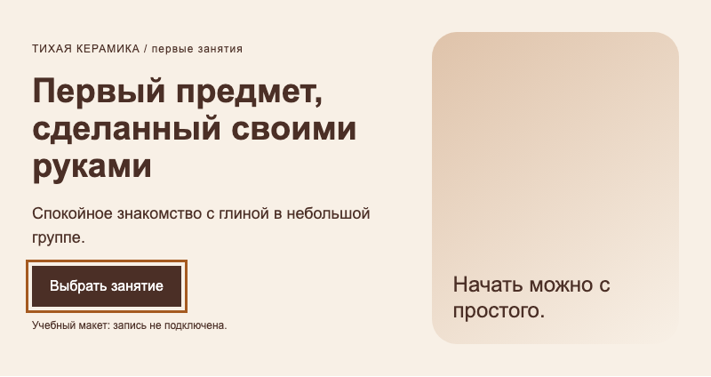
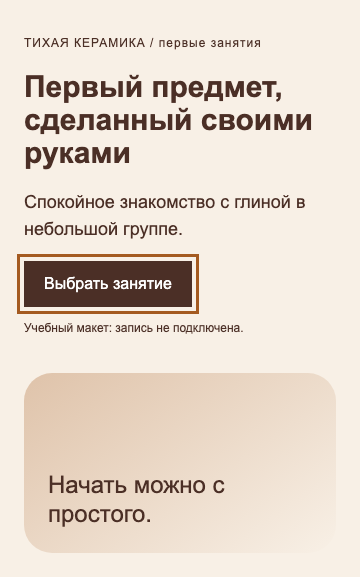

## Ответы и разборы упражнений

Сначала выполните свою попытку, затем сверяйте ход решения. В открытых задачах оценивается связь с брифом и качество проверки. Книга не заполняет за вас фактические результаты непроведённого теста.

### Ответ 1.1. Пройти по новому дереву

В условии дерево имеет корень `forma/`. Для каждого ответа сначала фиксируем базу — папку, относительно которой считаем маршрут. Имя исходного файла не является дополнительной папкой: из `delivery.html` не требуется ещё один подъём «наружу из файла».

**1. Из папки `pages/help/` к `styles/catalog.css`: `../../styles/catalog.css`.** Первый `..` поднимает из `help` в `pages`, второй — из `pages` в корень проекта `forma`. Только затем можно спуститься в соседнюю корневую папку `styles` и выбрать `catalog.css`.

```text
forma/pages/help/
  ..  → forma/pages/
  ..  → forma/
  styles/catalog.css → forma/styles/catalog.css
```

Вариант `../styles/catalog.css` неверен для этой базы: он потребовал бы `forma/pages/styles/catalog.css`, которого в условии нет.

**2. Из папки `pages/help/` к `pages/catalog.html`: `../catalog.html`.** Поднимаемся из `help` в `pages` и выбираем файл, уже лежащий там. Повторять слово `pages` после этого подъёма не нужно: `../pages/catalog.html` означало бы вложенную папку `pages/pages`.

```text
forma/pages/help/
  .. → forma/pages/
  catalog.html → forma/pages/catalog.html
```

**3. Из папки `styles/` к `data/products.json`: `../data/products.json`.** Один подъём приводит в `forma`, откуда выбираем `data`, затем `products.json`.

```text
forma/styles/
  .. → forma/
  data/products.json → forma/data/products.json
```

**4. От корня проекта к странице доставки: `pages/help/delivery.html`.** Начинаем уже в `forma`, поэтому не пишем ни начальный подъём, ни имя `forma` повторно. Допустим также явный вариант `./pages/help/delivery.html`: начальная точка оставляет нас в той же базе. Условие просит путь без начальной `/`; это не абсолютный файловый путь и не путь от корня сайта.

**5. Относительный путь зависит от базы.** Из `forma/styles/` строка `../data/products.json` приводит к `forma/data/products.json`. Из `forma/pages/help/` та же строка приводит к `forma/pages/data/products.json`. Во втором случае такой папки нет в заданном дереве. Текст пути совпадает, но отправная точка разная, поэтому разный и итоговый адрес.

Ожидаемый результат упражнения — четыре правильно записанных пути и объяснение зависимости от базы. Загружать изображения, открывать ссылки и выполнять сетевые запросы для этой проверки не требуется.

### Ответ 1.2. Изменить только разрешённое

Чтение — открыть `practice-brief.md`, прочитать `practice-title.html`, посмотреть полученный исходник после замены. Запись при подготовке — первоначально создать два новых разрешённых файла. Запись при выполнении самой правки — заменить текст внутри `h1` в `practice-title.html`. Открытие предпросмотра не редактирует сохранённую заметку и не является разрешением её менять.

Заметку читаем как условие работы. Не добавляем её текст в страницу и не «улучшаем формулировки» в ней: это вышло бы за границы задания. Если имена файлов были заняты, первоначальное создание нельзя выполнять через перезапись чужой или прежней работы; сначала нужны согласованные свободные имена.

Итоговый `practice-title.html` целиком:

```html
<!doctype html>
<html lang="ru">
<head>
  <meta charset="utf-8">
  <title>FORMA — учебная витрина</title>
</head>
<body>
  <h1>Предметы для спокойной работы</h1>
  <p>Все товары в этом примере вымышлены.</p>
</body>
</html>
```

В предпросмотре выбран именно этот HTML-файл. Ожидаем видимый заголовок «Предметы для спокойной работы» и абзац «Все товары в этом примере вымышлены.». CSS не задан и для подтверждения текстовой замены не нужен. Не обещаем определённый шрифт, цвет или расстояние: упражнение не задаёт оформление.

Проверяем, что осталось прежним:

- `title` содержит «FORMA — учебная витрина»;
- абзац содержит исходный текст без изменений;
- структура документа, язык и кодировка не менялись;
- `practice-brief.md` содержит исходные четыре строки и не редактировался после создания;
- дополнительные файлы, настройки и подключения не создавались в ходе правки.

Если на экране старый заголовок, сначала проверяем выбор HTML-файла и факт сохранения. Это ещё не повод менять другие файлы. Если на экране всё верно, но в исходнике изменён ещё и `title`, задание выполнено не полностью: внешний результат не отменяет нарушение ограничения на запись.

### Ответ 2.1. Прочитать другой полный манифест

**1. Объявлены ровно три сценария.** Их имена и значения:

```text
dev     → vite --host 127.0.0.1
build   → vite build --outDir public-build
preview → vite preview --port 4175
```

Слева — ключи внутри `scripts`, справа — строки команд. Например, `preview` — не имя установленного пакета; в данном файле оно выбирает действие инструмента `vite`. `--port 4175` относится к команде просмотра, а не к DNS и не к имени папки.

**2. `npm run build` выбрал бы `vite build --outDir public-build`.** В подготовленной внешней среде npm прочитал бы значение ключа `build`. По учебному условию параметр `--outDir` задаёт папку результата, поэтому ответ — `public-build`. Нельзя автоматически ответить `dist` только потому, что такое имя встречалось в другом примере: здесь настройка явно другая.

Это объяснение манифеста, а не подтверждение запуска. В текущем учебном приложении терминала нет; сохранять JSON разрешено, выполнять записанную строку через него нельзя.

**3. Сценарий `test` не объявлен.** Среди ключей `scripts` его нет. Следовательно, этот файл не задаёт явного сценария `npm run test`. Но по одному манифесту нельзя утверждать «тестов вообще не существует»: могли быть файлы проверок, другой инструмент или отдельный процесс команды. Правильная формулировка: «В предоставленном манифесте тестовый сценарий отсутствует; наличие и способ выполнения других проверок неизвестны».

**4. В `dependencies` находится `dayjs` версии `1.11.13`.** По условию его использует код приложения для работы с датами. В `devDependencies` находится `vite` версии `5.4.0`, инструмент разработки и сборки. Версии относятся к соответствующим пакетам, не к версии самого проекта: у проекта отдельно задано `1.1.0`.

Разделы различаются назначением пакетов. Неправильно утверждать, что весь список `dependencies` браузер обязан скачать отдельными файлами, а `devDependencies` никогда не влияет на выходной результат. Как исходники будут обработаны и переданы посетителю, зависит от устройства проекта.

**5. `private: true` не является входом по паролю.** Эта настройка предотвращает случайную публикацию пакета средствами npm. Она не реализует страницу входа, проверку пользователя или ограничение доступа к каталогу. Для утверждения о защищённом магазине нужны отдельные механизмы и проверки. В данном упражнении таких сведений нет.

### Ответ 2.2. Отделить доказанное от обещанного

Точные соответствия из предоставленного JSON:

```text
npm run build   → vite build
npm run test    → vitest run
npm run preview → vite preview
```

Объявление третьей команды не означает, что её выполнили. Отчёт прямо говорит обратное. Нельзя заменять этот факт предположением «раз сборка есть, preview наверняка работает».

Корректный итоговый текст, например:

> По предоставленному отчёту сборка завершилась без ошибки и создала `dist`. Два теста суммы корзины прошли. В обычном браузере на адресе сервера разработки виден заголовок. Просмотр собранного результата через `preview` не запускался; добавление товара не проверялось. Приёмка всего магазина пока не подтверждена.

В реальной передаче работы полезно приложить безопасные журналы и адрес проверенной среды. Здесь мы анализируем вымышленный отчёт, поэтому не выдаём его за собственное выполнение команд.

Подтверждённые в условии факты:

1. Указанная сборка закончилась без ошибки и дала выходную папку.
2. Два конкретных теста расчёта суммы прошли.
3. В браузере открывали адрес сервера разработки, и там был виден заголовок.

Оставшиеся проверки можно сформулировать так:

1. В подготовленной внешней среде запустить просмотр собранного результата и открыть именно его адрес.
2. Проверить загрузку нужных ресурсов в этой версии, а не только существование папки `dist`.
3. Проверить действие добавления товара: изменение количества, суммы и видимого состояния корзины.
4. Проверить поведение при пустом каталоге и ошибке получения данных.
5. Проверить согласованные требования к экрану, например читаемость на узкой ширине и доступность управления клавиатурой.

Для ответа достаточно минимум трёх конкретных оставшихся проверок. Важно не подменять их общей фразой «проверить всё». Два теста суммы защищают только закодированные ожидания; они не подтверждают каждую кнопку и каждый сетевой исход.

Адрес сервера разработки связан с обработкой исходников в режиме разработки. `preview` в данном проекте предназначен для просмотра подготовленного результата. Разные источники ресурсов и режимы могут проявить разные ошибки, поэтому открытие одного адреса не служит доказательством открытия другого. Более того, кнопка HTML/CSS-предпросмотра учебного приложения не запускает ни `vite`, ни `vite preview`.

### Ответ 3.1

Подпись кнопки соответствует буквальному запросу. Правка примечания меняет обещание о работе с контактами и добавляет не согласованную клиентом рассылку; её нельзя молча принять как часть переименования. Следует остановить эту часть правки и уточнить требование у куратора. Diff показывает изменение текста, но не доказывает отправку формы, доставку подборки или заметность элемента. Хороший ответ отделяет три разных факта: изменён код, проверено поведение, согласовано бизнес-решение.

### Ответ 4.1. Прочитать создание записи

**1. Метод — `POST`, путь — `/api/demo-carts`.** По заданному контракту действие создаёт демонстрационную корзину. Это не чтение списка товаров и не платёж. Не добавляем смысл, которого нет в договорённости API.

**2. `Content-Type: application/json` относится к телу самого запроса.** Клиент сообщает: «я отправляю JSON». `Accept: application/json` относится к желаемому формату ответа: «хочу получить JSON». Совпадение значений не делает заголовки взаимозаменяемыми.

**3. Передан товар `stand-demo` в количестве `2`.** Это видно внутри массива `items` в теле запроса. В ответе сервер вернул идентификатор корзины `cart-demo-17`. Идентификатор товара и идентификатор корзины — разные сущности. Нельзя назвать корзину `stand-demo`, потому что это значение поля `productId`, а не поля `id` ответа.

**4. `201 Created` сообщает о создании ресурса.** Заголовок `Location` указывает путь `/api/demo-carts/cart-demo-17`, связанный с созданной корзиной. Этот путь в сообщении не требует от ученика нажимать ссылку и не доказывает наличие отдельного файла на диске.

Допустимое сообщение интерфейса:

> Демонстрационная корзина создана. В ней 2 единицы товара `stand-demo`. Оплата не выполнялась.

Можно использовать более короткую формулировку, если она сохраняет смысл. Недопустимы «Заказ оплачен» и «Доставка оформлена»: для них в показанном обмене нет оснований. Также не нужно обещать успешное последующее открытие корзины, если отдельный запрос ещё не проверяли.

**5. По `/api` нельзя узнать количество компьютеров.** Это часть пути в обращении к программе. Та же программа может обслуживать страницу и API; возможен и другой вариант устройства системы. Показанный запрос не сообщает, на каких физических машинах выполняется обработка.

### Ответ 4.2. Четыре независимых исхода

Во всех случаях после нажатия сначала показываем «Загружаем товары…». Дальше рассматриваем каждый исход независимо: не переносим удачный результат A в B и не сохраняем бесконечную загрузку вместо завершения.

#### A — получен корректный пустой список

`receivedHttpResponse` равно `true`, статус — `200`, тип — `application/json`, в теле есть массив `items`. Массив пуст. Все условия успешного получения списка выполнены.

Конечное состояние — **empty**, не **error**. Сообщение: «По выбранным условиям ничего не найдено». Разумное действие — изменить или сбросить фильтр. Этот ответ позволяет утверждать отсутствие совпадений в рамках данного запроса, но не отсутствие всех товаров магазина навсегда.

```text
нажатие → loading → 200 + нужный JSON + [] → empty
```

#### B — сервер сообщил временную недоступность

HTTP-ответ получен, статус — `503`. Тело содержит код ошибки, а не подтверждённый список. Не заменяем его на `items: []`: это придумало бы данные, которых сервер не передал.

Конечное состояние — **error**. Сообщение: «Сервис временно недоступен. Попробуйте позже». Разумное действие — ограниченный повтор после ожидания, а не бесконечная отправка запросов без паузы. При наличии серверного указания времени ожидания его нужно учитывать. В предоставленном JSON такого заголовка нет: конкретный срок не выдумываем.

```text
нажатие → loading → получен 503 → error
```

Наличие или отсутствие товаров по этому исходу неизвестно. Известно только, что список не был успешно получен.

#### C — HTTP-ответ отсутствует

`receivedHttpResponse` равно `false`, статус — `null`, указан сбой разрешения имени `DNS_NAME_NOT_RESOLVED`. Запрос не дошёл до стадии получения HTTP-ответа от нужной службы. Это не `404`, не `500` и не «HTTP-статус null».

Конечное состояние — **error**. Сообщение: «Не удалось связаться с сервисом». Разумно проверить правильность адреса и доступность разрешения имени, сообщить проблему куратору, затем повторить после устранения причины. Не нужно менять разметку товаров или отключать TLS: это не следует из данного признака.

```text
нажатие → loading → сбой DNS, HTTP-статуса нет → error
```

Ничего об ассортименте этот исход не доказывает. Аналогично при отказе TLS до HTTP-обмена нельзя приписывать серверу несуществующий статус; но в данном наборе явно указан именно DNS, поэтому сертификат не объявляем установленной причиной.

#### D — успешный статус, но неподходящее содержимое

HTTP-ответ получен со статусом `200`. Однако `Content-Type` равен `text/html`, а тело — HTML-строка демонстрационной страницы входа. Контракт ожидает JSON-объект с массивом `items`. Полученное представление этому контракту не соответствует.

Конечное состояние — **error**, а не **ready** и не **empty**. Сообщение: «Не удалось прочитать данные каталога: получен неожиданный формат». Разумное действие — сообщить проблему и проверить адрес, перенаправления и правила доступа в подготовленной среде. Нельзя требовать настоящие пароли в учебном упражнении или автоматически вставлять чужой HTML в страницу каталога.

```text
нажатие → loading → 200, но HTML вместо ожидаемого JSON → error
```

Отсутствие товаров не доказано. Заголовок входа в теле может подсказать направление расследования, но не доказывает конкретную причину, например «пароль истёк»: таких данных в условии нет.

#### Пример отчёта куратору

> По заданным данным A успешно вернул пустой список и требует состояния empty. B вернул HTTP 503 и требует состояния ошибки. В C HTTP-ответа нет: указан сбой DNS. В D есть HTTP 200, но пришёл HTML вместо JSON по контракту. Чтобы расследовать реальные случаи, нужны безопасный адрес без секретных параметров, метод, время попытки, наличие или отсутствие HTTP-ответа, статус при его наличии, тип содержимого и минимальный обезличенный фрагмент ответа. Для сбоя до HTTP нужно отдельное сообщение браузера о сетевой причине. Пароли, токены, cookie и реальные данные покупателей в отчёт не включаем.

Все четыре исхода завершают ожидание определённым экраном. Только A даёт основание показать отсутствие совпадений. Нельзя объединять B, C и D с A ради визуально аккуратной страницы: это скрывает проблему и сообщает пользователю неверный факт.

### Ответ 5.1

```html
<section aria-labelledby="restore-title">
  <h1 id="restore-title">Вернём любимой мебели характер</h1>
  <p>Обсудим состояние и предложим варианты восстановления.</p>
  <button type="button">Показать предмет мастеру</button>
</section>
```

ID заголовка совпадает со ссылкой в `aria-labelledby`. Фотография не отправляется: нет выбора файла, обработчика, серверного API и подтверждения доставки. Для текущего статического макета это ожидаемая граница, а не повод заявлять о готовой интеграции. Допускаются другие формулировки объяснения, но не утверждение «кнопка автоматически всё отправит».

### Ответ 6.1

```css
.card {
  display: grid;
  gap: 20px;
  padding: 32px;
  max-width: 420px;
  background: #f3f0e8;
  color: #18352b;
}
.card h2, .card p { margin: 0; }
.card button { padding: 14px 22px; }
```

Первое число в записи кнопки относится к вертикальному направлению, второе — к горизонтальному. `gap` меняет промежутки между заголовком, абзацем и кнопкой; отступ от границы задаёт `padding` карточки. Изменение параметров не доказывает качество на узком экране: нужно посмотреть, не зажалась ли полезная ширина и не возникло ли переполнение.

### Ответ 7.1

```js
function conceptLabel(status) {
  if (status === "saving") {
    return "Сохраняем концепцию…";
  }
  return "Сохранить концепцию";
}
```

Для `saving` действует первая ветка, для `draft` — вторая. Предсказание результата и реальный запуск — разные факты. Слова «не запускал, ожидаю такую строку по разбору функции» являются корректным отчётом, если исполнитель пока недоступен.

### Ответ 8.1

Обе карточки показывают заголовок «Подставка для ноутбука». Подписи различаются: «Дуб» и «Орех». Идентификаторы `stand-oak` и `stand-walnut` разные и не зависят от расположения. В этой упрощённой структуре это две отдельные записи. В более подробной модели они могут быть вариантами одного товара; для упражнения важно не молча объединить разные записи по одинаковому заголовку.

### Ответ 9.1

А — `empty`, сообщение об отсутствии подходящих результатов, предложение изменить фильтр. Б — `error`, сообщение о невозможности загрузить и повтор. В — `error`: HTTP-обмен завершился, но формат данных не соответствует договору; не показывать пользователю повреждённый технический текст как каталог. Г — `loading`, сообщение ожидания. Задержка не равна доказанному отсутствию данных. Конкретные слова могут отличаться, если сохраняется смысл и доступно понятное действие.

### Ответ 10.1

По значениям договору соответствует `first`. У `second` заголовок логический, а нужен текст; можно заменить `true` на согласованную строку. У `third` тема `violet` не разрешена; выбрать `light`/`dark` либо отдельно изменить и реализовать согласованный договор темы. Есть техническая тонкость вывода типов: при отдельном создании изменяемого объекта TypeScript может расширить литерал темы до `string`. Для однозначной проверки объявите `const first: Hero = { ... }`; упражнение проверяет прежде всего смысл полей, а не незнакомые особенности вывода типов.

### Ответ 11.1

```jsx
<FeatureCard
  title="Проект под помещение"
  description="Учтём размеры и сценарии жизни."
/>
<FeatureCard
  title="Понятный процесс"
  description="Покажем этапы до начала изготовления."
/>
```

Каркас меняется в `FeatureCard`, содержание конкретного блока — в props соответствующего вызова. Чтобы показать это уже сейчас без React-исполнителя, можно отдельно сверстать статический HTML; это не следует выдавать за запущенный React-компонент.

### Ответ 12.1

Запрос не должен включить Production или переключить пользователя на Тест. Источником полномочий остаются проверенная личность и серверные разрешения. Роль student и её прогресс не меняются. Скрытая кнопка — только удобство интерфейса: прямой запрос всё равно должен быть отклонён. Не требуются секреты и действия в чужом профиле; проверку выполняют на выделенных тестовых данных.

### Ответ 13.1

```sql
SELECT id, title
FROM works
WHERE category = 'lighting';
```

Ожидается `work-light` / «Свет для мастерской». `SELECT` выбирает данные, а не меняет CSS. Упражнение не требует доступа к клиентской или учебной базе: все исходные записи приведены в условии.

### Ответ 14.1

`oak`: «Дуб», сообщение об отсутствии, покупка недоступна. `walnut`: «Орех», доступное состояние и действие покупки. Повторяется принцип единого источника выбранного варианта: содержание и действия соответствуют одной и той же записи. Не следует оставлять блокировку от дуба после перехода к ореху или разрешать отсутствующий вариант по старому состоянию кнопки.

### Ответ 15.1

**Заголовок:** «Поможем вернуть повседневные вещи в носку».

**Уточнение:** «Ремонтируем одежду после осмотра. Принесите вещь в мастерскую: обсудим, что можно сделать, и согласуем стоимость до работы».

**Действие:** «Как подготовить вещь» — ссылка на следующий раздел.

**Вспомогательный блок:** «Сначала посмотрим ткань и повреждение. Возможность ремонта зависит от состояния вещи». Если в исходном текстовом списке услуг нет конкретной операции, не добавляйте её от себя. Адрес размещается только в том виде, который действительно предоставлен клиентом; поскольку в формулировке упражнения он не указан буквально, в сдаче допустима отметка «адрес из материалов клиента» вместо придуманной улицы.

**Следующий раздел:** «Перед визитом» с тремя пунктами: принести саму вещь; показать место, которое беспокоит; рассказать о желаемом результате. Специальные правила стирки или подготовки нельзя изобретать: их должен подтвердить клиент. Если ученик хочет их добавить, это вопрос к согласованию, не установленная инструкция.

На широком экране допустимы две колонки: основное предложение и краткие границы услуги. Однако это не обязанность. Хорошо обоснованная одноколоночная композиция тоже подходит, особенно если текста мало. На телефоне порядок такой: вид услуги, заголовок, условие осмотра, действие, подготовка, подтверждённый адрес.

Отсутствие фотографии не нужно маскировать пустой «картинкой ради картинки». Для этого задания текстовая композиция уже завершена. Если предусмотрено будущее изображение, его роль можно описать как «показать рабочее место и процесс осмотра», а не «украсить сайт». Нельзя брать чужой снимок и считать, что ссылка на автора заменяет разрешение на публикацию.

**Почему решение подходит:** услуга объяснена простыми словами, оценка не обещается до осмотра, а посетитель получает выполнимый следующий шаг. Если ваш заголовок другой, но сохраняет эти свойства, это не ошибка. Переписанная мебельная метафора без учёта одежды была бы слабее, потому что не показывает самостоятельной работы с новым брифом.

### Ответ 15.2

**Раздел первый:** название прогулки; заголовок «Посмотрите на знакомые дворы через их истории»; пояснение «Прогулка для взрослых жителей города»; группа условий «Около полутора часов», «Место встречи: требуется подтверждение», «Маршрут проходит по лестницам»; ссылка «Прочитать маршрут».

**Раздел второй:** «Что будет на маршруте». В нём обозначается место для согласованного описания остановок, повторяется ограничение о лестницах и честно указано: «Даты пока не согласованы». В исходном брифе нет адреса встречи и конкретных дворов, поэтому их нельзя выдумывать даже ради завершённого вида. Завершённый прототип может содержать явно подписанные неизвестные, но готовая публичная страница потребует их уточнить.

Предупреждение находится до действия, рядом с длительностью и местом, а не в самом низу страницы. Оно влияет на возможность участия, поэтому не является незначительной сноской. Не стоит описывать маршрут как «доступный всем»: присутствие лестниц как минимум требует отдельного обсуждения потребностей посетителей.

Роль будущего изображения — показать характер пространства или конкретный участок маршрута после согласования. Фото не должно подменять текст о лестницах. На телефоне сохраняется последовательность: предложение, условия, предупреждение, действие, подробности. Вместо оформления с жёсткой высотой, которое может обрезать длинное предупреждение, блоки растут по содержанию.

**Самопроверка:** вы не добавили даты и билеты; основное действие ведёт к описанию; условия заметны; неизвестные подписаны; мобильная версия содержит тот же смысл. Другая формулировка заголовка или порядок двух справочных строк допустимы, если важное ограничение остаётся перед решением об участии.

### Ответ 16.1

Возможная карта: первый экран → три карточки типов света → процесс подбора → контактное действие. Повторяемая часть — LightTypeCard. Задание ограничивает секцию карточек, даёт названия/описания и требования к мобильному расположению; не разрешает менять первый экран, контакты, ядро студии и добавлять оплату. Конкретные названия файлов зависят от выбранного проекта: здесь оценивается распределение ответственности, а не выдуманная структура неизвестного репозитория.

### Ответ 17.1

Корректный план включает карточку с приведённым длинным текстом, просмотр широкого и узкого расположения, переход фокуса клавишей Tab, наблюдение переносов, неперекрытия и видимого фокуса кнопки. Фактический результат нельзя получить из условия — он заполняется только после проверки своего макета. Поэтому в книге нет заранее «успешного факта» за ученика. Ответ оценивает полноту плана и честность статуса, а не совпадение субъективного вкуса.

### Ответ 18.1

Отчёт называет статический прототип двух секций, оба файла и реально выполненные проверки из условия. Кнопка обозначается демонстрационной; отправка и публикация не заявляются готовыми. Личный кабинет не записывается в выполненную работу: куратору направляется вопрос о новом объёме и необходимости отдельного согласования. Фразы «сайт полностью готов» и «добавлю кабинет бесплатно» не следуют из приведённых данных и ответственности ученика.

### Ответ 19.1

### Концепция А. «Спокойный старт сезона»

**Первый экран:** «Подготовим велосипед к городским поездкам». Пояснение: «Начнём с осмотра. Затем согласуем нужные работы и стоимость». Действие: «Как обратиться в мастерскую».

**Структура:** предложение → что смотрит мастер → как проходит согласование → какие сведения подготовить → ограничения и подтверждённые контакты. В пределах исходного брифа перечень осмотра включает тормоза, переключение передач и колёса. Электросистемы обозначены как исключение, а бесплатность и сроки не утверждаются.

**Визуальный язык:** спокойная крупная типографика, ведущая текстовая область и вспомогательная полоса с этапами. Будущее фото могло бы показать реальный осмотр велосипеда после получения собственных материалов. Сейчас достаточно подписанной области или полностью текстовой страницы. На телефоне этапы идут после предложения и перед подробными ограничениями; исключение по электросистемам остаётся заметным.

### Концепция Б. «Покажите, что вас беспокоит»

**Первый экран:** «Не знаете название детали? Опишите, как ведёт себя велосипед». Пояснение: «Для первого разговора достаточно ваших наблюдений. Перечень и стоимость ремонта согласуем после осмотра». Действие: «Что рассказать мастеру».

**Структура:** понятные бытовые категории наблюдений → подготовка обращения → осмотр и согласование → границы услуги. В карточках допустимы нейтральные подписи «При торможении», «При переключении», «При вращении колеса». Это не диагнозы и не интерактивный тест: они помогают подготовить рассказ. Нельзя утверждать причину неисправности по одной жалобе.

**Визуальный язык:** модульная схема из текстовых блоков с выразительными заголовками. Картинка не обязательна: основная идея уже показана организацией наблюдений. На телефоне каждый блок занимает полную ширину. В отличие от направления А, вход в услугу организован через язык посетителя, а не через общий рассказ мастерской.

Для статического прототипа можно выбрать Б, если рабочая гипотеза состоит в том, что посетителей останавливает незнание терминов. В сдаче это нужно назвать гипотезой, не результатом исследования. А также подходит, если автор убедительно показывает простоту и прозрачность этапов.

**Отклонённое направление:** «умный диагностический центр» с автоматическим определением поломки. Оно добавляет неподтверждённую возможность и не соответствует HTML/CSS-среде. **Вопросы клиенту:** оплачивается ли осмотр, какие велосипеды принимаются кроме городских, каков порядок обращения, какие контакты разрешены к публикации, что требуется привезти. Эти вопросы не означают, что ученик должен сам назначить условия.

**Критерий самостоятельности:** два направления различаются входом в предложение, структурой и визуальным носителем. Только другие цвета на одинаковых карточках не выполняют условие двух концепций.

### Ответ 19.2

**Концепция:** «Знакомство перед камерой». Она обещает понятную подготовку и разговор, а не роскошь как самоцель. **Заголовок:** «Семейная съёмка начинается с разговора о вашей семье». **Пояснение:** «До бронирования обсудим привычный ритм ребёнка, ваши ожидания и организацию встречи». Такое содержание остаётся в рамках предварительного обсуждения и не обещает непереданные пакеты услуг.

**Структура:** предложение → как устроена подготовка → вопросы до бронирования → что ещё предстоит согласовать → будущий контактный канал. Вопросы можно сформулировать как темы разговора: кто будет участвовать, что важно семье, какие организационные условия нужно обсудить. Стоимость, длительность, количество готовых снимков и сроки передачи не задаются без клиента.

Сдержанное оформление выражается ясной иерархией, спокойными полями, небольшим количеством акцентов и читаемым текстом. «Дорогой минимализм» не оправдывает едва заметные подписи, скрытые ограничения или отсутствие необходимого содержания. Мобильная версия не начинает с огромного пустого поля: предложение и подготовка доступны сразу, затем раскрываются подробности.

Фотографии с лицами пока не публикуются. Корректная учебная замена — текстовая область «Здесь планируется согласованная семейная фотография; разрешение на публикацию не получено» или макет вообще без изображения. Простая обрезка лиц не должна автоматически объявляться достаточным разрешением: этот вопрос требует отдельной проверки. Референсы остаются только материалом обсуждения.

**Вопросы до выпуска:** подтверждённые стоимость и длительность; фактический процесс; допустимые формулировки об условиях; контакт; права и согласия на выбранные фотографии. **Почему ответ подходит:** он превращает расплывчатый стиль в конкретный опыт подготовки, сохраняет ограничения и не приписывает клиенту несуществующие гарантии поведения ребёнка на съёмке.

### Ответ 20.1

Возможная адаптация: слева ясное обещание «Рабочее место под ваш день», короткое пояснение консультации и действие «Обсудить рабочее место». Справа — собственная простая схема зон: свет, поверхность, хранение. На узком экране сначала предложение и действие, потом схема. Переносится принцип «один главный смысл и узнаваемый предмет разговора», а не чужая мебельная сцена. Отказ: сложная вращающаяся 3D-модель, потому что в брифе нет исходных моделей и такой эффект не объясняет услугу лучше доступной схемы. Пример не доказывает рост заявок; проверяются понятность предложения и следующий шаг. Другой вариант принимается, если так же связан с задачей, не копирует чужую работу и честно учитывает ресурсы.

### Ответ 20.2

Хороший выбор сочетает источник реальных веб-страниц для структуры услуги и источник разборов/лендингов для иерархии записи. В каждом ищут не абстрактную красоту, а такие конкретные решения: как показать первый визит, фотографии рук/предметов, длительность и формат занятия, простое действие записи. Названия выбранных площадок сверяются с карточками подборки; единственной обязательной пары нет. Плохой перенос — эффектная 3D-заставка без расписания и доступного действия. У клиента нет 3D-производства, а главная задача — понятная запись, поэтому сначала защищается простая концепция с собственными фотографиями и ясными условиями. Две ссылки без объяснения поиска не выполняют задание.

### Ответ 21.1

**Ведущая мысль:** показать, где изменяется направление света и где находится выключатель. **Заголовок:** «Направьте свет на нужную часть стола». Рядом уточнение: «Концепт страницы лампы. Диапазон регулировки и характеристики требуют подтверждения». Это не обещание измеренных углов или медицинского эффекта.

| Фаза | Состояние | Привязка к странице | Сохранённый смысл |
| --- | --- | --- | --- |
| Вход | Общий вид лампы на условном столе | Начало раздела входит в окно | Название, назначение, ссылка «К характеристикам» |
| Регулировка | Два заранее согласованных положения плафона | Основная часть раздела видна | Подпись «Направление меняется поворотом плафона» |
| Управление | Крупный вид основания | Следующий блок входит в область чтения | Подпись «Отдельный выключатель на основании» |
| Выход | Спокойный общий вид | Появляется раздел условий | Перечень неподтверждённых данных |

При отсутствии согласованных положений не рисуйте произвольные технические пределы как факт. На раскадровке допустимы условные виды с пометкой «положение требуется подтвердить». Имитировать реальную световую диаграмму тоже нельзя без материалов.

**Сравнение способов:** статические виды уже объясняют устройство; короткое видео могло бы показать движение плафона по добровольному запуску. Последовательность кадров подходит для заданной траектории, но требует подготовки и загрузки; WebGL можно обсуждать при реальной потребности управлять ракурсом. Для первого выпуска разумно выбрать статические виды с возможным отдельным роликом позже. Другой выбор допустим, если он обоснован задачей и ресурсами, а не словом «современно».

**Мобильная и спокойная версии:** общий вид, положение плафона, выключатель, характеристики — обычными блоками в этом порядке. Действие не прячется до конца показа. При reduced motion вместо перемещения остаются два подписанных положения. В нынешнем приложении все виды представлены текстовыми областями: никаких роликов, изображений и вращения на самом деле нет.

**Что нужно получить:** модель или собственные фото, пределы регулировки, размеры, мощность, согласованный текст и права. **Что проверить позже:** время появления содержания, плавность на слабом устройстве, отсутствие перекрытой навигации, работу запасной версии. В статическом прототипе эти технические результаты нельзя объявлять уже измеренными.

### Ответ 21.2

**Концепция:** «Как павильон связан с двором». **Статус рядом с заголовком:** «Концептуальный проект для обсуждения. Строительство не утверждено». Это уточнение не переносится в едва заметную сноску: оно влияет на понимание всего показа.

**Кадр первый:** условный общий вид сверху под небольшим углом, на котором обозначены дорожка, вход и место отдыха. Подпись: «Схема размещения, требует согласования». Он появляется как начало истории, когда раздел входит в область просмотра. **Кадр второй:** вид с дорожки в сторону входа; подпись «Предполагаемый подход ко входу». Его положение связывается с центральной частью раздела. **Кадр третий:** вид зоны отдыха; подпись «Идея места для остановки и общения». Он завершает историю перед обычным текстом состава проекта.

При отсутствии модели это подписанные прямоугольники или простая текстовая схема, а не придуманная фотореалистичная архитектура. Нельзя дорисовывать точные размеры, материалы и высоты как согласованные. Если для обсуждения введено пространственное предположение, оно явно называется предположением и выносится в список вопросов.

**Выбор будущего способа:** начать с согласованных статических видов. Они позволяют обсуждать три пространственные связи без сложного управления. В будущем подготовленный видеопролёт может связать ракурсы, а реальное 3D — дать свободный обзор, если такая потребность подтвердится. Наличие объёмной модели само по себе не доказывает соответствие нормам или удобство входа.

**Навигация:** ссылки «Состав проекта» и «Вопросы для обсуждения» доступны независимо от сцены. Посетитель может перейти к тексту сразу, не дожидаясь условного пролёта. Прокрутка не перехватывается. На телефоне три вида идут по одному с теми же подписями; при reduced motion используется та же последовательность без движения. Если модели или изображений нет, текстовые связи «дорожка → предполагаемый вход → место отдыха» сохраняют смысл.

**Состав проекта:** на текущем уровне можно перечислить только павильон, подход от дорожки и место отдыха как элементы концепции. **Вопросы:** фактические размеры, перепады высот, доступность входа, статус согласования, материалы и ограничения участка. Проверку доступности нельзя заменить фразой «вход выглядит широким». Сроки и стоимость остаются неизвестными.

**Почему ответ подходит:** он делает пространственный замысел обсуждаемым, но не превращает концепт в обещание стройки. Технология выбирается под задачу, содержание сохраняется без движения, а границы знания видны человеку до принятия решений.

### Ответ 22.1

Ниже один полный допустимый вариант. Здесь сохраняется структура знакомого примера, но меняются обещание, характер текста и палитра. В поле HTML нужно указать `examples/ceramics.html`, в поле CSS — `examples/ceramics.css`.

```html
<!doctype html>
<html lang="ru">
<head><meta charset="utf-8"><title>Тихая керамика</title></head>
<body>
  <main class="hero" aria-labelledby="hero-title">
    <div class="hero-copy">
      <p class="eyebrow">ТИХАЯ КЕРАМИКА / первые занятия</p>
      <h1 id="hero-title">Первый предмет, сделанный своими руками</h1>
      <p class="description">
        Спокойное знакомство с глиной в небольшой группе.
      </p>
      <button type="button">Выбрать занятие</button>
      <p class="status">Учебный макет: запись не подключена.</p>
    </div>
    <div class="hero-scene" aria-label="Условная тактильная сцена">
      <span class="scene-label">Начать можно с простого.</span>
    </div>
  </main>
</body>
</html>
```

```css
* { box-sizing: border-box; }
body { margin: 0; font-family: Arial, sans-serif; }
.hero {
  display: grid;
  grid-template-columns: 3fr 2fr;
  gap: 32px;
  padding: 36px;
  background: #f8f0e6;
  color: #4b2f26;
}
.hero-copy { min-width: 0; }
.eyebrow { font-size: 12px; letter-spacing: 1px; }
h1 { font-size: 38px; line-height: 1.1; margin: 20px 0; }
.description { font-size: 18px; line-height: 1.5; }
button {
  padding: 14px 20px;
  background: #4b2f26;
  color: #ffffff;
  border: 0;
  font: inherit;
  cursor: pointer;
}
button:focus-visible { outline: 3px solid #a45a20; outline-offset: 4px; }
.status { font-size: 12px; line-height: 1.5; }
.hero-scene {
  min-height: 260px;
  padding: 24px;
  border-radius: 28px;
  background: linear-gradient(145deg, #dfc3aa, #f8f0e6);
  display: flex;
  align-items: flex-end;
}
.scene-label { max-width: 15ch; font-size: 24px; line-height: 1.2; }
@media (max-width: 640px) {
  .hero { grid-template-columns: 1fr; padding: 24px; gap: 24px; }
  h1 { font-size: 30px; }
  .hero-scene { min-height: 180px; }
}
```

Отличается не только цвет: заголовок обещает первый опыт, пояснение снижает страх новичка, кнопка связана с выбором занятия. Строка статуса не выдаёт демонстрационную кнопку за готовую запись. Визуальная область — заглушка, а не чужая фотография глины. Приёмка всё равно требует просмотра собственного результата: этот образец не является фактом проверки ученического файла.





### Ответ 22.2

Возможная небольшая правка — заменить только правило заголовка внутри уже существующего медиаблока, например на `h1 { font-size: 26px; line-height: 1.15; }`. Остальные части брифа не требуют добавления расписания или формы. Нужно снова посмотреть узкую область с исходным и длинным текстом, убедиться в читаемости, расположении кнопки и отсутствии обрезания. Не существует честного заранее заполненного фактического результата для любого ученического экрана: в отчёт подставляются свои наблюдения. Если после изменения строка всё ещё неудобна, размер не считается автоматически правильным только потому, что он совпал с числом в ответе. Сдача содержит изменённый CSS, объяснение решения и свежую проверку.
