# H&B — дизайн и основы AI-веб-разработки, редакция 2

## Как пользоваться книгой без опыта

Эта книга учит понимать веб-проект, придумывать собственную концепцию по задаче клиента и доводить небольшой прототип до проверяемого результата. Она не предполагает, что вы уже знаете терминал или умеете читать код. Незнакомое слово объясняется рядом с действием; словарь в конце основной части помогает вспомнить определение.

Порядок работы: сначала прочитайте объяснение и схему, затем повторите полностью разобранный пример и только потом выполните похожее упражнение. Исходные данные находятся в задании. Ответы самостоятельных задач расположены последним разделом; разборы показанных образцов остаются перед упражнениями. Для дизайн-задач возможны разные хорошие решения — ответ объясняет критерии, а не требует копировать единственную картинку.

Номер главы не равен номеру дня курса. Для первого знакомства с инструментом можно сначала открыть главу 22, а затем вернуться к понятиям глав 1–6. Программа определяет учебные дни, приложение хранит личную практику, книга объясняет устройство и способ работы.

FORMA — придуманный учебный магазин; другие клиенты в примерах тоже вымышлены. Их данные даны в условиях, не требуют поиска реального клиента или использования чужих секретов. Референсы служат для анализа принципов, не дают права присваивать код, бренд, тексты или медиа.

Сейчас в приложении работает статический HTML/CSS-предпросмотр. Живой ИИ, терминал, JS/React-исполнитель, внешние ресурсы, отправка форм и публикация не подключены. Поэтому чтение кода, статический макет, будущая реализация и фактически выполненная проверка обозначаются отдельно. Примеры команд объясняют их смысл, а не требуют открыть несуществующий терминал.

## Глава 1. Файл, папка и путь: где живёт сайт

### Что мы собираемся понять

Представьте, что куратор просит заменить заголовок каталога FORMA. На экране магазина видна одна страница, но внутри проекта могут лежать десятки материалов. Как выбрать нужный? Почему изменение иногда сохраняется, а страница остаётся прежней? Почему файл с названием `main.css` не обязательно является тем файлом, который сейчас оформляет экран? Начнём не с программирования, а с ответа на вопрос: **какое содержимое, по какому адресу и кто читает**.

FORMA здесь — вымышленный учебный магазин. Все названия товаров и тексты придуманы. Задания не требуют реальных клиентских файлов, изображений, паролей или доступа к чужим папкам. В текущем учебном приложении есть один проект: в нём можно читать и записывать собственные HTML, CSS, JS, TS, TSX, JSON, MD и TXT. Предпросмотр показывает только HTML и CSS; скрипты, изображения, сетевые обращения, формы и переходы по ссылкам в нём не работают. CSS выбирают через отдельное поле CSS-файла. Поэтому мы будем отдельно проверять **адрес по дереву проекта** и **видимый результат в ограниченном предпросмотре**.

### Файл — не картинка на экране

Файл — отдельная сохранённая порция содержимого с именем. В текстовом файле можно прочитать символы. Например, `note.txt` может содержать единственную строку «Заменить заголовок». HTML-файл тоже текстовый: внутри записана разметка, по которой браузер строит страницу. Браузер обычно показывает результат чтения разметки, а не угловые скобки исходника. Так один материал существует в двух представлениях: сохранённый текст и построенное по нему изображение страницы.

Папка — контейнер для файлов и других папок. Она помогает группировать материалы, но сама по себе не превращает их в работающий сайт. Папка с названием `styles` не применяет оформление автоматически. Кто-то должен прочитать определённый CSS-файл и связать его с документом. Организация файлов и соединение их между собой — разные действия. Различие важно: наличие нужного текста в проекте ещё не доказывает, что программа его использует.

Расширением называют часть имени после последней точки. У `catalog.html` это `html`, у `main.css` — `css`. Обычно HTML описывает структуру, CSS — оформление, JS — поведение, JSON — данные, MD — текст с разметкой Markdown, TXT — обычный текст. TS и TSX связаны с TypeScript; пока достаточно узнавать такие имена, а не пытаться выполнить их в нашем предпросмотре. Принятые имена и организация файлов помогают ориентироваться в веб-проекте.[1]

Расширение не меняет содержимое само. Если написать «Добро пожаловать» и назвать файл `photo.jpg`, внутри не появится фотография. Если переименовать `main.css` в `main.html`, правила оформления не станут HTML-разметкой. Имя — подсказка человеку и программе о способе чтения, а не команда преобразования. Поэтому прежде чем править незнакомый файл, полезно открыть его и сопоставить имя с содержимым.

### Дерево: сначала место, потом адрес

Дерево ниже — схема устройства демонстрационного проекта, а не предложение искать эти файлы на компьютере. Все файлы для практических упражнений дальше приведены полностью.

```text
forma/
  index.html
  styles/
    main.css
  pages/
    about.html
  notes/
    brief.md
```

Первая строка — верхняя папка `forma`. Назовём её **корнем проекта**: в пределах этой главы все разрешённые материалы лежат внутри неё. Отступ означает вложенность. `main.css` лежит в `styles`, а `styles` — в `forma`. `about.html` находится не рядом с `main.css`, а в другой папке. Два файла могут называться одинаково, если находятся в разных папках: `pages/index.html` и `archive/index.html` — разные адреса.

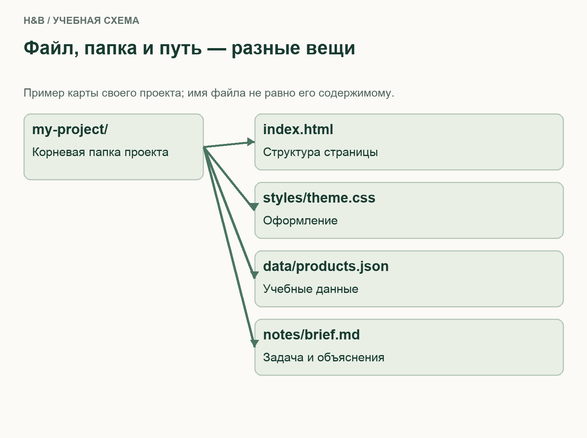

Корень проекта не равен корню всей файловой системы. На условном компьютере проект может находиться по адресу `/Users/student/forma/`. В этом адресе начальный `/` обозначает корень файловой системы, а `forma` — только одну из вложенных папок. Это вымышленный адрес для объяснения, не путь, который нужно открывать в приложении.

```text
корень файловой системы /
  → Users
    → student
      → forma              ← корень проекта
        → styles
          → main.css
```

Абсолютный файловый путь задаёт расположение от корня файловой системы: `/Users/student/forma/styles/main.css`. Относительный путь задаёт маршрут от выбранной исходной папки: например, `styles/main.css` от корня `forma`. Без исходной папки относительный путь неоднозначен. Слова «относительно чего?» — не придирка, а необходимая часть вычисления адреса.

Точка `.` означает текущую папку, две точки `..` — родительскую. Поэтому `./main.css` из папки `styles` ведёт к файлу внутри `styles`, а `../index.html` из неё сначала поднимается в `forma`, затем выбирает `index.html`. Косая черта разделяет шаги пути. Ссылки между файлами веб-проекта используют такие относительные маршруты.[1]

Есть ещё путь от корня **сайта**, например `/styles/main.css` в адресе страницы. В обычном браузере начальная черта здесь относится к корню адреса сайта, а не к папке `/` на вашем диске. Кроме того, сайт могут разместить в подпапке адреса. Нельзя механически считать эти три понятия одним: корень файловой системы, корень проекта и корень сайта отвечают на разные вопросы.

### Разобранный пример 1.1

Возьмём уже показанное дерево. Задача: из `pages/about.html` описать относительный путь к `styles/main.css` и путь к `index.html` в корне проекта. Никакого редактирования для этого не требуется.

Сначала определяем базовую папку. Исходный файл — `pages/about.html`, значит, начинаем внутри `pages`, а не внутри `forma` и не «внутри имени файла». Для стилей поднимаемся на один уровень: `..` приводит в `forma`. Далее спускаемся в `styles`, после чего выбираем `main.css`. Получаем `../styles/main.css`. Для главной страницы после подъёма сразу выбираем файл: `../index.html`.

```text
pages/about.html
      база: pages/
      ..             → forma/
      styles/        → forma/styles/
      main.css       → forma/styles/main.css

итог: ../styles/main.css
```

Проверим обратным проходом. Если вместо этого написать `styles/main.css`, поиск начнётся внутри `pages` и потребует папку `pages/styles`. В нашей схеме её нет. Ошибка возникла не потому, что стили плохие, а потому, что выбран другой адрес. Такой мысленный проход полезен до любого запуска: он отделяет ошибку пути от ошибки содержимого.

### Упражнение 1.1. Пройти по новому дереву

Это бумажная задача на адреса: создавать файлы и запускать переходы не нужно. Дано всё дерево:

```text
forma/
  index.html
  pages/
    catalog.html
    help/
      delivery.html
  styles/
    catalog.css
  data/
    products.json
```

1. База — папка файла `pages/help/delivery.html`. Запишите относительный путь к `styles/catalog.css`.
2. Из той же базы запишите путь к `pages/catalog.html`.
3. База теперь — папка `styles/catalog.css`. Запишите путь к `data/products.json`.
4. Запишите путь к `pages/help/delivery.html` относительно корня проекта, без начального `/`.
5. Объясните, почему строка `../data/products.json` не обозначает один и тот же файл при любой базе.

Запишите пять отдельных ответов и маршрут для каждого пути. Полное решение находится только в итоговом приложении ответов.

### Чтение и запись: разница в последствиях

Читать файл — получить его содержимое, не меняя сохранённую версию. Записывать — создать содержимое или заменить существующее. Просмотр `brief.md` помогает понять задачу; изменение `brief.md` уже меняет договорённость, даже если страница магазина выглядит прежней. Поэтому разрешение посмотреть материалы не означает разрешения переписывать их все.

Перед записью полезно сформулировать маленький договор: «Меняю только текст заголовка в `index.html`; стиль и остальные файлы сохраняю». Такой договор можно проверить. Фраза «приведи проект в порядок» границ не задаёт: под неё легко случайно подвести переименование папок, замену настроек и удаление старых материалов. Новичку особенно важно ограничивать действие одним понятным результатом.

Рабочий цикл выглядит так: прочитать нужный файл, назвать ожидаемую замену, сохранить небольшую правку, прочитать получившийся фрагмент и проверить отображение. Сравнение текста отвечает на вопрос «что записано?», предпросмотр — «как это показано выбранным документом?». Если они расходятся, сначала проверяют выбранный HTML и CSS, а не переписывают весь проект.

### Разобранный пример 1.2

Куратор разрешил изменить только заголовок в `demo-title.html`. Исходный файл целиком:

```html
<!doctype html>
<html lang="ru">
<head>
  <meta charset="utf-8">
  <title>FORMA — пример</title>
</head>
<body>
  <h1>Старый каталог</h1>
  <p>Демонстрационная витрина.</p>
</body>
</html>
```

Нужно показать «Каталог для рабочего места». Читаем файл и замечаем два похожих места: `title` и `h1`. Первое задаёт название документа, второе — видимый заголовок в содержимом страницы. Задание касается видимого заголовка, значит, меняем только текст внутри `h1`. Результат полностью:

```html
<!doctype html>
<html lang="ru">
<head>
  <meta charset="utf-8">
  <title>FORMA — пример</title>
</head>
<body>
  <h1>Каталог для рабочего места</h1>
  <p>Демонстрационная витрина.</p>
</body>
</html>
```

После сохранения выбираем `demo-title.html` для предпросмотра. Ожидаем увидеть новый заголовок и прежний абзац. CSS для этого примера не нужен. Успех подтверждают два наблюдения вместе: в исходнике изменена одна текстовая часть, на странице показана именно она. Скриншот нового заголовка сам по себе не доказывает, что случайно не изменён другой файл.

### Упражнение 1.2. Изменить только разрешённое

Используйте свой текущий учебный проект. Создайте два текстовых файла из блоков ниже. Если такие имена уже заняты вашей работой, сначала согласуйте с куратором свободные имена: не перезаписывайте старые материалы. Разрешённая правка после создания — только видимый заголовок в `practice-title.html`. Требуемый новый текст: «Предметы для спокойной работы». Запрещено менять название документа, абзац и содержимое заметки.

`practice-title.html`:

```html
<!doctype html>
<html lang="ru">
<head>
  <meta charset="utf-8">
  <title>FORMA — учебная витрина</title>
</head>
<body>
  <h1>Предметы для дома</h1>
  <p>Все товары в этом примере вымышлены.</p>
</body>
</html>
```

`practice-brief.md`:

```md
## Задание куратора
Меняем только видимый заголовок учебной витрины.
Название документа и поясняющий абзац сохраняем.
Эту заметку не редактируем.
```

Сначала запишите, какие операции здесь являются чтением, а какая — записью. Выполните разрешённую замену, выберите HTML-файл в предпросмотре и опишите ожидаемый экран. Приложите итоговый HTML и отдельно перечислите то, что должно остаться прежним. Не пытайтесь подключать заметку к странице: она предназначена для чтения человеком.

### Что взять с собой дальше

Правильный путь нужен не только для картинок: так связывают стили, данные, компоненты и документы. Безопасная запись нужна не только при работе с помощником: человек тоже способен исправить не тот файл. В нашей оболочке нет работающего ИИ, терминала, npm, Git или исполнения React. Эти возможности нельзя подразумевать по одному расширению файла. Пока достаточно уверенно отвечать: где находится материал, откуда считается адрес, что разрешено менять и какое наблюдение подтвердит результат.

Источники с сохранённой нумерацией общего учебника: [1] MDN, «Dealing with files». Примеры, задания и правила работы в учебном приложении — авторские учебные материалы; ограничения приложения заданы условиями курса.

## Глава 2. Проект, зависимости, сборка и выполнение

### Почему папки с HTML бывает недостаточно

В предыдущей главе мы связали файл с его расположением. Теперь добавим вопрос: **какие инструменты превращают сохранённые материалы в работающую страницу?** Простой HTML можно показать непосредственно. Но большой проект часто включает раздельные модули, специальные форматы исходников, библиотеки и проверки. Кто-то должен соединить части, преобразовать поддерживаемый инструментом синтаксис и подготовить результат для браузера. Эти действия не возникают из названия папки: их описывают правила проекта.

Проектом будем называть согласованный набор материалов для одной задачи. В него входят исходники, данные, настройки, документация и, если предусмотрены, тесты. Исходники — то, что человек редактирует. Настройки — указания инструментам, как обработать исходники. Результат обработки может лежать отдельно. Поэтому вопрос «в какой файл внести правку?» зависит не только от видимого текста, но и от того, является файл исходником или заново создаваемым результатом.

В текущем учебном приложении мы можем читать и записывать собственные текстовые файлы одного проекта. Оно не предоставляет терминал, npm, Git, запуск React или тестового процесса; ИИ отключён. Предпросмотр исполняет только HTML и CSS, а не JavaScript. В этой главе команды — **объекты чтения и объяснения**, а не просьба искать отсутствующую консоль. Все результаты команд ниже — явно заданные учебные условия, не сообщения о реальном запуске в приложении.

### Зависимость: чужая часть внутри нашей задачи

Представим, что для интерфейса нужна небольшая готовая функция объединения имён CSS-классов. Можно написать её самостоятельно, а можно использовать пакет, например `clsx`. Пакет — распространяемый набор кода и описания. Зависимость означает, что проект рассчитывает на наличие такого пакета. Это не ссылка, которую посетитель обязательно видит на экране, и не разрешение автоматически передавать пакету любые данные.

Другой пакет может быть нужен не самому интерфейсу, а разработчику: например, чтобы запустить сервер разработки или подготовить выпуск. Так появляются две разные причины подключения. В `dependencies` обычно записывают зависимости приложения, в `devDependencies` — инструменты разработки и проверки. Эти разделы описывает формат `package.json` в npm.[2] Это различие по назначению, а не простая формула «первое всегда загружается браузером, второе никогда не влияет на результат». Инструмент сборки может включить используемый код в итоговые файлы; посетитель не читает весь манифест как список сетевых загрузок.

`package.json` — текстовый файл в формате JSON с описанием пакета проекта. Назовём его манифестом: это описание, а не сама программа магазина. Если написать имя инструмента в манифесте, его код не возникнет в учебной оболочке. В обычной подготовленной среде установка зависимостей является отдельным действием. Здесь её не выполняем.

### Как читать JSON, не принимая его за заклинание

JSON организует данные через пары «ключ — значение». Ключ пишется в двойных кавычках; после него стоит двоеточие. Значение может быть строкой в кавычках, числом, логическим значением `true` или `false`, объектом в фигурных скобках, массивом в квадратных скобках либо `null`. Запятые разделяют соседние записи. После последней записи объекта лишнюю запятую не ставят. Комментарии внутрь обычного JSON не вставляют, поэтому объяснения ниже вынесены из кода.

Манифест примера приведён полностью. Версии в нём фиксированы для учебного чтения: это не рекомендация устанавливать именно эти выпуски и не обещание их актуальности. Полный манифест не равен полному запускаемому проекту: здесь нет исходников магазина и подготовленной среды.

```json
{
  "name": "forma-manifest-demo",
  "version": "1.0.0",
  "private": true,
  "type": "module",
  "scripts": {
    "dev": "vite",
    "build": "vite build",
    "test": "vitest run",
    "preview": "vite preview"
  },
  "dependencies": {
    "clsx": "2.1.1"
  },
  "devDependencies": {
    "vite": "5.4.0",
    "vitest": "2.0.5"
  }
}
```

Разберём **каждую строку**, включая знаки группировки. Считать начинаем с первой фигурной скобки, пустых строк внутри блока нет.

1. `{` открывает внешний объект. Всё дальнейшее описание принадлежит одному манифесту.
2. `"name": "forma-manifest-demo",` задаёт имя пакета; запятая сообщает, что дальше есть следующая запись.
3. `"version": "1.0.0",` задаёт версию самого проекта, а не установленного npm и не браузера.
4. `"private": true,` помечает пакет как приватный для npm: это защита от случайной публикации пакета в реестр. Она не создаёт пароль на сайт и не скрывает код от посетителя.[2]
5. `"type": "module",` указывает режим интерпретации `.js` в соответствующем контексте Node.js как ES-модулей. Здесь это настройка среды, а не команда запуска.[2]
6. `"scripts": {` открывает вложенный объект с именованными командами. Следующие записи относятся именно к нему.
7. `"dev": "vite",` связывает короткое имя `dev` со строкой команды `vite`.
8. `"build": "vite build",` связывает имя `build` с другой строкой — `vite build`. Дополнительное слово меняет действие инструмента.
9. `"test": "vitest run",` связывает имя `test` с однократным запуском тестового инструмента. Из этой строки нельзя узнать, какие проверки написаны.
10. `"preview": "vite preview"` задаёт команду просмотра собранного результата. Запятой нет: это последняя запись внутри `scripts`.
11. `},` закрывает только объект `scripts`. Запятая нужна, потому что во внешнем объекте далее есть другие поля.
12. `"dependencies": {` открывает объект зависимостей приложения.
13. `"clsx": "2.1.1"` задаёт имя пакета и точную версию в этом примере. Кавычки показывают, что версия записана строкой, не десятичным числом.
14. `},` закрывает `dependencies` и отделяет его от следующего поля внешнего объекта.
15. `"devDependencies": {` открывает объект инструментальных зависимостей.
16. `"vite": "5.4.0",` указывает пакет инструмента разработки и сборки; запятая отделяет следующую зависимость.
17. `"vitest": "2.0.5"` указывает пакет тестового инструмента. Это последняя запись данного объекта.
18. `}` закрывает `devDependencies`. Запятой нет, потому что это последнее поле внешнего объекта.
19. `}` закрывает весь манифест. Фигурные скобки не являются командами: они показывают вложенность данных.

### Имя сценария не равно названию инструмента

В обычной среде запись `npm run build` означает: попросить npm найти поле `scripts`, взять значение по ключу `build` и выполнить эту строку в контексте проекта. npm — посредник, `build` — выбранное имя сценария, `vite build` — фактическая команда из нашего примера.[2] Нельзя узнать действие только по левому слову: автор мог записать под именем `build` совсем другую команду. Поэтому сначала читаем значение справа.

```text
человек выбирает npm run build
       ↓
манифест: scripts → build
       ↓
строка команды: vite build
       ↓
инструмент Vite готовит выходные ресурсы
       ↓
ресурсы позже размещают и открывают в браузере
```

Слова `dev`, `build`, `test`, `preview` полезно различать по вопросу, на который каждое отвечает. Разработка (`dev`) даёт среду для работы с меняющимися исходниками. Сборка (`build`) готовит результат для распространения. Тест (`test`) проверяет запрограммированные ожидания. Просмотр сборки (`preview`) помогает локально посмотреть уже подготовленный результат. В типовом проекте Vite команда сборки создаёт выходные ресурсы; важны также настройки адресов их размещения.[24]

`preview` в манифесте и кнопка предпросмотра нашего учебного приложения — разные механизмы. Первая запись предполагает внешний инструмент и подготовленную среду. Кнопка приложения показывает разрешённые HTML/CSS и удаляет исполняемые скрипты. Совпадение слова не доказывает совпадения возможностей. JSON-файл можно сохранить и прочитать, но это не запустит ни одного сценария.

### Разобранный пример 2.1

Возьмём манифест выше. Нужно выписать соответствие четырёх имён фактическим действиям и разделить пакеты по назначению. Последовательно читаем `scripts`: `dev` означает `vite`, `build` — `vite build`, `test` — `vitest run`, `preview` — `vite preview`. Для каждого называем стадию: работа с исходниками, подготовка результата, проверка ожиданий, просмотр результата.

Затем читаем зависимости. `clsx` находится в `dependencies`; в данном сценарии это помощник для кода интерфейса. `vite` и `vitest` находятся в `devDependencies`; один обслуживает разработку и сборку, другой — тесты. Не пытаемся вывести эти роли только из звучания имён: назначение учебного примера мы объяснили, а принадлежность к разделу видна непосредственно в JSON.

Наконец формулируем границу знания. Манифест объявляет тестовый сценарий, но не показывает тестовые файлы и результаты. Правильный вывод: «способ вызова тестов описан». Неправильный: «магазин проверен». Между описанием действия и выполненным действием лежит реальная работа; между выполнением и приёмкой — проверка требований.

### Упражнение 2.1. Прочитать другой полный манифест

Это самостоятельный второй манифест, а не продолжение предыдущего объекта. Ничего устанавливать и запускать не нужно.

```json
{
  "name": "forma-delivery-demo",
  "version": "1.1.0",
  "private": true,
  "type": "module",
  "scripts": {
    "dev": "vite --host 127.0.0.1",
    "build": "vite build --outDir public-build",
    "preview": "vite preview --port 4175"
  },
  "dependencies": {
    "dayjs": "1.11.13"
  },
  "devDependencies": {
    "vite": "5.4.0"
  }
}
```

Для этого вымышленного проекта `dayjs` выбран как библиотека обработки дат в коде приложения. В учебном условии `--outDir` обозначает выбранную папку результата, `--port` — выбранный порт процесса просмотра, `--host` — адрес, на котором слушает сервер разработки.

1. Выпишите все объявленные имена сценариев и точные строки справа от них.
2. Какую строку выбрал бы `npm run build` в подготовленной среде? В какую папку направлен результат?
3. Есть ли здесь объявленный сценарий `test`? Что можно и чего нельзя заключить об имеющихся проверках?
4. Разделите пакеты по двум разделам и объясните роль каждого в этом условии.
5. Объясните, почему `private: true` не доказывает, что магазин требует пароль посетителя.

### Сборка и выполнение происходят в разное время

Представьте рецепт и готовое блюдо. Успешно прочитать рецепт — ещё не приготовить блюдо, а приготовить — ещё не убедиться, что оно подходит гостю. Аналогично сборка обрабатывает материалы, а выполнение программы происходит позже в определённой среде. Для кода интерфейса такой средой обычно служит браузер. Для серверного JavaScript ею может быть Node.js. Одинаковый язык не означает одинаковые возможности: браузер строит страницу, серверная среда решает другие задачи.

После сборки могут получиться HTML, CSS и JavaScript. Если посетитель открывает страницу, браузер получает эти ресурсы и выполняет разрешённый код. Ошибка загрузки данных может возникнуть уже после успешной подготовки файлов. Следовательно, «собралось» и «каталог работает» — разные утверждения с разными доказательствами. Не нужно обесценивать сборку: она полезна, просто её область проверки ограничена.

Тесты тоже имеют область действия. Проверка расчёта суммы не доказывает удобство мобильного экрана. Проверка наличия кнопки не доказывает успешность ответа сервера. Полезно переводить любой отчёт в точные слова: что запустили, на каких входных данных, что наблюдали, что осталось неизвестным. Уверенный тон сообщения не расширяет покрытие проверки.

### Разобранный пример 2.2

Учебное условие: другой разработчик в подготовленной внешней среде получил три наблюдения. Это не вывод нашего приложения.

```text
Сценарий: dev → vite
Наблюдение: сервер разработки сообщил, что готов.
Сценарий: build → vite build
Наблюдение: подготовка выходных ресурсов завершилась без ошибки.
Ручная проверка: открыли каталог в обычном браузере.
Наблюдение: заголовок появился, запрос товаров получил ответ 503.
Тесты: не запускались.
```

Разбираем последовательно. Сообщение первого процесса подтверждает готовность сервера разработки, но не посещение правильного адреса браузером. Вторая строка результата подтверждает завершение подготовки ресурсов, но не получение товаров. Ручное наблюдение подтверждает видимый заголовок и одновременно обнаруживает проблему загрузки. Для тестов подтверждений нет, потому что их не запускали.

Корректный отчёт: «Подготовка ресурсов прошла; заголовок виден; данные каталога не загрузились, получен 503; тесты не запускались». Нельзя написать «магазин работает полностью» и нельзя написать «всё сломано»: оба выражения теряют важные различия. Следующий шаг расследования выбирают по неудачной стадии, а не случайной заменой зависимостей.

### Упражнение 2.2. Отделить доказанное от обещанного

Ниже весь необходимый вход: небольшой манифест и вымышленный отчёт коллеги. Реального исполнения не требуется.

```json
{
  "name": "forma-status-demo",
  "version": "1.0.0",
  "private": true,
  "scripts": {
    "dev": "vite",
    "build": "vite build",
    "test": "vitest run",
    "preview": "vite preview"
  },
  "devDependencies": {
    "vite": "5.4.0",
    "vitest": "2.0.5"
  }
}
```

```text
Условие: коллега работал во внешней подготовленной среде.
1. npm run build завершился без ошибки и создал папку dist.
2. npm run test завершился: 2 теста суммы корзины прошли.
3. npm run preview не запускали.
4. В обычном браузере открыли адрес сервера разработки.
5. На странице виден заголовок, кнопка добавления не проверялась.
6. Коллега написал: «Сборка, preview и весь магазин проверены».
```

Назовите фактические команды для `build`, `test`, `preview`. Перепишите итоговое сообщение так, чтобы оно не обещало лишнего. Отдельно перечислите подтверждённые факты и минимум три оставшиеся проверки. Объясните, почему открытие адреса сервера разработки не подтверждает просмотр собранного результата.

Источники с сохранённой нумерацией общего учебника: [2] npm, «package.json»; [24] Vite, «Building for Production». Манифесты и отчёты выше созданы для обучения, а не скопированы из рабочего магазина.

## Глава 3. Git и diff: как видеть последствия работы ИИ

### История, а не запасные папки

Git хранит историю состояний проекта и помогает сравнивать изменения. Коммит — зафиксированный снимок с сообщением о смысле работы. Ветка обозначает линию разработки. Для новичка важнее не сложная стратегия веток, а возможность точно ответить: от какой рабочей версии началось изменение, какие файлы затронуты и как вернуться к известному состоянию без потери чужой работы.

Diff показывает различия между выбранными состояниями. Обычный `git diff` сравнивает рабочие правки с индексом; подготовленные к коммиту изменения смотрят через `git diff --cached`. Поэтому пустой вывод одной команды не всегда означает отсутствие работы: изменения могли быть подготовлены отдельно. Сначала смотрят статус, затем выбирают правильное сравнение.[25]

```text
git status --short
git diff --stat
git diff -- src/cart.js
git diff --cached
```

Эти команды предназначены для чтения. Они не дают разрешения делать коммит или отправлять изменения. Выполняйте их через доступный инструмент оболочки в разрешённом проекте. Если история уже содержит чужие незавершённые правки, помощник должен их отделить от своих и не «приводить всё к порядку» без согласования.

### Читайте смысл, а не только цвет

В стандартном текстовом diff строка с минусом удалена, с плюсом добавлена; строки рядом дают контекст. Изменение условия с `quantity > 0` на `quantity >= 0` выглядит маленьким, но меняет допустимое поведение. Большой новый компонент может быть безобидным отображением, а одна строка отключения проверки — серьёзным риском. Оценивать работу по числу строк нельзя.

Чтение удобно вести в три прохода. Сначала перечень файлов: ожидаемы ли они для задачи? Затем ответственность: не переехали ли расчёты или секреты в браузер? Наконец детали: как изменились условия, сообщения, типы и тесты? Если помощник поменял настройки сборки при исправлении текста, попросите объяснить причинную необходимость. Необоснованную часть лучше отделить до продолжения.

Особое внимание удалённым тестам, пропущенным проверкам и слишком широким исключениям ошибок. Код `catch { return []; }` может превратить отказ сервера в ложное сообщение «товаров нет». Пользователь увидит аккуратную страницу, но диагностика исчезнет. Хорошее исправление сохраняет различие между пустым результатом и невозможностью получить данные.

### Точка восстановления

Не используйте разрушительный откат как универсальное лекарство. Команда, которая сбрасывает всё рабочее дерево, может уничтожить несохранённую работу. Сначала выясняют, какие изменения принадлежат текущей задаче, сохраняют нужное и выбирают согласованный способ восстановления. Ученик не должен выполнять предложенную моделью опасную команду только потому, что рядом написано «безопасно».

После любой правки снова проверяйте именно новую версию. Вывод тестов до изменения не подтверждает состояние после него. В отчёте связывайте результат с версией или конкретным набором файлов. Такая дисциплина позволяет куратору принимать работу по свидетельствам, а не по тону уверенного рассказа.

### Разобранный пример 3.1. Что именно изменил ИИ

Клиент попросил сделать главное действие заметнее и назвать его точнее. В исходном фрагменте были такие строки:

```html
<button class="primary" type="button">Подробнее</button>
<p class="note">Отвечаем в рабочие дни.</p>
```

ИИ предлагает следующую разницу. Строка с минусом убрана, с плюсом добавлена; это не команды, которые надо выполнять:

```diff
-<button class="primary" type="button">Подробнее</button>
+<button class="primary" type="button">Обсудить проект</button>
 <p class="note">Отвечаем в рабочие дни.</p>
```

Мы читаем diff по смыслу. HTML-элемент остаётся кнопкой. Класс `primary` остаётся прежним: сам этот diff не меняет её размер или цвет. Изменяется только видимая подпись. Новая подпись лучше сообщает о предполагаемом действии, но ещё не доказывает, что открывается форма или отправляется сообщение. Это отдельная проверка. Строка о времени ответа не меняется; в таком выводе она служит контекстом — ориентиром, где находится правка.

Разобранный вывод: правка подписи соответствует части запроса, а требование «заметнее» ещё не подтверждено. Следующий шаг — открыть экран, оценить визуальный приоритет и проверить фактическое действие, если оно реализовано. Если мы пока делаем статический макет, честно записываем, что переход не подключён. Мы не запускаем Git в учебном приложении: здесь учимся читать предоставленный diff и сравнивать версии глазами.[25]

### Упражнение 3.1. Проверь границы правки

Другой клиент попросил заменить подпись кнопки на «Получить подборку». Все исходные данные ниже:

```diff
-<button type="button">Отправить</button>
+<button type="button">Получить подборку</button>
-<p class="note">Без передачи контактов третьим лицам.</p>
+<p class="note">Подписываем вас на рекламные рассылки.</p>
```

Напиши в отчёте: какое изменение соответствует запросу, какое меняет смысл услуги, чего этот diff не доказывает о работе кнопки. Не придумывай причину изменения второй строки за ИИ. Сдача — три объяснения своими словами; править систему или выполнять команды не требуется.

## Глава 4. Браузер, сервер, HTTP, DNS и HTTPS

### Что происходит после нажатия

Нажать «Показать лампы» кажется одним действием. Для работающего магазина это цепочка: обработать нажатие, составить запрос, передать его по сети, дождаться ответа, прочитать данные и изменить экран. Ошибка на любом шаге может выглядеть одинаково — пустым местом под заголовком. Чтобы не чинить страницу наугад, научимся различать шаги и подтверждать каждый конкретным наблюдением.

В этой главе FORMA — вымышленный магазин, а `forma.example` — демонстрационное имя, не сервис для настоящих заказов. Все запросы и ответы напечатаны целиком как учебные сообщения. Их не нужно отправлять. Текущий предпросмотр нашего приложения показывает HTML/CSS, но не выполняет скрипты и сетевые запросы, не загружает изображения, не отправляет формы и не переходит по ссылкам. Объяснение настоящей сети относится к обычному браузеру и подготовленному сайту, а упражнения здесь выполняются чтением готовых данных.

### Браузер и сервер — роли программ

Браузер — клиентская программа: она запрашивает ресурсы, читает ответы и строит интерфейс. Серверная программа принимает запросы и формирует ответы. Разделение описывает роли, а не обязательное количество компьютеров. На учебной машине браузер и сервер разработки могут работать рядом. У опубликованного магазина между ними могут находиться другие программы, например промежуточный сервер или кэш.[3]

API — согласованный способ обращения к возможностям программы. В веб-примере это правила: по какому адресу обращаться, какой метод использовать, какие данные передавать и какой ответ ожидать. Путь `/api/products` может обслуживаться той же серверной программой, которая отдаёт страницу. Слово API не означает отдельный физический сервер. Иногда роли разделены между службами и машинами, иногда нет: это решение устройства конкретной системы, а не свойство трёх букв.

Интернет обеспечивает связь сетей. Веб — один из способов использования этой связи через страницы, ресурсы и запросы. Поэтому работающий мессенджер не доказывает доступность домена магазина, а доступный магазин не доказывает исправность его каталога. Проверять нужно нужный путь взаимодействия, а не наличие связи вообще.[4]

### Имя, IP и порт отвечают на разные вопросы

Возьмём условный адрес:

```text
https://forma.example:8443/api/products?category=light
│       │             │    │             │
схема   имя            порт путь          параметры
```

Доменное имя `forma.example` удобно человеку. DNS — система, которая помогает получить записи, связанные с именем, в том числе подходящие IP-адреса. IP-адрес используется для сетевой адресации. Порт помогает направить соединение к нужной службе на адресованной стороне. Это не номер комнаты с товаром и не часть названия файла. У одного IP могут работать несколько служб на разных портах, а у одного имени могут быть разные адреса.

Поэтому DNS нельзя описывать как загрузку страницы: он решает другую задачу. Представим адресную книгу и телефонный разговор. Найти номер — не то же самое, что дозвониться, а дозвониться — не то же самое, что получить нужный ответ. Аналогия ограничена, но полезна для причинной связи: успешный предыдущий шаг только позволяет попробовать следующий.

Если порт явно не указан, браузер использует стандартный для схемы: для обычного HTTP это 80, для HTTPS — 443. Порт 8443 в нашем адресе выбран явно, поэтому его нельзя отбросить как несущественный текст. В локальной разработке часто встречается другой явно указанный порт. Если открыть не тот адрес, можно попасть к другой программе или получить отказ соединения, даже когда нужный процесс работает.

Слово «адрес» полезно уточнять. Полный URL включает схему, имя, возможный порт, путь и параметры. IP — только часть сетевой адресации, а `/api/products` — путь внутри обращения к службе. Путь не обязан совпадать с папкой на диске сервера: программа может разобрать его и вычислить ответ без отдельного файла с таким именем.

### Где заканчивается TCP и начинается HTTPS

Для начальной модели рассмотрим HTTP/1.1 или HTTP/2 поверх TCP. TCP помогает установить транспортное соединение и передавать упорядоченный поток байтов с механизмами надёжной доставки. Он сам не знает, что такое карточка товара, не выбирает цену и не задаёт HTTP-статус. Если соединение невозможно установить, ответа приложения может вообще не быть.

Для HTTPS поверх такого соединения используется TLS: стороны согласуют защиту обмена, а браузер проверяет сертификат сервера, в том числе соответствие имени и цепочку доверия. Только после успешного установления защищённого обмена передают HTTP-сообщения. HTTPS — не отдельный каталог товаров и не просто «HTTP с другим портом». Это защищённый способ передачи HTTP. В современном вебе есть также HTTP/3 поверх QUIC; наша схема с TCP не утверждает, что абсолютно любой веб-запрос использует именно TCP.[3]

```text
имя из URL
  ↓ DNS: получить подходящий сетевой адрес
IP и порт
  ↓ транспорт: установить соединение
TLS для HTTPS
  ↓ согласовать защиту и проверить сертификат
HTTP-запрос
  ↓ сервер обрабатывает метод, путь и данные
HTTP-ответ
  ↓ браузер читает статус, заголовки и тело
решение интерфейса: данные / пусто / ошибка
```

Кэш DNS, повторное использование соединений и сохранённые ресурсы могут сократить путь. Схема объясняет зависимости шагов, а не обещает новый поиск и новое соединение при каждом нажатии. HTTPS защищает данные в пути, но не доказывает честность магазина, правильность суммы или наличие у пользователя нужных прав. Сервер может безопасно передать ошибочный расчёт — шифрование расчёт не исправляет.

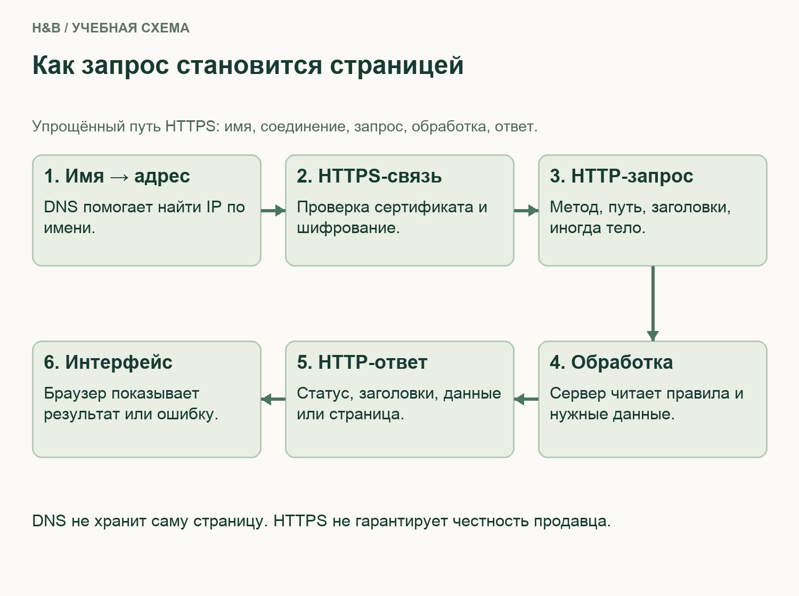

### Из чего состоит сообщение HTTP

В учебном представлении запроса есть метод, цель запроса, заголовки и возможное тело. Метод сообщает смысл действия. `GET` обычно запрашивает представление ресурса; `POST` передаёт данные для обработки, часто создаёт запись; `PUT` обычно заменяет представление ресурса; `PATCH` передаёт частичное изменение; `DELETE` запрашивает удаление. Реальное поведение определяет контракт сервера. Имя метода само не проверяет права и не гарантирует изменение данных.

Заголовки — дополнительные сведения о сообщении. `Accept: application/json` говорит, какой формат ответа клиент хочет получить. `Content-Type: application/json` говорит, какой формат тела отправитель передаёт в данном сообщении. Это разные направления смысла. Тело содержит данные: JSON, HTML, текст или другое представление. Не каждый запрос и не каждый ответ имеет тело.[3]

JSON — текстовый формат данных, а не команда выполнить программу. В объекте `{"items": []}` ключ `items` назван автором контракта, а `[]` обозначает пустой массив. HTTP не обязывает все магазины использовать именно это имя. Чтобы понять ответ, нужны сразу два уровня: общие правила сообщения и договорённость конкретного API.

### Разобранный пример 4.1

Договорённость учебного API: запрос списка товаров использует `GET /api/products`; параметр `category` ограничивает категорию; успешный ответ содержит массив `items`. Ниже показано читаемое представление, а не полный захват всех сетевых байтов.

```http
GET /api/products?category=light HTTP/1.1
Host: forma.example
Accept: application/json
```

```http
HTTP/1.1 200 OK
Content-Type: application/json

{"items":[{"id":"lamp-demo","title":"Лампа «Точка»"}],"demo":true}
```

Разбираем запрос. Метод — `GET`, путь — `/api/products`, параметр категории — `light`, принимаемый формат — JSON. Тела в этом показанном запросе нет. `Host` сообщает имя адресуемого узла в таком представлении HTTP/1.1. Эти строки не создают отдельный сервер и не означают чтение папки `/api` с нашего компьютера.

Разбираем ответ. `200` сообщает успешную обработку запроса. Заголовок описывает JSON-тело. В `items` находится один объект с идентификатором и названием; `demo` отмечает демонстрационные данные. При принятом контракте интерфейс может показать одну карточку «Лампа «Точка»». Он не должен сообщать об успешном заказе: никакого заказа этот запрос не создавал.

### Упражнение 4.1. Прочитать создание записи

Договорённость другого учебного API: `POST /api/demo-carts` создаёт демонстрационную корзину. Клиент передаёт массив `items`, где `productId` — идентификатор товара, `quantity` — количество. При успехе сервер отвечает JSON с `id` новой корзины и заголовком `Location`, указывающим её путь. Никаких платежей и реальных данных нет.

```http
POST /api/demo-carts HTTP/1.1
Host: forma.example
Accept: application/json
Content-Type: application/json

{"items":[{"productId":"stand-demo","quantity":2}],"demo":true}
```

```http
HTTP/1.1 201 Created
Content-Type: application/json
Location: /api/demo-carts/cart-demo-17

{"id":"cart-demo-17","items":[{"productId":"stand-demo","quantity":2}],"demo":true}
```

1. Отдельно выпишите метод, путь и назначение действия.
2. Различите два заголовка формата в запросе: какой относится к отправляемым данным, какой — к желаемому ответу?
3. Назовите переданный товар и количество, затем найденный в ответе идентификатор корзины.
4. Объясните роль статуса и `Location`. Предложите одно честное сообщение пользователю, не обещающее оплату.
5. Можно ли по слову `/api` заключить, что запрос ушёл на отдельный физический компьютер? Обоснуйте.

### Статус — часть смысла, а не оценка красоты экрана

Статус ответа помогает выбрать дальнейшее действие. Его читают вместе с контрактом, заголовками и допустимым телом. В частности, `200` не гарантирует, что тело является нужным JSON: сервер мог вернуть HTML. После транспортного успеха приложению всё ещё нужно проверить формат и ожидаемую структуру данных.

`200 OK` означает успешную обработку; массив `items: []` при договорённом формате может означать отсутствие подходящих товаров. `201 Created` означает, что запрос привёл к созданию ресурса; ответ может сообщать, где он доступен. `204 No Content` сообщает успех без тела ответа: пытаться обязательно разобрать JSON из пустоты — ошибка клиента. Успех не всегда означает наличие карточек и даже не всегда означает наличие тела.

`301 Moved Permanently` сообщает постоянное перенаправление; дальнейший адрес обычно указан в `Location`. Это не самостоятельное доказательство, что товар удалён. `304 Not Modified` связан с условным запросом и кэшем: при подходящих условиях клиент использует сохранённое представление. Это не ответ «пустой каталог», и у такого ответа нет нового тела страницы для обычного разбора.

`400 Bad Request` означает, что сервер не может или не хочет обработать запрос из-за воспринимаемой ошибки клиента, например неверного формата данных. `401 Unauthorized` обычно требует аутентификации — подтверждения, кто обращается. `403 Forbidden` означает отказ в доступе: одного повторного входа может быть недостаточно. `404 Not Found` означает, что запрошенное представление не найдено либо сервер не раскрывает его наличие. Он отличается от успешного списка без совпадений.

`409 Conflict` сообщает конфликт с текущим состоянием ресурса, например невозможность применить устаревшую версию данных. `429 Too Many Requests` означает ограничение частоты обращений; автоматическое частое повторение способно ухудшить ситуацию. Сервер может сообщить срок ожидания через `Retry-After`. Конфликт и ограничение частоты требуют иных действий, чем исправление опечатки в адресе.

`500 Internal Server Error` — непредвиденная серверная ошибка. `502 Bad Gateway` обычно означает, что посредник получил некорректный ответ от вышестоящей стороны. `503 Service Unavailable` сообщает временную недоступность обслуживания, например при перегрузке или обслуживании. Клиент не должен переводить все три в «товаров нет»: данные не были успешно получены.

Если DNS не дал подходящего адреса или проверка TLS завершилась ошибкой, HTTP-ответ от нужного сервера может не появиться вовсе. Нельзя называть такую ситуацию «сервер вернул 500» без фактически полученного статуса. Сообщение браузера об ошибке сертификата — не тело API. Не отключайте защиту ради исчезновения сообщения: сначала нужно выяснить причину и проверить адрес.

### От ответа к состоянию интерфейса

После нажатия обычный работающий интерфейс переходит в состояние загрузки: сообщает «Загружаем товары…», чтобы ожидание не выглядело бездействием. Далее нужно завершить ожидание одним из определённых результатов. Если данные корректны и массив непустой, показывают карточки. Если корректен пустой массив, объясняют отсутствие совпадений и предлагают изменить фильтр. Если ответ неуспешен, формат нарушен или обмен не состоялся, показывают ошибку с уместным дальнейшим действием.

```text
нажатие
  → loading: ожидаем результат
    → успешный ответ + корректные items + есть элементы → ready
    → успешный ответ + корректные items + нет элементов → empty
    → неуспешный статус / плохой формат / нет ответа    → error
```

Это учебная модель для списка товаров, а не универсальный разбор абсолютно всех HTTP-ответов. Для условного `304` сначала нужен механизм кэша; для `204` — контракт операции без тела. Нельзя бездумно отправлять каждый статус на один и тот же JSON-разбор. Также важно не оставить индикатор навсегда: загрузка — промежуточное состояние, а не замена обработке ошибки.

### Разобранный пример 4.2

Договоримся: список ламп принимает только `200` с JSON-объектом, в котором `items` — массив. Три независимых запуска дают такие готовые данные:

```json
{
  "caseA": {
    "status": 200,
    "contentType": "application/json",
    "body": {"items": [{"id": "lamp-demo", "title": "Лампа"}]}
  },
  "caseB": {
    "status": 200,
    "contentType": "application/json",
    "body": {"items": []}
  },
  "caseC": {
    "status": 500,
    "contentType": "application/json",
    "body": {"error": "DEMO_INTERNAL_ERROR"}
  }
}
```

Перед результатом во всех трёх запусках показываем загрузку. В A статус успешен, формат подходит, список содержит один элемент: после ожидания показываем карточку «Лампа». В B запрос тоже успешен, но список пуст: сообщаем «По этому фильтру ничего не найдено» и предлагаем сбросить фильтр. В C успешного списка нет: показываем «Не удалось загрузить товары» и возможность повторить обращение, если это уместно.

Почему не заменить C на пустой массив? Такая замена стирает различие между полученным знанием «подходящих товаров нет» и отсутствием знания «мы не смогли получить список». Для покупателя это разные причины и разные действия. Красивый пустой экран может скрывать ошибку, а не исправлять её.

### Упражнение 4.2. Четыре независимых исхода

Весь вход дан ниже. Это не настоящая запись браузера, а специально подготовленный JSON для чтения. `receivedHttpResponse` означает, был ли получен HTTP-ответ. `status: null` означает отсутствие HTTP-статуса, а не особый статус с именем `null`. Контракт списка: только `200` с JSON-объектом и массивом `items` считается полученным списком.

```json
{
  "A": {
    "receivedHttpResponse": true,
    "status": 200,
    "contentType": "application/json",
    "body": {"items": []}
  },
  "B": {
    "receivedHttpResponse": true,
    "status": 503,
    "contentType": "application/json",
    "body": {"error": "DEMO_SERVICE_UNAVAILABLE"}
  },
  "C": {
    "receivedHttpResponse": false,
    "status": null,
    "networkFailure": "DNS_NAME_NOT_RESOLVED",
    "body": null
  },
  "D": {
    "receivedHttpResponse": true,
    "status": 200,
    "contentType": "text/html",
    "body": "<h1>Демонстрационная страница входа</h1>"
  }
}
```

Для каждого случая запишите цепочку от нажатия до конечного состояния: начальное сообщение ожидания, результат проверки ответа, конечный экран и разумное действие пользователя. Отдельно объясните, где имеется HTTP-статус, а где его нет, и можно ли доказать отсутствие товаров по каждому исходу. Затем составьте короткий отчёт куратору без паролей и других секретов: какие данные нужны для различения сетевой проблемы, серверного отказа и неожиданного формата.

Источники с сохранённой нумерацией общего учебника: [3] MDN, «Overview of HTTP»; [4] MDN, «How does the Internet work?». Все имена, контракты, сообщения и наборы данных в упражнениях — авторские демонстрационные примеры, не работающие внешние API.

## Глава 5. HTML и DOM: смысл раньше украшения

### Разметка как структура

HTML описывает структуру и смысл содержимого: заголовки, абзацы, списки, ссылки, формы. Элемент обычно имеет открывающий и закрывающий тег, атрибуты уточняют его свойства. Некоторые элементы, например изображение, записываются без отдельного закрывающего тега. Вложенность важна: она выражает, какая часть относится к другой, а не просто создаёт отступы.[5]

Ниже полноценный маленький учебный документ. Его можно сохранить как HTML внутри разрешённого проекта. Кнопка пока ничего не добавляет — отсутствие поведения обозначено явно, а не спрятано за видом готового магазина. Изображение не используется, поэтому пример не зависит от чужого ассета.

```html
<!doctype html>
<html lang="ru">
<head>
  <meta charset="utf-8">
  <meta name="viewport"
        content="width=device-width, initial-scale=1">
  <title>FORMA — учебная карточка</title>
</head>
<body>
  <main>
    <h1>Учебный каталог FORMA</h1>
    <article aria-labelledby="lamp-title">
      <h2 id="lamp-title">Лампа «Точка»</h2>
      <p>Вымышленный товар для упражнений.</p>
      <p>Демонстрационная цена: 1 290 руб.</p>
      <button type="button">Добавить в корзину</button>
    </article>
  </main>
</body>
</html>
```

Ссылка нужна для перехода, кнопка — для действия. Если весь интерфейс построен из безымянных блоков с обработчиками клика, разработчику придётся вручную восстанавливать множество полезных свойств управления. Семантические области и логичные заголовки помогают ориентироваться не только визуально, но и при использовании вспомогательных технологий.[20]

### Исходный HTML и живое дерево

DOM — представление документа в памяти как дерева узлов, доступного программам. JavaScript может найти элемент, изменить текст, добавить узел или подписаться на событие. Поэтому исходный файл и текущая структура страницы не обязаны совпадать: после нажатий и запросов дерево меняется. Инструмент Elements показывает живую структуру, а не только первоначальную строку HTML.[8]

Для первого поведения выберите кнопку и подключите обработчик. Не вставляйте произвольную строку внешнего происхождения как HTML, когда нужен обычный текст. В учебном примере достаточно безопасного изменения текстового содержимого. Это показывает путь «событие — функция — изменение интерфейса», который позднее сохранится и в компонентном подходе.

```js
const button = document.querySelector('button');
button.addEventListener('click', () => {
  button.textContent = 'Учебное добавление выполнено';
});
```

Фрагмент предполагает, что кнопка уже существует к моменту исполнения. Если скрипт запустить раньше построения нужной части документа, поиск может не найти элемент. Не прячьте такую проблему случайной задержкой. Выясните порядок подключения и предусмотрите подходящий момент запуска. Наличие ошибки обращения к отсутствующему элементу — наблюдение о жизненном цикле, а не доказательство неисправности браузера.

### Формы и имена

Полю ввода нужна связанная подпись; placeholder не заменяет её, потому что исчезает при вводе. Связь `label` и `id` помогает понять назначение поля. Ошибка должна объяснять, что исправить, а не только окрашивать рамку. Для учебного заказа используйте вымышленные значения, не просите ученика вводить реальный телефон ради демонстрации.[21]

### Разобранный пример 5.1. Из предложения в структуру страницы

Содержание клиента: «Студия делает мебель на заказ. Главное — показать проекты, потом получить запрос на консультацию». Сначала выделяем смысловые части: название предложения, короткое объяснение, действие. Заголовок — не просто крупный шрифт: он обозначает основную тему. Абзац раскрывает предложение. Кнопка выражает действие на текущей странице; ссылка обычно ведёт к другому адресу.[5][20]

Полный маленький фрагмент разметки:

```html
<section aria-labelledby="offer-title">
  <h1 id="offer-title">Мебель для вашего пространства</h1>
  <p>Проектируем и изготавливаем по вашим размерам.</p>
  <button type="button">Обсудить проект</button>
</section>
```

Читаем его сверху вниз. `section` группирует одно предложение. `aria-labelledby` ссылается на ID заголовка: группе дано понятное имя. Между открывающим и закрывающим тегами находится содержимое. `type="button"` обозначает обычную кнопку; само наличие тега не создаёт форму и не отправляет данные. Здесь ещё нет ни обработчика, ни настроенного обращения к серверу. Мы подготовили правильную основу для будущего поведения, а не готовую заявку.

Если меняем тему на студию света, сохраняем отношения между элементами, но меняем текст и ID согласованно. Не нужно превращать каждый абзац в заголовок ради размера — внешний вид позже задаётся CSS. Так дизайнер и разработчик работают с одной понятной смысловой структурой.

### Упражнение 5.1. Собери аналогичное предложение

Бриф: мастерская реставрирует деревянную мебель. Заголовок «Вернём любимой мебели характер», пояснение «Обсудим состояние и предложим варианты восстановления», действие «Показать предмет мастеру». Используй структуру примера и ID `restore-title`. Приведи целиком свой HTML-фрагмент. Затем объясни, почему кнопка ещё не означает работающую отправку фотографии. Сдача — фрагмент и объяснение, без поиска внешних картинок.

## Глава 6. CSS, адаптивность и композиция

### Коробка каждого элемента

CSS задаёт отображение элементов через правила: селектор выбирает цель, свойства описывают её вид. Вокруг содержимого есть внутренний отступ, граница и внешнее пространство. При обычной модели ширина содержимого и итоговый занимаемый размер могут отличаться; `box-sizing: border-box` включает внутренние отступы и границу в заданный размер. Понимание этой модели полезнее десятков случайных исправлений ширины.[6]

```css
* { box-sizing: border-box; }
body {
  margin: 0;
  color: #152b34;
  background: #f5f3ee;
  font-family: system-ui, sans-serif;
  line-height: 1.55;
}
.catalog {
  display: grid;
  grid-template-columns: 1fr;
  gap: 1.25rem;
  max-width: 72rem;
  margin-inline: auto;
  padding: 1rem;
}
.card { padding: 1.25rem; background: white; }
@media (min-width: 48rem) {
  .catalog { grid-template-columns: repeat(3, 1fr); }
}
```

Здесь одна колонка является исходным вариантом, а более широкое пространство позволяет показать три. Это не универсальная сетка для любого каталога, а понятный учебный выбор. Адаптивный интерфейс перестраивает представление под доступное место; гибкая сетка, изображения и медиазапросы помогают избежать отдельной неподвижной картинки для каждого устройства.[7]

### Почему правило не сработало

На один элемент могут влиять разные правила. Смотрите в браузере вычисленное значение и источник победившего свойства. Возможно, селектор не совпал, другое правило оказалось приоритетнее, файл не загрузился или свойство применено не к тому элементу. Просьба «добавь везде important» обычно заменяет расследование и увеличивает будущие конфликты. Сначала найдите конкретное противоречие.

Flexbox удобно рассматривать для расположения элементов вдоль направления, Grid — для сеток строк и колонок. Но выбирать инструмент нужно по связи элементов, а не по моде. Кнопка с ценой внутри карточки и каталог из карточек решают разные задачи. Не создавайте сложную вложенную сетку там, где достаточно обычного потока и пары отступов.

### Композиция как управление вниманием

В H&B визуальное решение начинается с вопроса покупателя. Он хочет понять предмет, его стоимость, доступность и следующее действие. Главный акцент не должен одновременно принадлежать логотипу, декоративной анимации, скидке и кнопке. Сгруппируйте связанное: название рядом с характеристикой, цена рядом с выбранным вариантом, ошибка рядом с проблемным полем. Это авторский рабочий принцип, проверяемый на сценарии.

Типографическая шкала задаёт отношения между заголовком, обычным текстом и пояснением. Сначала добейтесь читабельности и разумной длины строки, затем подбирайте выразительный характер. Русское название часто длиннее короткой английской подписи; проверяйте настоящие длинные строки, а не только удобные заглушки. Не обрезайте важные характеристики ради одинаковой высоты без понятного способа прочитать их полностью.

Проверка адаптива — не три красивых скриншота. Меняйте ширину постепенно, увеличивайте текст, открывайте длинное название и пустое состояние. Убедитесь, что нет горизонтальной прокрутки всей страницы и что основное действие не ушло за недоступную область. Значения ширин из упражнения — контрольные примеры, а не доказательство работы на любом экране.

### Разобранный пример 6.1. Отступ внутри и расстояние между элементами

Представь карточку как коробку с надписью и кнопкой. `padding` оставляет воздух между границей коробки и содержимым. `gap` разводит дочерние элементы внутри сетки или flex-контейнера. Эти свойства не заменяют друг друга: большой внешний прямоугольник может иметь тесно прижатые друг к другу строки, если внутренние расстояния не настроены.[6]

Полные исходные данные примера:

```html
<article class="card">
  <h2>Свет для вечернего чтения</h2>
  <p>Мягкое направленное освещение рядом с креслом.</p>
  <button type="button">Посмотреть светильник</button>
</article>
```

```css
.card {
  display: grid;
  gap: 16px;
  padding: 24px;
  max-width: 420px;
  background: #f3f0e8;
  color: #18352b;
}
.card h2, .card p { margin: 0; }
.card button { padding: 12px 18px; }
```

Внутри карточки три элемента. `display: grid` делает их элементами сетки, а `gap` задаёт интервалы между ними. `padding` отодвигает всё содержимое от краёв. У заголовка и абзаца убраны стандартные браузерные отступы, чтобы расстояния не складывались неожиданно. У кнопки свой внутренний воздух: надпись не касается её края. Числа здесь — не магические эталоны красоты, а выбранные параметры конкретного решения. Их оценивают по читаемости, содержанию и месту на экране.

### Упражнение 6.1. Перенеси принцип на другую карточку

Используй тот же HTML, заменив заголовок на «Тихое рабочее место», описание на «Подберём предметы, которые не отвлекают от главного», кнопку на «Собрать комплект». Требования: внутри карточки от края до текста 32px, между элементами 20px, внутри кнопки сверху/снизу 14px, слева/справа 22px. Приведи полный CSS и объясни, какое требование меняет `padding`, а какое `gap`. Сдача — код и наблюдение, не стали ли строки неудобно узкими.

## Глава 7. JavaScript: значения, условия и функции

### От текста к данным

JavaScript описывает поведение программы. Строка хранит текст, число участвует в расчёте, логическое значение представляет да или нет. Объект объединяет свойства, массив — упорядоченные элементы. `null` удобно использовать как намеренное отсутствие значения, а `undefined` часто указывает, что значение не задано. Эти различия важны при чтении ответа API и обработке пустых состояний.[9]

Переменная — имя, через которое программа обращается к значению. `const` запрещает повторное присваивание этому имени, но не превращает содержимое объекта в неизменяемое. `let` допускает новое присваивание. Хорошее имя говорит о смысле: `quantity`, а не `x`; `priceMinor`, а не неоднозначное `priceText`. Помощник должен объяснять единицы измерения так же ясно, как тип.[9]

### Правило выражается функцией

Функция получает аргументы, выполняет действия и может вернуть результат. Параметры описаны при объявлении, аргументы передаются при вызове. Чистую вычислительную функцию удобно проверять отдельно от интерфейса: одинаковый вход должен давать одинаковый результат без запроса к сети и изменения страницы. Это упрощает поиск причины неверной суммы.[10]

```js
function lineTotal(priceMinor, quantity) {
  if (!Number.isSafeInteger(priceMinor) || priceMinor < 0) {
    throw new Error('Некорректная учебная цена');
  }
  if (!Number.isSafeInteger(quantity) || quantity < 1) {
    throw new Error('Количество должно быть целым и положительным');
  }
  const total = priceMinor * quantity;
  if (!Number.isSafeInteger(total)) {
    throw new Error('Сумма вне учебного диапазона');
  }
  return total;
}
```

Для учебного магазина деньги хранятся в целых минимальных единицах, а подпись с валютой формируется отдельно. Функция не разбирает декоративную строку `1 290 руб.`. Такое разделение делает расчёт независимым от пробелов и оформления. Здесь ограничение безопасного целого явно включено в учебный контракт, а реальные денежные правила проекта согласуются отдельно.

Условие `if` выбирает ветку. Выражение после `return` становится результатом вызова, а дальнейшие строки этой функции уже не исполняются. `throw` передаёт управление механизму обработки ошибки. Не используйте ошибку как молчаливое значение ноль: неверный ввод и настоящая нулевая сумма имеют разный смысл. Интерфейс должен показать понятную причину отказа.

### Проверяйте границы и преобразования

Значение из текстового поля часто приходит строкой. Строка `'2'` и число `2` — не одно и то же. Неявные преобразования способны дать неожиданный результат, особенно при сложении. Преобразование должно происходить в обозначенном месте с последующей проверкой диапазона. Не принимайте `Number(value)` за полную валидацию бизнес-правила.

При чтении кода идите по конкретному примеру. Назовите аргументы, затем каждое условие и получившийся результат. Если модель объясняет абстрактно, попросите трассировку для одного корректного и одного некорректного входа. Это полезнее вопроса «всё ли правильно?», на который легко получить общее одобрение без проверки.

### Разобранный пример 7.1. Код управляет понятной подписью

Программирование интерфейса — не только расчёты. Оно помогает показать человеку, что происходит. Пусть форма может быть готова к отправке или отправляться прямо сейчас. Функция получает состояние и возвращает подходящую надпись:

```js
function actionLabel(status) {
  if (status === "sending") {
    return "Отправляем…";
  }
  return "Обсудить проект";
}
```

`status` — входное значение. `===` сравнивает его с конкретной строкой. Если состояние совпало с `sending`, выполняется первый `return`, то есть функция сразу отдаёт результат. Если не совпало, чтение продолжается ниже и возвращается обычная подпись. Кавычки обозначают текст, а не название переменной. Ожидаемый результат для `actionLabel("sending")` — строка «Отправляем…»; для `actionLabel("idle")` — «Обсудить проект». Это разбор чтения кода, не выдаваемый за его запуск.

Важно связать код с UX: одна подпись не блокирует повторную отправку и не подтверждает получение заявки сервером. Для этого нужны отдельные состояния и проверки. Мы начинаем с одной объяснимой функции, а не делаем вид, что несколько строк создают всю систему.[9][10]

### Упражнение 7.1. Похожая функция для сохранения концепции

Полное условие: если `status` равен `saving`, показать «Сохраняем концепцию…»; во всех остальных случаях — «Сохранить концепцию». Напиши функцию `conceptLabel(status)` по образцу и предскажи результаты для `saving` и `draft`. Не требуется неизвестная библиотека. В текущем приложении можно сохранить JS как текст; фактический запуск отмечается только при наличии исполнителя.

## Глава 8. Объекты, массивы и модель каталога

### Данные должны быть объяснимыми

Объект товара объединяет идентификатор, название и общие сведения. Вариант описывает конкретную продаваемую комбинацию: например, цвет лампы и тип основания. Если цена или наличие зависят от комбинации, их нельзя хранить только в общем тексте карточки. Для учебного проекта заранее определите, какие поля обязательны и какое значение имеет отсутствие каждого поля.

```js
const variants = [
  { id: 'v-sand', productId: 'lamp',
    color: 'Песочный', priceMinor: 129000, stock: 4 },
  { id: 'v-ink', productId: 'lamp',
    color: 'Чернильный', priceMinor: 139000, stock: 0 }
];
const available = variants.filter(item => item.stock > 0);
const names = available.map(item => item.color);
const sorted = [...variants].sort(
  (a, b) => a.priceMinor - b.priceMinor
);
```

Массив хранит элементы в порядке и даёт способы преобразования. `filter` выбирает подходящие, `map` создаёт новый набор результатов, `sort` сортирует сам массив, поэтому в примере перед ним сделана поверхностная копия. Важно понимать не только результат метода, но и то, изменяет ли он исходную коллекцию. Иначе сортировка на одной странице может неожиданно повлиять на другую.[11]

### Идентификатор не равен номеру на экране

Идентификатор обозначает сущность независимо от текущего порядка. Первый товар после сортировки не обязан быть тем же, что первый до неё. Поэтому номер позиции в массиве — плохая замена устойчивому идентификатору товара. Отдельный устойчивый идентификатор варианта позволяет отличать песочную лампу от чернильной, даже когда у них одно общее название.

Корзина хранит выбранные варианты и количества. В простом случае ключом позиции может быть `variantId`, если он уникален во всём каталоге. При добавлении того же варианта количество увеличивается; другой вариант создаёт отдельную позицию. Если у товара есть персонализация, ключ может требовать дополнительных параметров. Такое правило нужно написать до реализации, а не обнаруживать случайно после жалобы покупателя.

### Преобразование и производные значения

Сумма корзины — производное значение: её получают из цен и количеств. Хранить одновременно позиции, сумму каждой позиции и общий итог без необходимости опасно: копии могут разойтись. В учебном клиенте удобнее пересчитывать итог из одного источника. На настоящем сервере подтверждённый заказ, напротив, должен сохранять согласованные цены и условия, чтобы последующее изменение каталога не переписало историю покупки.

Фильтры должны сочетаться предсказуемо. Запишите словами правило: категория подходит и цена в диапазоне и есть в наличии, если включён соответствующий переключатель. Затем подготовьте маленький набор, где каждое условие можно проверить отдельно. Большой случайный массив труднее анализировать: ученик не замечает, почему именно исчез конкретный товар.

Отличайте отсутствие совпадений от отсутствия исходных данных. При пустом результате фильтра предложите сбросить ограничения. При ошибке загрузки предложите повторить запрос. При пустом каталоге у владельца может быть отдельный редакторский сценарий. Один массив `[]` без статуса не объясняет происхождение пустоты.

### Разобранный пример 8.1. Данные и композиция не одно и то же

Объект объединяет сведения об одном предмете, массив — несколько таких объектов. Сами данные не решают, где на экране стоит изображение или насколько крупный заголовок: это отдельная задача представления.

```js
const products = [
  { id: "lamp-sand", title: "Настольный свет", tone: "Песочный" },
  { id: "tray-dark", title: "Лоток для мелочей", tone: "Графит" }
];
```

У первого объекта три поля: `id`, `title`, `tone`. Значение `title` можно показать как название, `tone` — как описание варианта. `id` нужен системе для устойчивого узнавания предмета. Если карточки переставят, предмет «Настольный свет» не станет другим только потому, что поменялось его место на экране. Поэтому номер строки и идентификатор предмета не стоит путать.[11]

Разобранное представление первого объекта: заголовок «Настольный свет», подпись «Песочный», внутренний ID `lamp-sand`. Другой дизайн может показать подпись над заголовком или под ним, но смысл данных останется тем же. Так мы учимся отдельно обсуждать содержание, внешний вид и поведение.

### Упражнение 8.1. Прочитай готовый набор

```js
const products = [
  { id: "stand-oak", title: "Подставка для ноутбука", tone: "Дуб" },
  { id: "stand-walnut", title: "Подставка для ноутбука", tone: "Орех" }
];
```

Запиши заголовок и подпись каждой карточки, затем ответь: какие поля одинаковы, какое позволяет различить эти позиции, изменятся ли идентификаторы при перестановке карточек. Все данные уже даны; придумывать сервер или искать каталог не нужно.

## Глава 9. Асинхронность: загрузка не происходит мгновенно

### Обещание будущего результата

Сеть отвечает не сразу. Promise представляет будущий результат операции: она ещё выполняется, завершилась успешно или отклонена. `async` и `await` помогают записать последовательность работы, не превращая ожидание сети в мгновенную операцию. Пока запрос идёт, интерфейсу нужно выразить состояние ожидания и сохранить понятность действий.[12]

Успех соединения не равен успеху бизнес-операции. `fetch` обычно не отклоняет обещание только из-за HTTP-статуса ошибки, например `404`; статус требуется проверить. Чтение JSON также асинхронно и может завершиться ошибкой, если тело не соответствует формату. Поэтому несколько стадий одного запроса требуют отдельных осмысленных проверок.[13]

```js
async function loadDemoCatalog(fetcher = fetch) {
  const response = await fetcher('/api/demo/products');
  if (!response.ok) {
    throw new Error(`Каталог недоступен: ${response.status}`);
  }
  const data = await response.json();
  if (!Array.isArray(data.items)) {
    throw new Error('Неверная форма учебного ответа');
  }
  return data.items;
}
```

Фрагмент проверяет только оболочку ответа, не каждое поле товара. Это намеренная граница примера, а не полная защита API. Отдельная функция принимает `fetcher`, чтобы тест мог подставить контролируемый учебный ответ без настоящей сети. Такой симулятор нужно прямо обозначать; его успех не подтверждает существование реального сервера.

### Состояния и гонки

Продумайте состояния до оформления: первоначальное, загрузка, успех с данными, успех без данных, ошибка. Когда пользователь меняет фильтр несколько раз, старый запрос может завершиться позже нового. Если бездумно записывать каждый ответ в интерфейс, пользователь увидит данные предыдущего выбора. Это гонка результатов, а не «каприз браузера».

Исправление выбирают под задачу: отменяют устаревшую операцию, сравнивают идентификатор актуального запроса или используют согласованный инструмент управления серверными данными. Не нужно вводить сложную библиотеку только ради слова «асинхронность». Важно показать, какой ответ считается актуальным, и проверить ситуацию с искусственной задержкой предыдущего запроса.

Повторная отправка заказа — более опасный случай, чем повторное чтение каталога. Блокировка кнопки уменьшает случайные клики, но не гарантирует единственность серверной операции. Сеть может оборваться после создания заказа, а клиент повторит запрос. Поэтому настоящая интеграция нуждается в серверном правиле повторов и идемпотентности. Учебный экран должен честно отделять это требование от простой анимации кнопки.

### Ошибка — часть продукта

Сообщение об ошибке должно говорить, что произошло, сохранились ли введённые значения и что можно сделать дальше. Не показывайте покупателю внутренний стек программы и не скрывайте отказ за ложным успехом. Для диагностики сохраняйте безопасный код события, достаточный разработчику, но не полный набор пользовательских данных.

### Разобранный пример 9.1. Пустой результат или неудачная загрузка

Сайт запросил подборку проектов. Пока ответа нет, мы не знаем, сколько их будет, и показываем состояние загрузки. При успешном ответе `200` с пустым массивом `[]` запрос завершился нормально: подходящих проектов нет. При `503` сервер сообщил о временной недоступности; утверждать «проектов нет» нельзя.[3][13]

Разобранная цепочка:

```text
Нажали «Показать проекты»
  -> loading: «Загружаем проекты…»
  -> получен 200 и []
  -> empty: «В этой категории пока нет проектов»
```

Другой исход той же операции:

```text
Нажали «Показать проекты»
  -> loading: «Загружаем проекты…»
  -> получен 503
  -> error: «Не удалось загрузить. Попробовать ещё раз»
```

Мы меняем только входной исход запроса, но получаем другой смысл для пользователя. Кнопка повтора уместна при ошибке, а изменение фильтра — при пустом результате. Ответ `200` сам по себе также не доказывает правильный формат данных: повреждённый JSON требует отдельной обработки.

### Упражнение 9.1. Составь четыре сообщения интерфейса

Дано четыре случая: А — ответ `200`, тело `[]`; Б — ответ `503`; В — ответ `200`, но вместо JSON получен обрывок текста `{broken`; Г — запрос отправлен, ответа пока нет. Для каждого укажи состояние `loading`, `empty` или `error`, текст сообщения и подходящее следующее действие. Здесь не нужно вызывать сеть из учебного preview: это разбор готовых ситуаций.

## Глава 10. TypeScript: договор о форме данных

### Зачем нужны типы, если приложение уже работает

В JavaScript ошибка может проявиться только на определённом входе. Карточка отображает число, пока сервер не прислал пустое значение; расчёт выглядит правильным, пока количество не оказалось строкой. TypeScript позволяет описать ожидаемые значения и обнаруживать часть несоответствий до выполнения. Он не заменяет JavaScript: программа всё равно запускается в конкретной среде, а не внутри обещания разработчика о правильности данных.[14]

Рассмотрим учебный вариант товара. Нам нужны устойчивый идентификатор, целая цена в копейках, количество на складе и доступные изображения. Не нужно описывать двадцать полей «на будущее». Чем меньше договор, тем легче проверить его смысл.

```ts
type Variant = {
  id: string;
  productId: string;
  priceMinor: number;
  stock: number;
  imageUrl?: string;
};

function canAdd(variant: Variant, quantity: number): boolean {
  return Number.isInteger(quantity)
    && quantity > 0
    && quantity <= variant.stock;
}
```

Знак вопроса означает, что поле может отсутствовать. Интерфейс обязан учитывать этот случай: показать согласованный запасной визуал, а не сломанное изображение. Тип `number` сам по себе не устанавливает положительность, целочисленность или валюту. Эти ограничения в примере проверяются логикой. Различайте «значение является числом» и «значение допустимо для покупки». Это разные уровни договора.

### Как читать ошибку типов

Сначала найдите место, где значение создаётся, затем место, где оно используется. Если функция ожидает `number`, а поле формы отдаёт `string`, не просите модель поставить `any`. Нужно определить границу преобразования, преобразовать ввод и проверить результат. Использование `as Variant` также не доказывает, что пришедший объект содержит необходимые поля: это заявление автора кода, не проверка ответа сети.[14]

Полезный порядок чтения сообщения: ожидаемая форма → фактическая форма → источник значения → минимальное исправление. Не меняйте все связанные типы сразу. Иногда ошибка показывает реальное противоречие требований: значение может отсутствовать, а дизайн не предусматривает такого состояния. В этом случае исправление включает продуктовый вопрос, а не только синтаксис.

Слишком сложные обобщённые типы на первом проекте мешают обучению. Начинающему достаточно понимать объект, массив, необязательное поле, объединение вариантов и возвращаемое значение функции. Например, статус запроса удобно описать как `'idle' | 'loading' | 'success' | 'error'`, а не произвольную строку. Такой договор помогает не перепутать название состояния между файлами.

### Разобранный пример 10.1. Тип описывает разрешённую форму

```ts
type Hero = {
  title: string;
  theme: "light" | "dark";
};
const hero: Hero = {
  title: "Пространство для спокойной работы",
  theme: "light"
};
```

`Hero` здесь — договор о данных первого экрана. `title` должен быть строкой. Для `theme` разрешены только две конкретные строки; вертикальная черта означает выбор одного из вариантов. Это удобнее, чем позволить любому слову незаметно стать новой темой оформления. Объект `hero` соответствует договору: заголовок текстовый, тема `light` входит в список.[14]

Тип не подбирает красивую композицию и не проверяет фактический ответ сервера вместо программы. Он помогает обнаружить несогласованность при работе с кодом. Если дизайнер предложил третью тему, нужно согласовать её поддержку, а не просто написать случайное значение и ожидать, что все стили появятся сами.

### Упражнение 10.1. Найди несоответствия готовому договору

Используй ровно тип `Hero` из примера. Даны объекты:

```ts
const first = { title: "Новая коллекция", theme: "dark" };
const second = { title: true, theme: "light" };
const third = { title: "Мастерская рядом", theme: "violet" };
```

Какие из них можно присвоить переменной `Hero` по смыслу объявленного договора? Объясни по одному исправлению для остальных. Это чтение типов: без подключённого TypeScript-исполнителя не нужно выдумывать вывод компилятора.

## Глава 11. React: компоненты, props и состояние

### От повторяющейся разметки к повторяемому решению

Компонент объединяет часть интерфейса и её поведение. Карточки товаров отличаются данными, но разделяют структуру. Вместо восьми вручную скопированных карточек можно описать одну и передавать ей разные товары. Входные данные называют props. Они позволяют понять, что необходимо компоненту для отображения. Изменяемые значения, которые участвуют в поведении интерфейса, могут храниться в состоянии — state.[15]

```tsx
type Product = { id: string; title: string; priceMinor: number };

function ProductCard({ product }: { product: Product }) {
  const [favorite, setFavorite] = useState(false);
  return (
    <article>
      <h2>{product.title}</h2>
      <p>{(product.priceMinor / 100).toFixed(2)} руб.</p>
      <button type="button" aria-pressed={favorite}
        onClick={() => setFavorite(value => !value)}>
        {favorite ? 'В избранном' : 'В избранное'}
      </button>
    </article>
  );
}
```

Это фрагмент для подготовленного React-проекта: `useState` необходимо импортировать из React. Пример показывает связь события, изменения состояния и нового отображения; он не сохраняет избранное на сервере. Обновление страницы может вернуть исходное состояние. Не называйте такую кнопку полноценным пользовательским сервисом без согласованного правила сохранения.

### Где должно жить состояние

Если каждое окно страницы хранит свою независимую корзину, счётчик в шапке может расходиться с содержимым боковой панели. Общим участникам нужен согласованный источник состояния. Но это не означает, что всё нужно переносить в глобальное хранилище. Сначала определите, кому действительно требуется значение. Локально открытое меню карточки обычно не обязано быть известно всему приложению.

Не храните производные значения без причины. Если итог можно получить из позиций корзины, отдельная изменяемая копия итога создаёт возможность рассинхронизации. Это особенно заметно после удаления позиции: список обновился, а сумма осталась старой. Объясните помощнику источник истины и потребуйте проверку двух отображений одного состояния.

React использует устойчивые ключи, чтобы сопоставлять элементы списков. Идентификатор товара лучше отражает сущность, чем текущая позиция после сортировки. События следует задавать как функции, а не вызывать нужное действие прямо во время создания интерфейса. Хуки вызываются по правилам React, в предсказуемом порядке, а не случайно внутри условия. Начинающему важно уметь заметить нарушение, а не заучивать внутренний механизм библиотеки.[15]

### Разобранный пример 11.1. Один компонент — разные тексты

```jsx
function FeatureCard({ title, description }) {
  return (
    <article className="feature">
      <h2>{title}</h2>
      <p>{description}</p>
    </article>
  );
}
```

`FeatureCard` описывает общую структуру карточки. `title` и `description` приходят снаружи как props — входные значения компонента. Фигурные скобки в JSX означают, что здесь подставляется значение JavaScript, а не печатается слово `title`.[15]

Полный пример использования:

```jsx
<FeatureCard
  title="Поможем выбрать"
  description="Сравним материалы и размеры."
/>
```

На экране ожидается заголовок «Поможем выбрать» и абзац «Сравним материалы и размеры.». Если надо изменить общую разметку всех таких карточек, правят компонент. Если только текст одного преимущества — его входные данные. Дизайнеру полезно понимать это различие: просьба «одинаковые карточки с разными данными» не означает вручную нарисовать каждую заново. Текущий учебный preview JSX не выполняет; этот фрагмент предназначен для разбора, а исполнение подключается отдельным этапом.

### Упражнение 11.1. Используй тот же компонент

Нужны две карточки: «Проект под помещение» / «Учтём размеры и сценарии жизни.» и «Понятный процесс» / «Покажем этапы до начала изготовления.». Напиши два вызова `FeatureCard`, не переписывая его функцию. Объясни, где менять общий HTML-каркас, а где — текст отдельного преимущества.

## Глава 12. API, валидация и секреты: кому можно доверять

### Контракт важнее красивого ответа

API описывает способ взаимодействия компонентов. Клиент запрашивает каталог, сервер возвращает данные; клиент отправляет выбранные варианты, сервер проверяет возможность заказа. Для каждого действия нужны форма запроса, форма ответа, значения статусов и поведение при ошибке. Текст «подключить API» без этих деталей не является проверяемым заданием.

Учебный запрос создания заказа может содержать идентификатор варианта и количество. Он не должен определять окончательную цену по произвольной строке из браузера. Пользователь контролирует свой клиент и может изменить отправляемые значения. Поэтому настоящая серверная часть заново получает доверенные сведения, проверяет ограничения и рассчитывает результат. Валидация на клиенте улучшает удобство, но не заменяет проверку на доверенной границе.[16]

```json
{
  "items": [{ "variantId": "lamp-sand", "quantity": 2 }],
  "operationId": "учебный-идентификатор-действия"
}
```

Этот объект является проектным примером, не доказательством работающего обработчика. Перед реализацией запишите: что будет при неизвестном варианте, отрицательном количестве, пустой корзине, превышении наличия и повторе идентичного действия. Хороший контракт объясняет не только удачную покупку.

### Авторизация — не скрытая кнопка

Аутентификация отвечает, кто обращается; авторизация — что ему разрешено. Спрятать кнопку публикации от ученика полезно для интерфейса, но недостаточно для защиты. Сервер должен отвергнуть запрещённый запрос независимо от того, откуда его отправили. Поле `role: owner` в пользовательском JSON не может само предоставить полномочия владельца.

Секретный API-ключ не размещают в исходниках браузера. Если приложение отправлено посетителю, находящаяся в нём строка не становится тайной от этого посетителя. Закрытые ключи хранятся на доверенной стороне, не выводятся в сообщения об ошибках, не попадают в учебные примеры и Git. Безопасный отчёт содержит категорию отказа и необходимые сведения для воспроизведения, но не полный дамп окружения.

Для прототипа допустим контролируемый симулятор ответа. Его нужно назвать симулятором в интерфейсе и документации. Проверка симулятора подтверждает поведение клиента при выбранном ответе; она не доказывает доступность внешнего сервиса, правильность его авторизации или коммерческую готовность интеграции.

### Разобранный пример 12.1. Видимая роль не выдаёт полномочий

Представим учебную систему с двумя ролями: ученик подаёт работу, куратор принимает. Авторизация означает проверку того, что конкретному подтверждённому пользователю разрешена операция. Надпись на кнопке и поля присланного JSON не должны сами выдавать права.

Условный запрос ученика:

```json
{
  "submission_id": "work-a",
  "decision": "accepted",
  "role": "owner"
}
```

Надёжное решение сервера не звучит как «поле role равно owner, значит принять». Сервер сначала определяет пользователя по проверенному ключу, затем его роль из своих данных. Если ключ принадлежит ученику, запрос на приёмку отклоняется и прогресс не меняется. Это можно схематично записать: ключ ученика → роль student → операция принятия запрещена. Такой запрет в действующем приложении проверяется отдельно от вида интерфейса.[16]

### Упражнение 12.1. Примени то же правило

Дано: профиль Матвея подтверждён его личным ключом. Он отправляет поля `{"student_id":"test","role":"owner","action":"enable_production"}`. Истинная роль на сервере — student, принятых дней пока нет. Как должен ответить сервер по смыслу, что должно остаться неизменным и почему недостаточно просто спрятать переключатель? Сдача — объяснение правила, а не попытка получить чужой ключ.

## Глава 13. База данных, SQL, ограничения и миграции

### Когда массива уже недостаточно

Массив в программе удобен для учебного каталога. Но после перезапуска он может исчезнуть, одновременно работающие пользователи могут расходиться в состоянии, а историю заказов требуется сохранять. База данных предоставляет организованное долговечное хранение и средства работы с ним. В реляционной модели данные описываются таблицами, строками, столбцами и связями.[17]

Ниже сокращённая схема для понимания. Это не готовая модель коммерческого магазина: здесь нет налогов, доставки, нескольких валют и управления складом.

```sql
CREATE TABLE variants (
  id TEXT PRIMARY KEY,
  product_id TEXT NOT NULL,
  price_minor BIGINT NOT NULL CHECK (price_minor >= 0),
  stock INTEGER NOT NULL CHECK (stock >= 0)
);

SELECT id, price_minor
FROM variants
WHERE stock > 0
ORDER BY price_minor ASC;
```

Первичный ключ различает строки. `NOT NULL` требует наличия значения, а `CHECK` выражает ограничение. Ограничение в БД дополняет проверку приложения: оно помогает не сохранить невозможные данные при другом пути записи. Внешний ключ связывает допустимые ссылки между таблицами; его конкретное место зависит от выбранной схемы.[26]

### Транзакция защищает связанное действие

Представьте операцию из двух изменений: создать заказ и уменьшить остаток. Если второе действие не получилось, частичный результат может быть недопустим. Транзакция позволяет рассматривать связанные изменения как единое действие, которое подтверждается или отменяется. Она не угадывает бизнес-правило и не устраняет автоматически все проблемы конкурентного доступа; нужно правильно выбрать сами операции и ограничения.[18]

Не следует складывать весь магазин в одну таблицу только ради простоты первого запроса. Но и дробление на десятки сущностей без требований не помогает новичку. Начните с понятий: товар, вариант, черновик заказа, позиция заказа. Затем задайте вопрос, какая информация общая, а какая относится к конкретной покупке. Цена подтверждённой покупки не должна молча меняться вслед за сегодняшней ценой каталога.

Миграция — согласованное изменение схемы. Добавить обязательное поле к таблице с существующими строками сложнее, чем нарисовать поле в новом проекте. Нужно определить значения для старых записей, порядок выкладки и восстановление при ошибке. Поэтому ученик не запускает миграцию на клиентской БД по просьбе модели без отдельного технического допуска.

### Разобранный пример 13.1. Содержимое сайта хранится отдельно от макета

У небольшой студии есть каталог реализованных работ. Таблица — набор однотипных записей; колонка описывает одно поле записи. В примере уже даны все данные:

```text
id          title                  category
work-desk   Кабинет у окна         interior
work-light  Свет для мастерской    lighting
```

Запрос SQL — инструкция базе, какие записи выбрать:

```sql
SELECT id, title
FROM works
WHERE category = 'interior';
```

Читаем его как фразу: «выбрать поля id и title из works только там, где category равно interior». Ожидается одна запись `work-desk` / «Кабинет у окна». Это не рисунок карточки и не цвет страницы. База отдаёт содержание, а интерфейс решает, как показать результат. Данные примера условные, этот запрос не объявляется выполненным в реальной базе.[17]

### Упражнение 13.1. Выбери другой раздел

Используй ту же таблицу из двух записей. Напиши аналогичный запрос, возвращающий `id` и `title` для `lighting`, и укажи ожидаемую строку. Объясни, изменит ли запрос цвет заголовка сайта. В приложении сейчас нет SQL-консоли: сдаётся текст запроса и объяснение.

## Глава 14. Интернет-магазин как последовательность состояний

### Товар, вариант и позиция — разные понятия

Товар объединяет предложение: например, настольную лампу. Вариант описывает продаваемую комбинацию, например песочный цвет и конкретный размер. Позиция корзины связывает вариант с количеством и дополнительными параметрами выбора. Если объединять позиции только по названию товара, можно случайно заменить выбранный покупателем цвет.

Покупательский путь удобно проверить как цепочку. Каталог показывает доступные варианты поиска. Карточка объясняет предложение и выбор. Корзина позволяет сверить состав. Оформление собирает необходимые сведения и подтверждает условия. Экран результата сообщает, что действительно произошло. Не нужно начинать с анимации успеха, когда ещё не определено, что считается созданным заказом.

Для учебной FORMA договоримся: `draft` означает черновик, `submitted_demo` — отправленный учебный заказ. Мы намеренно не вводим статус `paid`, поскольку настоящие деньги не принимаются. Такой словарь помогает не выдавать нарисованный экран за завершённую интеграцию.

### Повтор запроса и повторная оплата

Сеть может оборваться после того, как сервер совершил действие. Клиент не увидел подтверждения и предлагает повторить. Если обработчик безусловно создаёт новую запись, возникнут дубли. Идемпотентность описывает требование, чтобы согласованный повтор одного действия не создавал нежелательный дополнительный эффект. Нужно определить идентификатор операции, срок его действия и поведение при другом содержимом под тем же идентификатором.

В настоящих платежах возвращение пользователя на страницу успеха не является достаточным подтверждением оплаты. Платёжная система может присылать отдельные серверные уведомления. На примере документации Stripe видно, что обработчик webhook обязан учитывать проверку подлинности и повторную доставку событий; это иллюстрация класса задач, а не выбор Stripe для клиентов H&B.[19]

Сотрудник должен передать эти вопросы техническому ответственному, а не импровизировать финансовую логику. Учебный прототип может показать размещение формы и обработку сценариев, но реальный запуск требует подтверждённых условий оплаты, доставки, возвратов и согласованного содержания документов. Эти условия не следует сочинять по внешнему виду конкурента.

### Матрица сценариев магазина

Проверяйте не только один товар и одну удачную покупку. Добавьте длинное название, недоступный вариант, пустой каталог, отменённое действие, повторное добавление, отказ оформления и обновление страницы. Для каждого сценария заранее запишите ожидаемое состояние и то, что не должно измениться. Именно сохранение соседних свойств часто отличает аккуратное исправление от случайно работающей демонстрации.

### Разобранный пример 14.1. Интерфейс следует за выбранным вариантом

У товара «Настольный свет» два варианта. Песочный доступен, графитовый временно отсутствует. При выборе песочного интерфейс показывает его название и доступную кнопку добавления. При выборе графитового — объяснение отсутствия; нельзя оставить активное действие от предыдущего состояния. Это не задача «покрасить кружок»: меняется состояние предложения для покупателя.

Полные данные примера:

```json
{
  "product": "Настольный свет",
  "variants": [
    {"id":"sand","label":"Песочный","available":true},
    {"id":"graphite","label":"Графит","available":false}
  ]
}
```

Разобранный переход: выбран `sand` → подпись «Песочный» → действие доступно; выбран `graphite` → подпись «Графит» → сообщение «Временно нет в наличии» → покупка этого варианта недоступна. Все связанные элементы получают данные одного выбранного варианта, а не каждый живёт отдельно. Цена, наличие и разрешение заказа в настоящем магазине дополнительно проверяются сервером.

### Упражнение 14.1. Подготовь состояния другой карточки

```json
{
  "product":"Подставка для ноутбука",
  "variants":[
    {"id":"oak","label":"Дуб","available":false},
    {"id":"walnut","label":"Орех","available":true}
  ]
}
```

Опиши экран после выбора `oak`, затем после выбора `walnut`: подпись варианта, сообщение и доступность покупки. Какой общий принцип из примера ты повторил? Сдача — две понятные схемы состояния; интерактивное выполнение требует будущего JS-исполнителя.

## Глава 15. UI, UX и композиция: собирать страницу вокруг задачи

Важное различие среды: якорные ссылки в HTML-примерах описывают обычную веб-страницу. В текущем ограниченном preview переходы отключены; нужный раздел можно прочитать прокруткой. Не записывайте переход по ссылке как выполненную функцию приложения.

### Что вы научитесь делать

Представьте, что клиент просит «красивую страницу мастерской». Слово «красивая» не сообщает, кто придёт на сайт, что человек ищет и какое решение должен принять. Работа дизайнера начинается с этих вопросов, а не с поиска модного шрифта. В этой главе вы соберёте понятный первый экран, научитесь объяснять расположение элементов и перенесёте композицию на телефон. Результат — собственное решение по заданию клиента, а не копия чужой страницы.

UI, или пользовательский интерфейс, — видимые элементы взаимодействия: заголовки, ссылки, кнопки, карточки и их оформление. UX, или пользовательский опыт, — то, как человек проходит задачу: понимает ли предложение, находит ли условия, может ли продолжить без догадок. Красивый прямоугольник ещё не становится хорошей кнопкой, если непонятно, куда он ведёт. Удобный путь тоже не требует, чтобы все страницы выглядели одинаково.

**Граница учебной среды.** В текущем приложении доступен предпросмотр HTML и CSS: структуры страницы и её оформления. JavaScript не исполняется; изображения, сетевые запросы и отправка форм не поддерживаются. Поэтому работаем с текстом, цветом, блоками и явно подписанными местами для будущих материалов. Нельзя выдавать нарисованную заявку за работающий сервис. Куратора можно попросить оценить сохранённую работу, но живого наставника внутри предпросмотра нет.

### Начинаем с читательского маршрута

Композиция — организация частей в целое. Для страницы это не только расположение картинок: это порядок, в котором человек замечает обещание, подтверждение и следующее действие. До выбора цветов запишите три коротких ответа: «для кого», «что предлагается», «что делать дальше». Если ответы нельзя найти в тексте, увеличенный заголовок не исправит содержание.

Первый экран — начальная видимая область страницы до прокрутки; её высота различается у разных устройств. Не пытайтесь гарантированно уместить туда весь сайт. Пусть начало объясняет предложение и открывает путь к подробностям. Следующий раздел может раскрывать стоимость, ограничения или процесс. Навигация, то есть набор переходов по странице, помогает человеку выбирать путь, а не обязывает смотреть блоки только в заданном порядке.

Сначала разложите содержание на бумаге без оформления. Заголовок сообщает пользу, абзац уточняет условия, ссылка называет действие. Это каркас — грубая схема будущей страницы. Он нужен, чтобы обсуждать содержание отдельно от декоративных предпочтений. Если клиент меняет главную услугу, проще перестроить такой каркас, чем защищать уже нарисованную сложную сцену.

### Группировка и выравнивание

Группировка означает, что связанные сведения воспринимаются как один смысловой блок. Название услуги, её краткое описание и условия записи относятся друг к другу. Между ними оставляют меньше свободного места, чем между услугой и независимым разделом. Свободное место — полноценная часть композиции, а не участок, который обязательно надо чем-нибудь заполнить.

Выравнивание — общая линия начала или края элементов. Если заголовок, абзац и ссылка начинаются на одной вертикали, у страницы появляется опора. Это не запрет на центрирование. Центрированный короткий плакат и выровненная влево длинная инструкция решают разные задачи. Но случайное чередование краёв заставляет читателя каждый раз искать начало строки.

Не обводите рамкой каждый абзац. Рамка сообщает, что внутри отдельная сущность. Когда рамки получают все элементы, различия между сущностями исчезают. Попробуйте сначала разделить содержание расстоянием и подзаголовками. Добавляйте фон карточки там, где действительно нужно собрать самостоятельное предложение, например отдельную услугу со своей ценой и условиями.

### Иерархия, сетка и ритм

Иерархия — различимость главного, второстепенного и справочного. Её создают размер, насыщенность букв, расположение и контраст. Насыщенность — визуальная толщина штрихов. Не обязательно делать главное одновременно самым большим, ярким, жирным и окружённым рамкой. Выберите несколько согласованных признаков, иначе на странице появится несколько конкурирующих центров внимания.

Сетка — система направляющих для размещения содержания. Начинающему достаточно общего контейнера, то есть ограниченной по ширине области, и двух колонок внутри. Колонка текста может занимать больше места, чем сопровождающая панель. Сетка помогает согласовать края разделов, но не требует складывать любой материал в одинаковые квадраты.

Ритм — повторяемый характер расстояний, заголовков и блоков. В учебном макете можно договориться о малом расстоянии внутри группы, среднем между группами и большом между разделами. Значения в CSS выражают эту договорённость, но задача не в вычислениях. Смотрите, ощущаются ли близкими связанные сведения и отличимы ли самостоятельные части.

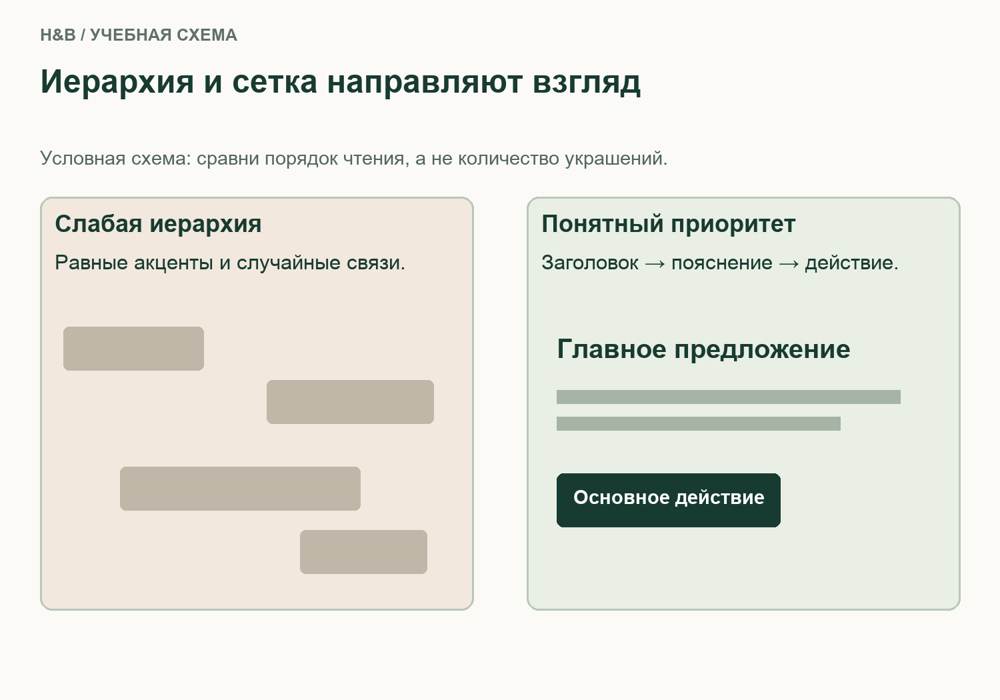

Рассматривая схему, найдите общий левый край, главный текстовый блок и более спокойную вспомогательную область. Затем мысленно уберите цвет. Если смысловой порядок пропал, возможно, всё держалось только на окраске. Хорошая учебная проверка — прочитать одни заголовки и названия действий: остаётся ли понятным предложение?

### Типографика и контраст

Типографика — работа с буквами, строками и текстовыми уровнями. Для первого проекта достаточно системного шрифта: он уже установлен у пользователя, поэтому не требует загрузки. Ограничьте количество размеров осмысленными ролями: главный заголовок, подзаголовки, обычный текст, подписи. Не уменьшайте условия до почти незаметного текста только потому, что они портят красивую картинку.

Межстрочный интервал — расстояние между строками; слишком плотный абзац выглядит слитным. Длина строки тоже влияет на характер чтения. Узкая колонка может превратить каждое предложение в лестницу переносов, слишком широкая — сделать абзац неудобным для обзора. Проверяйте реальное содержание, а не только короткую фразу «текст здесь».

Контраст — степень различия элементов. Он бывает не только цветовым: крупный заголовок контрастирует с обычным текстом, плотный блок — с пустым полем. Для текста выбирайте явно различимые фон и буквы; окончательное соответствие требованиям доступности проверяют специальным инструментом, а не ощущением «вроде видно». Ссылку отличайте не только цветом: подчёркивание помогает узнать её роль. Состояние фокуса — видимая отметка выбранного с клавиатуры элемента — не следует скрывать ради чистого вида.

### Роль изображения и мобильная композиция

До выбора фотографии назовите её функцию: показать предмет, объяснить процесс, дать доказательство или создать настроение. Настроение допустимо, но оно не заменяет сведения о продукте. Для мастерской фотография стола с материалами может быть полезнее отвлечённого красивого пейзажа. В прототипе напишите, что именно должно появиться в этом месте: «руки мастера и край реставрируемого стула», а не просто «картинка».

Референс — чужой пример, который помогает обсудить приём. Ссылка на понравившуюся фотографию не даёт права публиковать её на клиентском сайте. Для выпуска нужны собственные материалы или проверенные права использования. В учебном предпросмотре используйте текстовые обозначения, а не обещайте показать недоступное изображение.

Мобильная композиция — самостоятельное решение для узкого экрана, а не уменьшенная фотография большого макета. Сначала сохраняют смысловой порядок, затем перестраивают колонки. Ключевое обещание и действие не должны уходить после длинного декоративного блока. Адаптивное оформление, которое меняется при другой ширине окна, поддерживается средствами CSS; принципы такого подхода разобраны в [7]. Внешние и внутренние отступы принадлежат разным частям блочной модели элемента; подробности — в [6].

### Разобранный пример 15.1

**Пример: мастерская «Тихое дерево».** Вымышленный клиент восстанавливает небольшую деревянную мебель. Аудитория — владельцы любимых стульев и столиков, которые пока не знают, стоит ли начинать реставрацию. Предложение — предварительное обсуждение по фотографиям, а не мгновенный точный расчёт. Цель первого экрана — провести человека к инструкции, какие фотографии подготовить. Тон спокойный и конкретный. Реальной формы и загрузки файлов в прототипе нет.

Ниже готовый учебный результат: текст слева, спокойная информационная панель справа и следующий раздел с условиями. Это оригинальная простая композиция без внешних зависимостей. Ниже разобраны структура и причины выбора; затем предлагается похожая задача.

```html
<!doctype html>
<html lang="ru">
<head>
<meta charset="utf-8">
<meta name="viewport" content="width=device-width, initial-scale=1">
<title>Тихое дерево — учебный макет</title>
<style>
* { box-sizing: border-box; }
body { margin: 0; background: #f5f1e8; color: #242a25;
  font: 1rem/1.6 system-ui, sans-serif; }
.wrap { width: min(100% - 2rem, 68rem); margin-inline: auto; }
header { padding-block: 1.5rem; border-bottom: 1px solid #b8b9ad; }
header .wrap { display: flex; flex-wrap: wrap; gap: 1rem;
  justify-content: space-between; align-items: center; }
a { color: #254f3d; text-underline-offset: .2em; }
a:focus-visible { outline: 3px solid #254f3d; outline-offset: 4px; }
.hero { display: grid; grid-template-columns: 1.4fr 1fr;
  gap: 3rem; align-items: start; padding-block: 4rem; }
.eyebrow { margin: 0 0 .8rem; font-weight: 650; }
h1 { font-size: clamp(2rem, 5vw, 3.4rem); line-height: 1.12;
  max-width: 17ch; margin: 0 0 1.5rem; }
h2 { font-size: 1.4rem; line-height: 1.3; margin-top: 0; }
p { max-width: 58ch; }
.cta { display: inline-block; padding: .8rem 1.2rem;
  background: #254f3d; color: #fff; border-radius: .4rem; }
.panel { padding: 1.5rem; background: #e3e6d9;
  border: 1px solid #b8b9ad; border-radius: .8rem; }
.note { margin-bottom: 0; }
.details { padding-block: 2rem 4rem; border-top: 1px solid #b8b9ad; }
li + li { margin-top: .6rem; }
@media (max-width: 44rem) {
  .hero { grid-template-columns: 1fr; gap: 2rem; padding-block: 2.5rem; }
}
</style>
</head>
<body>
<header><div class="wrap"><strong>Тихое дерево</strong>
<nav aria-label="Основная"><a href="#prepare">Как начать</a></nav>
</div></header>
<main class="wrap">
<section class="hero" aria-labelledby="offer">
  <div>
    <p class="eyebrow">Мастерская небольшой деревянной мебели</p>
    <h1 id="offer">Сохраним мебель, с которой не хочется расставаться</h1>
    <p>Начнём с фотографий: обсудим состояние предмета и возможный
    следующий шаг. Точную стоимость определим после осмотра.</p>
    <a class="cta" href="#prepare">Какие фото подготовить</a>
  </div>
  <aside class="panel" aria-labelledby="scope">
    <h2 id="scope">Что берём в работу</h2>
    <p>Стулья, табуреты и небольшие столики из дерева.</p>
    <p class="note">Не обещаем восстановить любой предмет.
    Сначала уточним повреждения и ваши ожидания.</p>
  </aside>
</section>
<section class="details" id="prepare" aria-labelledby="steps">
  <h2 id="steps">Подготовьте три вида предмета</h2>
  <ul><li>Общий вид целиком при дневном свете.</li>
    <li>Крупный план повреждения.</li>
    <li>Нижняя сторона и места соединений.</li></ul>
  <p>Это учебный прототип. Отправка фотографий здесь не подключена.</p>
</section>
</main>
</body>
</html>
```

В этом коде HTML задаёт смысловые части: `main` обозначает основное содержание, `nav` — навигацию, `section` — раздел с заголовком. CSS задаёт вид этих частей. Класс — имя группы элементов, к которой применяются правила; селектор с точкой выбирает такой класс. `grid` включает сетку, `gap` задаёт промежуток между её частями, а `@media` позволяет поменять оформление при условии узкого окна. Не нужно запоминать весь синтаксис, чтобы осмысленно переставить блоки. Семантическая структура, то есть разметка по назначению частей, подробно объясняется в [20].

Для чтения кода пригодится небольшой словарь. `padding` — внутреннее пространство блока, `margin` — внешнее; `border` — рамка, `background` — фон, `color` — цвет букв. `rem` — единица, связанная с базовым размером шрифта страницы, `ch` — с шириной символа «0», а `fr` распределяет свободное место между колонками. `min()` выбирает меньшее из ограничений, `clamp()` удерживает размер между нижней и верхней границами. `font-size` задаёт размер букв, `line-height` — высоту строки. Числа с `#` обозначают цвет. Атрибут `id` даёт элементу уникальное имя: ссылка `href="#prepare"` указывает на раздел с `id="prepare"`. Атрибуты `aria-label` и `aria-labelledby` дают области понятное название для вспомогательных программ чтения; второй ссылается на уже существующий заголовок. Это пояснения к готовому образцу, а не требование выучить справочник перед первой композицией.

### Почему решение подходит этому брифу

#### От задачи к первому экрану

Человек ещё не готов заказать реставрацию: он не знает, стоит ли спасать предмет. Поэтому заголовок говорит о сохранении любимой мебели, а не начинает с профессиональных процессов. Следующий абзац сразу ограничивает обещание: фотографии помогают начать обсуждение, точная стоимость определяется после осмотра. Это важная часть предложения, а не мелкий текст, который можно скрыть ради эффектного первого экрана.

Действие «Какие фото подготовить» соответствует доступному следующему шагу. Оно не называется «Получить точную цену», поскольку такого результата клиент не обещал. В учебном коде это якорная ссылка: она ведёт к существующему разделу на той же странице. Ссылка не притворяется загрузкой фотографий или отправкой заявки. Даже если переходы конкретного предпросмотра ограничены, содержание раздела остаётся видимым ниже.

#### Как устроена композиция

Слева находится ведущая группа: описание деятельности, заголовок, уточнение и действие. Они близко расположены и выровнены по общему краю, поэтому читаются как один маршрут. Справа собраны границы работы. Отдельная панель помогает не спутать перечень предметов с главным обещанием. Ширины колонок неодинаковы: пояснение услуги занимает больше места, а короткий список не растягивается без необходимости.

Один тёмный акцент отмечает действие. Фон и информационная панель спокойнее, поэтому не конкурируют с ним. Общий контейнер связывает шапку, первый экран и следующий раздел. Размер заголовка делает его главным текстовым уровнем, но обычные условия остаются читаемыми. Скругления и оттенки можно изменить без разрушения идеи; смысловые группы и порядок важнее этих деталей.

В узкой версии колонки складываются в одну. В разметке ведущая группа идёт перед панелью, значит, на телефоне человек сначала узнаёт услугу и следующий шаг, затем границы работы. Панель не вставляется перед заголовком только потому, что её проще поместить сверху. Раздел подготовки остаётся обычным содержанием, доступным без изображения и анимации.

#### Что было бы ошибкой

Огромная неподписанная фотография в начале не объяснила бы, какую мебель берёт мастерская. Фиктивный калькулятор создал бы обещание точной оценки без осмотра. Набор одинаково ярких кнопок «Позвонить», «Заказать», «Узнать цену», «Написать» смешал бы стадии решения. Эти варианты отклоняются по данному брифу, а не потому, что фотографии или несколько контактов всегда плохи.

**Проверка примера:** предложение понятно без изображения; ссылка соответствует реальному разделу; ограничения не спрятаны; на узком экране нет обязательного горизонтального чтения; отсутствуют вымышленные отзывы и сроки.

### Упражнение 15.1: «Шов рядом»

Другой клиент ремонтирует повседневную одежду. Аудитория — жители района, которым нужно понять, подходит ли мастерская для их вещи. Предложение — оценка сложности ремонта при личном визите; цену нельзя обещать до осмотра. Главное действие — узнать, что принести и как подготовить вещь. Тон деловой, доброжелательный. Доступны текстовый список услуг и адрес; фотографий нет. Не придумывайте отзывы, сроки и скидки.

Соберите свой первый экран и следующий информационный раздел. Напишите заголовок, уточнение, одно основное действие и границы услуги. Покажите широкую и узкую композиции. Сдайте HTML/CSS либо две подписанные схемы и пояснение, что человек должен заметить первым. Не заменяйте только название в образце: решение должно учитывать другую услугу. Критерии самопроверки и один возможный ответ находятся отдельно в последнем разделе «Ответы и разборы упражнений».

### Разобранный пример 15.2

**Пример: информация о мастер-классе «Первая чашка».** Готовая схема состоит из заголовка «Слепите свою первую чашку», короткого пояснения «Для взрослых без опыта», затем компактной группы «Когда / Где / Что включено» и ссылки «Посмотреть условия участия». Ниже располагается раздел «Как проходит занятие». На узком экране справочная группа превращается в вертикальный список, но остаётся перед действием. Вместо фотографии указана подпись «Будущее фото: участник держит незавершённую чашку; нужны согласие и права». Это завершённый текстовый макет, а не обещание загрузить снимок. Аргументация приведена ниже перед самостоятельным заданием.

### Почему решение подходит этому брифу

Заголовок называет результат занятия, уточнение снимает сомнение о необходимости опыта. Сведения о времени, месте и составе занятия объединены: это одна задача выбора условий участия. Они расположены перед действием, чтобы человек мог принять решение на основании содержания. Для группы не нужны три огромных декоративных карточки: достаточно согласованных подписей и расстояний.

На узком экране вертикальный список сохраняет читаемость. Попытка оставить три тесные колонки создала бы множество переносов и ослабила связь подписи со значением. Фото участника с незавершённой чашкой должно показывать процесс новичка, а не только идеальный готовый предмет. При этом согласие на изображение человека и права на фото проверяются отдельно; подпись в прототипе не решает юридический вопрос публикации.

Отклонённый вариант — один большой вид готовой чашки и кнопка «Записаться» без условий. Он показывает предмет, но не объясняет, что это занятие для начинающих и что человеку предстоит делать. Для другого брифа предметная фотография могла бы быть ведущей; здесь важен опыт участия.

### Упражнение 15.2: прогулка «Истории дворов»

Клиент проводит прогулку для взрослых жителей города, а не занятие в помещении. Важны место встречи, продолжительность по данным клиента «около полутора часов», предупреждение «маршрут проходит по лестницам» и возможность сначала прочитать маршрут. Даты пока не согласованы; не выдумывайте расписание. Главный шаг — перейти к описанию маршрута, не купить несуществующий билет.

Составьте текстовый макет из двух разделов. Укажите порядок чтения, место предупреждения, роль будущего изображения и изменение для телефона. Представьте, что куратор видит только вашу схему: подписи должны объяснять содержание без устного рассказа. Сначала завершите собственную версию; затем откройте отдельный разбор. Совпадение цветов с ответом не является критерием успеха.

### Что сохранить после главы

Сохраните исходный бриф, макет, мобильную версию и короткую записку о решениях. Отдельно перечислите предположения, которые требуют подтверждения клиента. Проверяйте, можно ли прочитать важное без картинок, не теряется ли смысл при переносе строк и понятно ли действие без окружающих объяснений. На этом этапе важнее научиться видеть и обосновывать композицию, чем добавлять новые эффекты.

Источники главы: [6] — MDN, блочная модель; [7] — MDN, адаптивное оформление; [20] — W3C, структура страницы. Проверенные адреса и границы использования записаны в разделе «Источники и дальнейшее чтение». Все названия клиентов и учебные макеты вымышлены.

## Глава 16. Архитектура проекта и управление агентами

### Архитектура — распределение ответственности

Для начинающего достаточно сначала разделить отображение, действия, данные и доверенные решения. Каталог показывает данные, функция считает результат фильтрации, клиент отправляет запрос, сервер применяет правила, БД хранит подтверждённое состояние. Смешение всех задач в одном файле затрудняет объяснение и проверку; чрезмерное дробление без причины создаёт другую сложность.

```text
Покупатель
   ↓ действия и ввод
Браузер: страницы → компоненты → состояние
   ↓ запросы по договору API
Сервер: проверка доступа → валидация → правила заказа
   ↓ согласованные изменения
База данных: товары / варианты / заказы / позиции

Внешняя оплата и доставка — отдельные согласованные границы.
В учебном прототипе они не подключены.
```

Схема помогает задавать вопросы. Где пересчитывается цена? Кто знает окончательный статус заказа? Что будет, если сеть недоступна? Какой компонент отвечает за ошибку? Если на схеме нет ответа, это не всегда повод добавить библиотеку: иногда нужно уточнить правило.

### Проверяемое ТЗ

Плохое требование: «сделай красивую корзину». Рабочее учебное требование: «при добавлении одного варианта дважды увеличивается его количество; другой вариант остаётся отдельной позицией; сумма пересчитывается; после удаления последней позиции появляется пустое состояние». К нему можно заранее подготовить проверку.

Каждому пункту назначьте идентификатор. Затем связывайте его с изменением и свидетельством: `CART-03 → файл расчёта → тест на два варианта → ручной прогон`. Это облегчает приёмку. Если требование изменилось, нужно изменить договор и проверки, а не только попросить модель «теперь иначе» в середине большого разговора.

### Агент — исполнитель роли, а не источник истины

Оркестратор получает цель, ограничения и контекст. Планировщик помогает разбить её. Разработчик реализует согласованный шаг. Дизайн-ревьюер и QA проверяют разные стороны. Не нужно запускать все роли ради изменения подписи. Выбирайте специалиста по риску и давайте ему необходимые факты.

Минимальное задание содержит: цель, исходные наблюдения, разрешённые файлы, критерии результата, исключения и проверки. Просьба «сделай полностью идеально» не определяет ни границ, ни способа приёмки. После ответа агента всё равно нужны просмотр diff и реальное выполнение проверок. Если два агента согласились, а кнопка не работает, решающим остаётся наблюдение.

### Разобранный пример 16.1. Разложи сайт по ответственности

Клиенту нужен небольшой сайт мастерской: предложение, примеры работ, процесс, контакты. Сначала обсуждаем части продукта, потом файлы. Страница — целый маршрут пользователя; секция — смысловой участок страницы; компонент — повторяемая часть, например карточка проекта. Данные — содержание этих частей; поведение — реакция на действия.

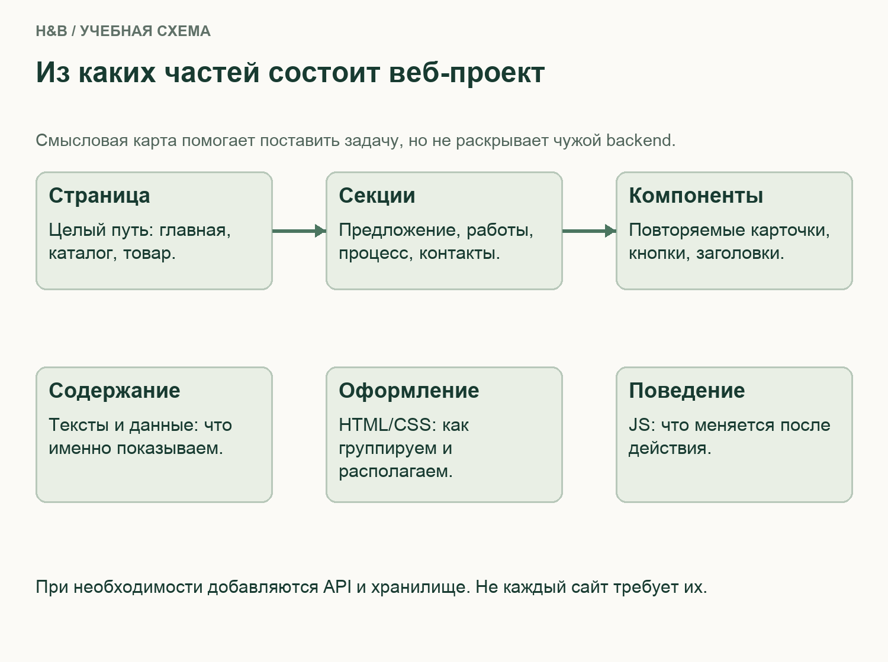

Разобранная карта:

```text
Главная страница
+-- Первый экран -> предложение и главное действие
+-- Работы       -> повторяющиеся ProjectCard
+-- Процесс      -> этапы сотрудничества
+-- Контакты     -> согласованный способ связи

Данные работ -> список -> карточки -> действие пользователя
```

Эта карта ещё не доказывает, что сайт построен на React или имеет отдельную базу: внешняя страница не раскрывает всю реализацию. Но по ней уже можно поставить задачу ИИ: «Сделай первый экран, остальные секции не меняй; содержание такое-то; критерии такие-то». Чем точнее граница, тем легче проверить результат и не принять лишнюю переработку.

### Упражнение 16.1. Аналогичная карта для другого клиента

Полный бриф: студия освещения хочет одну страницу с предложением, тремя типами света, объяснением подбора и кнопкой «Обсудить освещение». Нужны повторяющиеся карточки типа света. Онлайн-магазин, оплата, личный кабинет не входят. Составь карту страницы по образцу и краткое задание ИИ только на секцию типов света. В задании перечисли, что не трогать.

## Глава 17. Тестирование и отладка без гадания

### Ожидание нужно записать до запуска

Тест сравнивает поведение с ожидаемым результатом. Если ожидание не связано с требованием, зелёная отметка мало говорит о полезности. Небольшой тест функции расчёта хорошо ловит ошибку суммы, но не доказывает, что покупатель видит правильную кнопку. Ручная проверка цвета, в свою очередь, не защищает расчёт при следующем изменении.

Разделяйте уровни: отдельная функция, взаимодействие частей, путь пользователя через браузер. Рекомендации Playwright предлагают тестировать наблюдаемое поведение, изолировать проверки и использовать устойчивые способы обращения к элементам. Это помогает не привязать тест к случайной внутренней разметке.[23]

```js
// Оригинальный учебный пример для Node.js.
import assert from 'node:assert/strict';
const totalMinor = (priceMinor, quantity) => priceMinor * quantity;
assert.equal(totalMinor(129000, 2), 258000);
assert.equal(totalMinor(129000, 1), 129000);
```

Этот пример проверяет только умножение двух выбранных значений. Он намеренно не проверяет валидацию и границы. В настоящем наборе нужно отдельно выразить поведение при отрицательном, дробном и строковом количестве. Не делайте вид, что две строки подтверждают всю корзину.

### Найти причину, а не подавить сообщение

Начните с воспроизведения: что ввели, где нажали, что ожидали и что получили? Затем уменьшите сценарий. Если ошибка появляется с двумя вариантами, нет необходимости начинать расследование с анимации главной. Найдите границу, на которой данные становятся неправильными, и сравните ожидаемое с фактическим.

Сформулируйте гипотезу: «позиции объединяются по товару, а не варианту». Предсказание: разные варианты одного товара попадут в одну строку. Проверьте маленьким набором. Только после подтверждения меняйте ключ позиции. После исправления повторите исходный сценарий и соседний: повторное добавление того же варианта всё ещё должно увеличивать количество.

Регрессия — нарушение ранее работавшего поведения. Чтобы заметить её, храните короткий список основных сценариев и запускайте связанные проверки после каждой логической редакции. Не исправляйте тест удалением ожидания только потому, что новая реализация его нарушила. Сначала выясните, действительно ли поменялось требование.

### Разобранный пример 17.1. Проверка композиции как наблюдаемое действие

Требование: «На узком экране заголовок читается целиком и основная кнопка не выходит за границы блока». Плохой отчёт — «Всё красиво». Он не говорит, что именно смотрели. Хороший сценарий задаёт исходное состояние, действие, ожидание и фактическое наблюдение.

Условный разобранный отчёт:

```text
Исходное состояние: открыт первый экран, длинный заголовок.
Действие: сужено окно; просмотрен весь блок.
Ожидание: заголовок переносится, кнопка внутри блока.
Наблюдение в этом учебном примере: текст целиком,
кнопка под описанием, горизонтального обрезания нет.
Вывод: это требование в указанном состоянии выполнено.
Не проверено: отправка заявки и другие страницы.
```

Последняя строка не делает отчёт слабее: она не позволяет спутать осмотр одного блока с проверкой всего продукта. Для повторной редакции нужно новое наблюдение. Если в макете ещё нет работающей отправки, никакой снимок не докажет получение заявки сервером. Автоматические тесты могут помогать, но проверяют только сформулированные ожидания.[23]

### Упражнение 17.1. Составь собственный сценарий до проверки

Дано требование: «В карточке проекта длинное название не перекрывает категорию, а кнопка заметна и доступна с клавиатуры». Текст названия: «Переосмысление рабочего пространства для небольшой творческой команды». Категория: «Интерьер». Кнопка: «Посмотреть проект». Подготовь исходное состояние, действие и ожидания. После реального просмотра отдельно допиши факт; если макета ещё нет, оставь факт «не проверено».

## Глава 18. Публикация, передача и рабочая дисциплина H&B

### Готовность существует в нескольких состояниях

«Код написан», «сборка прошла», «локально проверено», «владелец принял» и «опубликовано и проверено» — разные утверждения. В рабочем отчёте называйте точную стадию. Публичный адрес может отдавать старую сборку, даже когда локальная страница правильная. Проверка после публикации должна касаться самого опубликованного результата.[24]

Перед запуском нужен согласованный список: контент, сценарии, разрешённые интеграции, обработка ошибок, права доступа, восстановление, ответственный и ограничения. Не следует объявлять готовность по наличию красивого первого экрана. Для магазина особенно важно пройти выбранный путь от поиска товара до подтверждённого результата и отдельно назвать непроверенные внешние шаги.

### Что передаёт сотрудник куратору

Пакет передачи включает краткий бриф, согласованное ТЗ, объяснение концепции, ссылку или разрешённый предпросмотр, матрицу требований и проверок, известные ограничения и инструкцию восстановления. Показать нужно и мобильный сценарий. Остаточный риск не прячут в конце длинного сообщения под словом «мелочь».

Пример честного статуса: «Карточка и учебная корзина проверены на трёх ширинах; отрицательное количество отвергается; настоящая оплата не подключена; публикация не выполнялась». Это полезнее обещания «магазин полностью готов», если последняя часть не доказана.

Рабочие запросы клиента проходят через куратора. Сотрудник различает исправление дефекта, уточнение существующего требования и новую функцию. Если добавлена новая платёжная схема, это не автоматически бесплатная мелкая правка. Нужно описать влияние, предложить варианты и передать решение владельцу, а не самостоятельно обещать сроки.

### Ограниченная бесплатная демонстрация

Предлагаемый учебный формат бесплатного прототипа — одна основная концепция, главный экран и один ключевой сценарий на демонстрационных данных. Это предложение для согласования, не договор со всеми клиентами. Его цель — проверить направление, не бесплатно построить весь магазин. После одобрения нужен новый согласованный объём платной реализации.

Проекты H&B, по словам куратора, обычно находятся в диапазоне 60–500 тысяч рублей; сложность нельзя определять только ценой. Доля сотрудника 30–35% и целевой доход 60–70 тысяч рублей не означают гарантированные заказы. В учебном замере учитывают и бесплатные прототипы, и проверки, и переделки — иначе производительность выглядит лучше действительной.

### Разобранный пример 18.1. Передача понятного прототипа

Куратор должен понять не только как выглядит работа, но и что уже действует. В примере подготовлен первый экран и секция преимуществ. Макет открывается, стили проверены; формы и внешняя публикация не подключены. Передача называет результат точно:

```text
Результат: статический первый экран и преимущества.
Основание: бриф «спокойное рабочее пространство».
Файлы: index.html, styles/theme.css.
Проверено: читаемость длинного текста, узкое расположение,
порядок блоков и видимый фокус кнопки.
Не реализовано: отправка формы, каталог, онлайн-оплата.
Нужно решение куратора: подходит ли визуальная концепция.
```

Такой отчёт не принижает работу — он делает её проверяемой. Куратор может принять именно визуальное направление, не перепутав это с разрешением публичного запуска. Если клиент после просмотра просит новый каталог, сначала уточняют, входит ли он в согласованный объём. Ученик не обещает расширение проекта от имени студии.

### Упражнение 18.1. Подготовь аналогичную передачу

Условия: готовы первый экран и блок трёх услуг для мастерской. Проверены длинные названия и узкий экран; кнопка только демонстрационная, формы нет, адрес сайта не публиковался. Файлы `services.html`, `services.css`. Клиент прислал пожелание добавить личный кабинет. Напиши отчёт по образцу и сформулируй отдельный вопрос куратору о новом пожелании.

## Глава 19. От клиентского брифа к двум самостоятельным концепциям

Важное различие среды: якорные ссылки в HTML-примерах описывают обычную веб-страницу. В текущем ограниченном preview переходы отключены; нужный раздел можно прочитать прокруткой. Не записывайте переход по ссылке как выполненную функцию приложения.

### Почему дизайнеру нужен не только красивый образец

Клиент может принести десять ссылок и попросить «как здесь, но наше». Ссылки полезны для разговора, однако они не описывают задачу бизнеса. Бриф — краткое согласованное описание задачи, аудитории, предложения, содержания и ограничений проекта. Он не является приказом копировать конкретный экран. Дизайнер превращает исходные сведения в варианты решения и показывает, как каждый вариант помогает человеку сделать нужный шаг.

Концепция — объединяющий замысел страницы: какая мысль ведёт содержание, каким способом оно организовано и какое впечатление поддерживает оформление. Это больше, чем палитра — набор используемых цветов. Заменить зелёный на синий в том же макете означает сделать цветовой вариант, а не обязательно новую концепцию. Два действительно разных подхода могут по-разному открывать предложение, выбирать визуальные материалы и выстраивать путь к действию, сохраняя честные факты одного брифа.

В этой главе вы выступаете автором решения. Не нужно ждать, пока куратор придумает идею за вас. Внутри учебного приложения нет живого наставника; сохраняйте вопросы отдельным списком для последующего обсуждения. Прототип здесь — проверяемое представление будущей страницы, но не работающий сервис: доступен только HTML/CSS-предпросмотр, без JavaScript, изображений, сети и отправки форм.

### Как читать бриф и не додумывать факты

Прочитайте задание дважды. При первом чтении выделите предложение и действие. При втором найдите ограничения: кому услуга не подходит, каких материалов ещё нет, какие утверждения нельзя использовать. Отделите факт от желания. «Есть фотографии интерьера» — факт о материалах. «Хочется выглядеть современно» — пожелание, которое предстоит расшифровать примерами.

Составьте список неизвестного, но не превращайте каждую неизвестность в остановку работы. Если цена не утверждена, можно спроектировать место для условий и честно указать, что они уточняются. Нельзя самовольно написать привлекательную сумму. Если клиент говорит «для всех», предложите рабочую гипотезу аудитории и явно подпишите её как требующую подтверждения. Гипотеза — предположение для проверки, не полученное исследованием доказательство.

Полезно описать один конкретный сценарий: человек приходит с такой-то потребностью, сначала узнаёт это, затем проверяет то, после чего делает следующий шаг. Сценарий не заменяет исследование реальных пользователей, но помогает не складывать на страницу все сведения без порядка. Чем точнее задача сценария, тем легче сравнить две композиции без спора «какая красивее».

### Полный одностраничный бриф: книжный магазин «Переплёт»

Следующий учебный документ рассчитан на одну содержательную страницу. Все сведения вымышлены и нужны только для проектирования. За пределами этого задания они не являются данными реального магазина.

**Клиент и задача.** Независимый районный книжный магазин «Переплёт» запускает подбор книги в подарок. Нужна отдельная страница, которая объяснит услугу и подготовит посетителя к разговору с продавцом. Магазин хочет получать более предметные обращения, а не обещать, что угадает любую книгу без сведений о получателе.

**Аудитория.** Взрослые покупатели, которые выбирают подарок знакомому, родственнику или коллеге, но не следят за книжными новинками. Их исходный вопрос: «Как выбрать не наугад?» Они могут не знать жанровых терминов. Часть приходит с телефона по ссылке, часть открывает страницу уже перед визитом.

**Предложение.** Продавец предложит несколько книг из имеющегося ассортимента после короткого разговора о получателе. Сам подбор не оплачивается отдельно; покупка книги оплачивается по её цене. Нельзя гарантировать наличие конкретного издания и нельзя обещать редкие книги под заказ: такой услуги в задании нет.

**Желаемое действие.** Основной шаг — прочитать, какие сведения о получателе подготовить перед визитом. На будущем рабочем сайте допустим переход к согласованному контактному каналу, но контакт ещё не передан. В плане страницы действие направляет к разделу подготовки, а не к форме; в нынешнем preview якорный переход отключён, раздел читают прокруткой.

**Тон.** Внимательный, ясный, без снобизма и экзамена по литературе. Запрещены выражения «для настоящих интеллектуалов», давление срочностью и обещание «идеального подарка каждому». Допустимы короткие редакторские подписи: пояснения, написанные голосом магазина, а не рекламные лозунги.

**Обязательное содержание.** Что делает продавец; какие сведения подготовить; как проходит подбор; от чего зависит выбор; ограничение по наличию; приглашение прийти. Адрес и часы работы должны быть получены у клиента перед публикацией. В прототипе они отмечаются как неподтверждённые поля и не подменяются правдоподобными данными.

**Материалы.** Есть название, согласованный текст предложения и две собственные фотографии полок без узнаваемых людей. Есть разрешение магазина использовать эти снимки в будущем проекте, но файлов в учебной среде нет. Нет отзывов, портретов сотрудников и согласованного списка рекомендуемых книг. Обложки нельзя случайно брать из поиска: права и условия использования проверяются отдельно.

**Ограничения и согласование.** Одна страница, без интернет-магазина, оплаты, личного кабинета и сложного подбора по анкете. Нужен удобный вариант для телефона. Клиент согласует содержание и выбранную концепцию до детальной отрисовки. Успех учебного этапа — понятное предложение, честные условия и осмысленный маршрут к подготовке, а не заявленный рост продаж без измерений.

### Разобранный пример 19.1: два законченных концептуальных направления

Ниже представлены результаты разработки по одному брифу. Сравнение и обоснование приведены перед самостоятельным упражнением. В самой главе рассматривайте формулировки и структуру как два готовых концептуальных макета, а не как единственно верный образец оформления.

#### Концепция А. «Записка книготорговца»

Главная идея: страница как спокойное личное обращение продавца. Первый экран открывается небольшим названием магазина, крупной фразой «Книга в подарок начинается с человека» и абзацем: «Расскажите, что ему интересно. Вместе найдём несколько вариантов из книг, которые есть у нас». Основное действие называется «Что рассказать о получателе» и ведёт к разделу ниже.

Композиция строится как редакционная полоса: широкое поле, одна ведущая текстовая колонка, рядом узкая заметка «Подбор отдельно не оплачивается. Книга — по своей цене». Редакционная полоса здесь означает организованный лист текста с различимыми заголовками и подписью, а не имитацию настоящей газеты. Фон тёплый светлый, текст тёмный, акцент один, неброский. В предпросмотре используются системные шрифты; дополнительные шрифты не загружаются.

После вступления идут «Три сведения для разговора», «Как пройдёт визит», «Что зависит от наличия». Будущее фото полок занимает широкую спокойную область между содержательными разделами; в текущем макете вместо него текстовое обозначение. На телефоне заметка становится обычным блоком сразу после вступления. Содержание не требует рассматривать фото, чтобы понять предложение.

#### Концепция Б. «Маршрут к подарку»

Главная идея: страница как короткий наглядный маршрут подготовки. Первый экран начинается с заголовка «Выбираете книгу не себе? Начнём с трёх подсказок». Под ним три самостоятельные карточки: «Что человеку интересно», «Что он уже читал», «Что важно в подарке». Карточка — визуально собранный блок содержания, а не обязательно кнопка. Здесь карточки ничего не переключают и не изображают работающую анкету.

Ниже расположено действие «Посмотреть подготовку к визиту», затем схема разговора: «Вы рассказываете → продавец показывает варианты → вы выбираете». Стрелки только обозначают порядок; в HTML те же шаги представлены читаемым списком. В отдельной заметке указаны условия оплаты и ограничения наличия. Визуальный язык — чёткая модульная сетка, то есть повторяющиеся согласованные блоки, холодный светлый фон, тёмные буквы и один контрастный акцент действия.

Большая фотография не является центром этого направления. Роль изображения может выполнять собственная простая схема, состоящая из текста и линий. В мобильной версии карточки идут друг за другом, а не сжимаются в три узкие колонки. Навигация позволяет сразу перейти к условиям. Пользователь не обязан пройти условный «тест», чтобы узнать базовые сведения.

**Отклонённые направления.** В итоговый набор не вошли: заставка с одной огромной фотографией без предложения; имитация теста с неработающими переключателями; каталог вымышленных «самых продаваемых книг». Причины отклонения и связь с ограничениями клиента разобраны выше в разборе примера. Это примеры решений, не принятых для данного задания, а не универсальный запрет на фотографии, тесты или каталоги.

### Почему решение подходит этому брифу

#### Почему это две концепции, а не две окраски

«Записка книготорговца» строит доверительный разговор через последовательное чтение. Главный образ — внимательный человек, который помогает выбрать. Поэтому в начале одна сильная фраза и пояснение, затем подготовка и условия. Фотография полок служит контекстом магазина, но не обязана нести ключевое обещание. Редакционный характер поддерживается свободными полями, длинной текстовой колонкой и спокойной заметкой сбоку.

«Маршрут к подарку» раскрывает ту же услугу через подготовительные категории. Посетитель сразу видит, о чём его попросят рассказать. Главный визуальный материал — структура вопросов, а не обстановка магазина. Повторяющиеся карточки и схема разговора создают иной способ чтения. Даже если сделать обе концепции чёрно-белыми, разница сохранится: личное обращение против наглядного маршрута.

Обе версии сохраняют одни факты: подбор из наличия, отсутствие отдельной платы за подбор и необходимость сведений о получателе. Концептуальное разнообразие не разрешает менять условия ради убедительного макета. Вариант с вымышленным ассортиментом был бы уже другим предложением, а не дизайнерской интерпретацией брифа.

#### Почему отклонены три направления

Большая заставка с фотографией без предложения отодвигает вопрос «что мне здесь помогут сделать». Её можно переработать, вернув понятный заголовок и путь, но в исходном виде она не решает задачу первого экрана. Причина отклонения — отсутствие смысла в доступной области, не размер фотографии сам по себе.

Имитация теста особенно опасна в текущей среде: карточки выглядели бы как выбор, но не меняли бы состояние и не выдавали результат. Для обычного будущего сайта работающий тест тоже потребовал бы отдельного задания, логики и честных ограничений. По этому брифу магазин предлагает разговор, а не автоматическую систему рекомендаций.

Каталог вымышленных бестселлеров добавляет неподтверждённые сведения и обещание наличия. Он не становится допустимым оттого, что красиво заполняет сетку. Если клиент позже передаст согласованный список и права на материалы, каталог можно будет обсуждать как новую часть проекта.

#### Как выбирать между концепциями

Если клиент ценит голос продавца и готов поддерживать хорошие тексты, направление А удобно для дальнейшей проработки. Если главным затруднением посетителя считается незнание, что рассказать о получателе, направление Б показывает подготовку непосредственно в начале. Это аргументы для обсуждения, а не доказательство эффективности без проверки. Можно проверить понимание на читателях: попросить пересказать услугу и следующий шаг, не подсказывая ответы. Результаты такого наблюдения следует записать отдельно от собственных предпочтений.

Перед выпуском нужны реальные адрес, график и контактный канал, проверка прав на фотографии и подтверждение условий подбора. До этого учебная страница не должна выглядеть работающей формой обращения. При презентации клиенту показываются две равно проработанные схемы и один список вопросов, чтобы обсуждение не подменялось выбором любимого цвета.

### Упражнение 19.1: другой клиент, другая задача

**Бриф «Колесо у дома».** Небольшая веломастерская принимает городские велосипеды на осмотр перед сезоном. Аудитория — взрослые владельцы, которые не умеют описывать техническую неисправность. Предложение — осмотр с последующим согласованием перечня и стоимости работ; бесплатность и точный срок не подтверждены. Действие — узнать порядок обращения и какие сведения сообщить мастеру. Тон спокойный, без запугивания авариями.

Есть собственный текстовый перечень работ: тормоза, переключение передач, колёса. Есть согласованное ограничение: электросистемы не ремонтируют. Фотографий, отзывов, адреса и графика пока нет. Нельзя добавлять фиктивный онлайн-расчёт, обещание ремонта за час или запись, которая якобы уже подключена. Для учебного макета задан маршрут к разделу подготовки; в ограниченном preview его читают прокруткой, а не проверяют неработающий переход. На будущем сайте реальный контакт добавляется после подтверждения клиентом.

Подготовьте две существенно разные концепции. Для каждой сдайте название идеи, главный заголовок, последовательность разделов, роль будущих изображений, характер типографики и отдельную мобильную схему. Выберите одну для статического прототипа и перечислите вопросы клиенту. Добавьте хотя бы одно отклонённое направление. Не переносите книжные метафоры автоматически: теперь человек хочет разобраться с обслуживанием своего велосипеда, а не выбрать подарок.

### От концепции к презентации клиенту

Презентация — объяснение решения в последовательности, удобной для обсуждения. Начните с задачи и границ, затем покажите две концепции в одинаковой степени готовности. Нельзя сравнивать тщательно оформленный любимый вариант с небрежным наброском второго. Клиенту должно быть понятно, что можно выбирать: принцип страницы, а не случайную разницу в качестве показа.

Отделите материал для обсуждения от материала для публикации. Доска настроения, или подборка визуальных примеров, может содержать ссылки на чужие работы с указанием автора и источника. Она не превращает эти работы в ваши лицензированные материалы. Для страницы нужны собственные или разрешённые изображения, проверенные тексты и согласованные факты. Не выдавайте придуманные отзывы за способ сделать концепцию убедительнее.

Попросите обратную связь о содержании: соответствует ли предложение услуге, чего боится аудитория, что необходимо уточнить до обращения. Комментарий «не нравится зелёный» полезен как предпочтение, но не отвечает на вопрос о сценарии. Можно предложить цветовую правку, сохранив идею; можно признать, что сама идея неверно описывает клиента. Важно различать эти уровни, чтобы не перестраивать всю страницу из-за одного оттенка.

### Разобранный пример 19.2

**Пример: питомник «Листва».** Исходный запрос: «Хотим выглядеть технологично». Согласованная услуга — помочь выбрать растение для конкретного места на участке, без обещания приживаемости в любых условиях. Готовое направление называется «Начинаем с вашего участка». Первый экран: «Подберём растение под условия вашего места», пояснение о свете и доступном пространстве, действие «Что подготовить для разговора». Дальше идут разделы «Освещение», «Свободное место», «Что уже растёт», затем условия консультации. Рядом с текстом предусмотрена собственная схема участка, в предпросмотре — подписанный блок. Вариант «цифровой сад» с вращающимися деревьями не принят. Аргументация результата дана ниже перед самостоятельным заданием.

### Почему решение подходит этому брифу

«Технологично» описывает желаемое впечатление, но не полезный результат посетителя. В готовом направлении это пожелание переводится в точность организации сведений: условия участка, вопросы для обсуждения, ограничения. Человеку не требуется знать ботанические термины, чтобы начать разговор о свете и месте.

Заголовок связывает услугу с конкретным участком, а подготовительные разделы объясняют, что рассказать. Схема участка имеет информационную роль: показывает отношения зон, а не создаёт видимость научного расчёта. В прототипе она подписана как будущий материал, поскольку реальных изображений нет. Гарантия приживаемости не появляется ни в заголовке, ни в подписи.

«Цифровой сад» с вращающимися деревьями отклонён не как плохой стиль вообще. В данном задании движение не объясняет условия выбора, а отсутствующие модели добавляют производственные задачи. Если в будущем клиенту понадобится показать форму кроны конкретного растения и будут материалы, такое направление можно оценить заново по другой задаче.

### Упражнение 19.2: студия семейной фотографии «Рядом»

Клиент просит «дорогой минимализм» — сдержанное оформление без лишних деталей. Аудитория — родители, которым важно понять, как проходит съёмка с маленьким ребёнком. Предложение — семейная съёмка по предварительному обсуждению; длительность и стоимость пока не согласованы. Главный шаг — узнать, какие вопросы обсудить до бронирования. Есть описание процесса и собственные фотографии, но разрешение на публикацию лиц ещё не получено.

Предложите содержательную концепцию, которая не сводится к белому фону и маленьким буквам. Запишите заголовок, структуру, видимые ограничения, разрешённую на текущем этапе замену фотографий и мобильную последовательность. Объясните в своей сдаче, какие данные нужны клиенту для выпуска; не придумывайте пакет услуг. Отдельный эталон покажет один допустимый вариант после самостоятельной попытки, а не единственный правильный стиль.

### Самопроверка перед сдачей

Поставьте рядом бриф и макет. Найдите аудиторию в словах страницы, предложение в первом экране, условия в доступном разделе, действие в понятной подписи. Проверьте, что вы не заменили задачу клиента демонстрацией собственных эффектов. Концепция считается самостоятельной не потому, что выглядит необычно, а потому, что вы можете связать её устройство с конкретным заданием и назвать границы своего решения.

Структуру разделов и смысловых заголовков сверяйте с [20]. Если на будущем рабочем сайте появится форма, подписи полей и инструкции следует проектировать осмысленно; соответствующие принципы изложены в [21]. Эта ссылка не означает, что формы работают в учебном приложении. Проверенные адреса находятся в разделе «Источники и дальнейшее чтение». Приведённые концепции — учебные авторские предложения, не исследование конверсии, то есть доли посетителей, совершивших желаемое действие.

## Глава 20. Насмотренность: как превращать референсы в свои решения

### Что мы развиваем на самом деле

Насмотренность — не количество сохранённых красивых картинок. Для нашей работы это способность заметить решение, объяснить его задачу, увидеть ограничения и применить принцип в другом контексте. Если человек сохранил сто первых экранов, но не может объяснить, почему кнопка находится именно там, у него есть папка картинок, а не готовый способ проектирования.

Сначала мы учимся наблюдать без догадок. «Заголовок занимает левую колонку, справа крупный объект, действие стоит сразу после объяснения» — наблюдение. «У компании из-за этого выросли продажи» — предположение, если нет опубликованного исследования. «Это сделано на React» — тоже не факт только по внешнему виду. Такая дисциплина нужна не ради придирок: неверная причина приводит к неверному заимствованию.

Смотреть полезно не только на победителей дизайн-конкурсов. Рабочий каталог магазина, понятная форма услуги и спокойная страница небольшого бренда могут научить задаче лучше эффектной заставки. Выставочная работа хорошо показывает идею, но не всегда — весь покупательский путь. Источники ниже используются для разных целей, а не как один универсальный рейтинг.

### Единица тренировки — не сайт, а одно решение

В начале занятия выбери конкретный вопрос. Например: «Как показать материал предмета без длинного текста?», «Как оставить основное действие заметным на узком экране?» или «Как отделить две аудитории, не создавая хаос?». Потом подбирай примеры именно на этот вопрос. Иначе поиск легко превращается в бесконечное пролистывание.

У одного референса выделяй пять слоёв. Первый — задача и главное действие. Второй — порядок смысловых блоков. Третий — композиция: колонки, крупные и малые объекты, интервалы. Четвёртый — характер: типографика, цвет, изображения, голос текста. Пятый — поведение: что изменяется при наведении, прокрутке, ожидании, ошибке. Если удалось увидеть только неподвижную картинку, пятый слой остаётся неизвестным.

Не нужно разбирать каждый пиксель целого сайта в первый день. Достаточно одного экрана и одного поведения, но с понятным выводом. Чужой текст, логотип, модель или видео не становятся нашими из-за того, что мы поняли композицию. Для проекта выбираются собственные либо отдельно разрешённые материалы; референс сохраняется как источник анализа.

### Разобранный пример 20.1. От понравившегося экрана к применимому принципу

Представим условный референс мебельного бренда: слева короткое предложение и кнопка, справа крупный предмет на спокойном фоне. Это описательный учебный пример, не заявление о просмотре конкретного сайта из каталога. Наш клиент — небольшая мастерская настольного света. Его цель — помочь посетителю выбрать направление освещения и оставить запрос, а не сразу оплатить товар.

Плохой перенос: повторить название чужого бренда, шрифт, фотографию и поворот объекта. Хороший перенос начинается с вопроса, что здесь решено. Крупный предмет помогает понять продукт; короткий текст не конкурирует с изображением; единственное главное действие показывает следующий шаг. Это принципы, а не комплект чужих материалов.

Делаем собственную адаптацию. Вместо кресла показываем собственную сцену света. Заголовок говорит о сценарии «Свет для спокойного вечера», а не копирует рекламную фразу. Три небольших ориентира ниже помогают выбрать назначение: чтение, работа, мягкий фон. На узком экране сначала идёт понятное предложение и действие, затем визуальная сцена. Так композиция сохраняет смысл, даже когда две колонки становятся одной.

Разобранная карточка наблюдения:

```text
Вопрос: как быстро объяснить назначение предмета?
Наблюдение: один крупный объект, короткое предложение,
действие рядом с объяснением.
Принцип: сначала узнаваемый продукт и один следующий шаг.
Для нашего клиента: собственная сцена света,
другой текст, три сценария использования.
Не переносим: чужую фотографию, бренд и буквальную композицию.
Проверка: понятно ли предложение без длинного рассказа?
Неизвестно: фактическая конверсия и скрытая реализация референса.
```

Теперь у нас есть основание решения. Куратор может возразить по задаче: например, если клиент продаёт сложный монтаж, одного объекта мало и выше понадобится объяснение процесса. Это полезное обсуждение, а не спор «мне нравится / мне не нравится».

### Упражнение 20.1. Повтори способ с другим брифом

Полное условие: клиент — сервис настройки домашних рабочих мест. Аудитория — люди, которым неудобно работать за кухонным столом. Предложение — разбор пространства и подбор предметов под реальный распорядок. Главное действие — «Обсудить рабочее место». Нет готовой 3D-модели и собственного видео; есть возможность сделать простую авторскую схему.

Используй описанный выше условный референс, но не буквальный макет. Заполни ту же карточку наблюдения, предложи первый экран и назови хотя бы одно решение, от которого ты сознательно откажешься. Все исходные данные есть в этом условии: для выполнения не обязательно искать новый сайт. Затем при желании сравни свою идею с реальным примером из подборки.

### Ежедневные 30 минут внутри учебного дня

Эта тренировка входит в существующий блок разбора референса, а не прибавляется к восьмичасовому дню. Первые пять минут — сформулировать вопрос и выбрать кандидатов. Следующие десять — разобрать один пример по слоям, не переписывая его рекламное описание. Ещё десять — нарисовать простую схему собственного применения: прямоугольники, подписи, порядок чтения. Последние пять — записать аргумент выбора, риск и одно неприменимое решение.

Работа сохраняется в понятном формате: `research/day-01.md`, где указаны вопрос, адрес источника, дата, наблюдение, переносимый принцип и собственный эскиз. Рядом можно вести `research/patterns.md`: не «красивые сайты», а категории вроде «сравнение вариантов», «первый экран услуги», «состояние без результатов». В текущем приложении Markdown сохраняется как обычный файл своего проекта; внешние страницы рассматриваются отдельно в браузере.

Не оценивай день количеством ссылок. Один разобранный приём и его собственная адаптация полезнее двадцати адресов без выводов. Куратор проверяет не скорость листания, а качество связи «задача → наблюдение → решение → проверка».

### Программа на восемь недель

**Неделя 1 — видеть состав.** Научиться находить главный смысл, действие, порядок блоков и повторяющиеся элементы. Результат — три небольших разбора и схема одного собственного первого экрана.

**Неделя 2 — видеть отношения.** Сравнить две композиции с одинаковым содержимым: выравнивание, масштабы, интервалы, типографика. Результат — объяснение, какое решение облегчает чтение конкретной аудитории.

**Неделя 3 — видеть систему.** Найти повторяющиеся компоненты, отделить контент от оформления и заметить, как один принцип работает в разных секциях. Результат — маленькая библиотека собственных карточек, кнопок и заголовков.

**Неделя 4 — видеть путь пользователя.** Разбирать не только первый экран, но и переход к каталогу, выбору или заявке. Результат — карта сценария с состояниями, где эффект не мешает действию.

**Неделя 5 — видеть трудные состояния.** Изучать пустую выдачу, ожидание, длинный текст, отсутствие изображения, ошибки формы. Результат — варианты интерфейса, которые остаются понятными без идеальных данных.

**Неделя 6 — видеть роль движения.** Различать украшение, объяснение и обратную связь. Результат — короткий storyboard: что видно в начале, середине и конце, и статический вариант той же идеи.

**Неделя 7 — выбирать под бриф.** Под один и тот же клиентский запрос сравнить несколько направлений и обосновать отказы. Результат — две действительно разные концепции, а не одинаковая структура с другим цветом.

**Неделя 8 — переносить самостоятельно.** Получить новый бриф и без готового шаблона объяснить выбор источников, структуру и ограничения. Результат — собственная концепция, прототип и защита решения перед куратором.

Это предложенная программа тренировки, не обещание профессионального вкуса за фиксированное число дней. Начальный результат оцениваем по работам: стал ли ученик точнее замечать, аргументировать и адаптировать. Последующая практика и обратная связь продолжаются на реальных проектах.

### Десять источников для поиска референсов

Подборка ниже проверяется отдельно и включает разные задачи: композицию, реальные сайты, портфолио, движение и 3D. Часть дополнительных функций конкретных площадок может требовать входа или оплаты; это отмечается в карточке. Мы не заменяем чтение реального сайта картинкой из каталога и не объявляем эту десятку объективным мировым рейтингом.

#### 1. Awwwards

[Открыть источник](https://www.awwwards.com/).[27]

Что изучать: Композиция промосайтов, крупная типографика, переходы между секциями и сценарий скролла.

Практика: Выберите два сайта одной отрасли. Откройте оригиналы, опишите порядок акцентов и сделайте свой wireframe из пяти блоков под другой бриф.

Доступ при проверке: Главная с номинантами и победителями доступна без входа; видны Log in, Sign Up, Be Pro и Academy. Условия Pro и стоимость курсов не проверялись.

Ограничение: Награда не доказывает конверсию, доступность или пригодность для малого бюджета. Скриншот не показывает сценарий и скорость; не копируйте фирменную графику.

#### 2. Recent — переход с Godly

[Открыть источник](https://recent.design/?ref=godly).[28]

Что изучать: Сопоставление веба, интерфейсов, брендинга и motion; различение общего настроения и конкретного приёма.

Практика: Найдите три разных примера с одним приёмом контраста. Для каждого запишите задачу и ограничение, затем примените принцип к собственному hero.

Доступ при проверке: Публичная главная и категории прочитаны без входа. Доступность всех карточек, сохранения, платных функций и внешних работ не проверялась.

Ограничение: godly.website перенаправил на Recent: не выдавайте старую коллекцию Godly за неизменившийся сервис. Слайды и картинки не заменяют оригинальный сайт; не переносите чужой стиль целиком.

#### 3. Siteinspire

[Открыть источник](https://www.siteinspire.com/).[29]

Что изучать: Сдержанная композиция, типографические сайты и сравнение по стилю, типу, теме и платформе.

Практика: Возьмите три сайта одного типа. Зарисуйте сетку первого экрана без графики, сравните ширины текста и выравнивания; сделайте четвёртый вариант для своего контента.

Доступ при проверке: Публичный каталог открыт в свежем браузере без входа; видны категории и карточки. urllib получил 429. Возможности аккаунта и платные ограничения не проверялись.

Ограничение: Кураторский отбор не является пользовательским исследованием. Проверяйте мобильный оригинал: статичная превью-картинка скрывает меню, фокус и прокрутку.

#### 4. One Page Love

[Открыть источник](https://onepagelove.com/).[30]

Что изучать: Структура одностраничников и отдельных секций: hero, социальное доказательство, pricing, FAQ, CTA.

Практика: Для одного брифа сопоставьте три секции FAQ и три CTA. Соберите свою последовательность страницы и объясните, какое возражение снимает каждый блок.

Доступ при проверке: Публичные примеры и категории доступны без входа. На главной отдельно показаны Free и Premium templates; это не означает бесплатность всех шаблонов. Покупки и скачивания не выполнялись.

Ограничение: Каталог смешивает вдохновение и шаблоны. Не копируйте последовательность без проверки брифа; бесплатный просмотр не даёт прав на код, фотографии и шрифты.

#### 5. Httpster

[Открыть источник](https://httpster.net/).[31]

Что изучать: Типографика, необычные сетки, минимализм и выразительный характер редакционных сайтов.

Практика: Отфильтруйте Typographic или Grid. У трёх оригинальных сайтов выпишите шрифтовые роли и интервалы; создайте свой текстовый блок с другим содержанием.

Доступ при проверке: Главная, стилевые и тематические категории и ссылки Visit получены без авторизации. Скрытые функции, тарифы и условия внешних сайтов не проверялись.

Ограничение: Экспериментальная навигация не всегда понятна новичку. Переходите по Visit, проверяйте клавиатуру и мобильный экран; не собирайте только скриншоты.

#### 6. Minimal Gallery

[Открыть источник](https://minimal.gallery/).[32]

Что изучать: Минималистичная иерархия, ритм отступов, соотношение текста и пустоты, портфолио и сервисные страницы.

Практика: Возьмите один референс как гипотезу о ритме. Постройте свою шкалу отступов и три текстовых уровня; проверьте их на длинном русском заголовке и мобильном экране.

Доступ при проверке: Публичный каталог с типами сайтов и платформами открыт без входа. Есть Templates, Bookmarks и формы коллекций; условия сохранения и цены шаблонов не проверялись.

Ограничение: Минимализм не равен отсутствию содержания. Не переносите пустоты и пропорции из картинки без реального текста; не копируйте чужие изображения.

#### 7. Curated

[Открыть источник](https://curated.design/).[33]

Что изучать: Сравнение реальных сайтов и секций по отрасли и визуальному характеру.

Практика: Для сервиса выберите три отраслевых примера. Составьте таблицу: что обещают, каким блоком доказывают, куда ведут CTA; придумайте собственную структуру доказательств.

Доступ при проверке: Каталог прочитан без входа. На главной прямо указано, что advanced filters, сортировка библиотеки и сохранённые поиски относятся к Curated Pro. Есть sign in/sign up; покупка не проверялась.

Ограничение: Метка real/live не подтверждает работоспособность каждого внешнего сайта сегодня. Откройте оригинал, проверьте адаптивность и не переносите чужое оформление или контент.

#### 8. HOVERSTAT.ES

[Открыть источник](https://www.hoverstat.es/).[34]

Что изучать: Нестандартные взаимодействия, hover, экспериментальная навигация и связь движения со смыслом.

Практика: Выберите одно взаимодействие из архива. Запишите три состояния и триггер, затем спроектируйте свой упрощённый вариант без hover для сенсорного экрана.

Доступ при проверке: Публичные записи архива и редакционные пояснения доступны без входа. Условия отправки работ и сторонних сайтов не проверялись.

Ограничение: Эффектный hover на записи не гарантирует удобство. Нужны проверка оригинала, альтернативы для touch/клавиатуры и reduced motion; не копируйте эффект покадрово.

#### 9. GSAP Showcase

[Открыть источник](https://gsap.com/showcase/).[35]

Что изучать: Движение как часть структуры сайта: скролл-сцены, смена состояний и синхронизация текста с визуалом.

Практика: Для одного сайта нарисуйте схему: триггер → изменяемое свойство → диапазон скролла → цель. Сделайте собственный текстовый motion-spec без заимствования кода.

Доступ при проверке: Showcase с примерами и ссылками доступен без авторизации. На странице есть Login/Create Account; условия отправки сайта и ограничения инструментов здесь не проверялись.

Ограничение: Попадание в showcase не означает, что любой эффект нужен вашему проекту. Скриншот скрывает тайминг и производительность; не имитируйте сложный motion без доступной статичной версии.

#### 10. Spline Community

[Открыть источник](https://community.spline.design/).[36]

Что изучать: Интерактивные 3D-композиции: свет, материал, глубина, камера и соответствие сцены задаче страницы.

Практика: После открытия доступного проекта разложите сцену на формы, материалы, свет и камеру. Сделайте собственную сцену из трёх примитивов и опишите статичный fallback.

Доступ при проверке: Стартовая страница публична, есть Login / Sign Up и Join the community. Открытие конкретного проекта, remix/export и тарифные ограничения не проверены; не обещаем их бесплатность.

Ограничение: Remix не является разрешением выдавать чужую сцену за свою. Проверяйте условия конкретного проекта, вес и мобильную производительность; картинка не показывает интерактивность.

### Видео: смотреть с заданием, а не вместо практики

Видео полезно, когда трудно мысленно представить сетку, направление чтения или движение. До просмотра запиши один вопрос. После — перескажи принцип без слов автора и сделай небольшой собственный вариант. Сохранённое видео не является выполненным упражнением. Для каждой ссылки в подборке указано, что действительно проверялось: метаданные, описание или доступные субтитры; это не означает просмотр всего урока.

#### Видео 1. Композиция и визуальная иерархия

[Композиция за 30 минут! Это изменит твой дизайн навсегда!](https://www.youtube.com/watch?v=-8ScOuQbEoU).[37] Канал: VideoSmile. Длительность: 30:58. Уровень: Базовый, русский.

Что проверено: В описании автора перечислены иерархия, пятно, сетка, контраст, воздух, ритм, баланс и практика с баннером. Проверены описание и авторское оглавление; видео целиком не просмотрено.

Язык и субтитры: Русская речь: metadata language=ru. Есть ru в subtitles, не в automatic_captions. В automatic_captions перечислены ru/ru-orig (автораспознавание). Проверен список дорожек, не их текст/точность и не доступность в каждом регионе. live_chat не считается субтитрами.

После просмотра: Что является главным акцентом и какими двумя средствами он выделен? Как изменится композиция при удвоении длины русского заголовка?

Практика: Сделайте два hero одного сервиса с одинаковыми текстами: один с типографическим акцентом, второй с изображением. Покажите порядок чтения стрелками и объясните CTA.

Ограничение: Название обещает очень сильный результат; это рекламная формулировка автора, не наша оценка. Примеры баннеров переносите в веб только после проверки адаптивности.

#### Видео 2. Типографика и сетка

[Как построить сетку. Графический дизайн, ч1](https://www.youtube.com/watch?v=gb6jS8Kjtz4).[38] Канал: ГРАФИЧ. Длительность: 50:16. Уровень: Базовый, русский.

Что проверено: Прочитано полное описание с дополнительными комментариями автора: сетка колонок и базовых линий, интерлиньяж и контраст кеглей. Это урок InDesign/журнальной вёрстки, не CSS-руководство.

Язык и субтитры: Русская речь: metadata language=ru. Неавтоматические русские субтитры в metadata не обнаружены. В automatic_captions перечислены ru/ru-orig (автораспознавание). Проверен список дорожек, не их текст/точность и не доступность в каждом регионе. live_chat не считается субтитрами.

После просмотра: От какого текста и интерлиньяжа начинается сетка? Какие правила из печати нельзя буквально перенести в responsive web?

Практика: Сделайте HTML/CSS-макет статьи или бумажный эскиз с тремя уровнями текста и одной сеткой. Затем сделайте мобильную версию с тем же порядком чтения и объясните изменения.

Ограничение: Материал опубликован в 2018 году. Не принимайте тезис о неактуальности модульной сетки за универсальный закон; не переносите печатные пункты напрямую в CSS и не считайте рекомендации автора нормативом.

#### Видео 3. Клиентский бриф → направления → концепция

[Как создаются дизайн-концепции сайтов в студии? На примере реального пресейла | Практика #10](https://www.youtube.com/watch?v=QjrYGysBKv8).[39] Канал: PRAGMATICA. Длительность: 7:17. Уровень: Базовый/практический, русский.

Что проверено: Прочитаны описание студии и её оглавление: задача клиента, подбор референсов и стилей, отбор идей, финальная концепция, прототип для презентации. Это разбор одного пресейла, а не универсальный курс брифинга.

Язык и субтитры: Русская речь: metadata language=ru. Неавтоматические русские субтитры в metadata не обнаружены. В automatic_captions перечислены ru/ru-orig (автораспознавание). Проверен список дорожек, не их текст/точность и не доступность в каждом регионе. live_chat не считается субтитрами.

После просмотра: Какая задача клиента должна ограничивать выбор стиля? Каким артефактом объясняется клиенту связь решения с задачей?

Практика: Для вымышленного клиента составьте одностраничный бриф: аудитория, задача, CTA, контент, ограничения и критерии согласования. Предложите два разных направления и выберите одно по этим критериям.

Ограничение: Пример про косметический бренд не заменяет сбор требований у вашего клиента. Не выдавайте чужие референсы/прототип за готовую собственную концепцию.

#### Видео 4. Анализ референсов: от наблюдения к гипотезе

[Понедельничные референсы #67 (Разбор сайтов, web-design, UX/UI, Figma) вайбкодинг, исследования](https://www.youtube.com/watch?v=0cbngt-MFsE).[40] Канал: Слава Кивич. Длительность: 9:35. Уровень: Базовый/практический, русский.

Что проверено: Прочитано описание автора: примеры упаковки чая, поиска с превью и sidebar; также ссылки на research и vibe coding. Это авторский разбор конкретных находок, не систематический курс и не проверка UX-метрик.

Язык и субтитры: Русская речь: metadata language=ru. Неавтоматические русские субтитры в metadata не обнаружены. В automatic_captions перечислены ru/ru-orig (автораспознавание). Проверен список дорожек, не их текст/точность и не доступность в каждом регионе. live_chat не считается субтитрами.

После просмотра: Где заканчивается наблюдение автора и начинается гипотеза о пользе для пользователя? Что нужно проверить на живом сайте, чего не видно по превью?

Практика: Выберите один показанный приём и заполните карточку: оригинальный URL, задача, наблюдение, гипотеза, ограничения, проверка на mobile/keyboard. Сделайте свой вариант для другого продукта.

Ограничение: Мнение автора не является результатом пользовательского исследования. Не приписывайте показанным решениям рост конверсии и не сохраняйте только скриншот.

#### Видео 5. Scroll-driven motion / GSAP ScrollTrigger

[Introducing ScrollTrigger for GSAP](https://www.youtube.com/watch?v=X7IBa7vZjmo).[41] Канал: GSAP Learning. Длительность: 21:43. Уровень: Дополнительный продвинутый, английский.

Что проверено: Прочитаны описание и авторское оглавление GSAP: basics, toggleActions, start/end, scrub, pinning, snapping, callbacks. Дополнительно прочитана текущая официальная страница ScrollTrigger; видео встроено в её Detailed walkthrough.

Язык и субтитры: Исходная речь: metadata language=en-US. Неавтоматические русские субтитры в metadata не обнаружены. В automatic_captions есть ru с параметром tlang=ru (автоматический перевод). Проверен список дорожек, не их текст/точность и не доступность в каждом регионе. live_chat не считается субтитрами.

После просмотра: Чем запуск анимации по пересечению границы отличается от scrub? Что остаётся доступным, если убрать pinning и отключить анимацию?

Практика: Сейчас: подпишите раскадровку входа, основной фазы и выхода; обозначьте статичную замену. После подключения JS-исполнителя: выполните маленькую сцену с одним transform/opacity и проверьте resize/reduced motion по актуальной документации GSAP.[46]

Ограничение: Видео 2020 года: сверяйте API и установку с актуальными docs, а не со старыми greensock.com из описания. Не начинайте с переписывания сложного award-сайта; HTML/CSS и основы JS — обязательная подготовка.

#### Видео 6. 3D и интерактивность / Spline

[New to Spline? Watch This First! An Introduction to Spline 3D | Beginners Tutorial](https://www.youtube.com/watch?v=Kxz8fzU2OUE).[42] Канал: Spline. Длительность: 26:15. Уровень: Дополнительный продвинутый, английский.

Что проверено: Прочитаны описание Spline, оглавление и страница Spline Academy: интерфейс, объекты и камера, состояния/анимация, export, embedding и community. Связь страницы с YouTube ID подтверждена VideoObject JSON-LD.

Язык и субтитры: Исходная речь: metadata language=en-US. Неавтоматические русские субтитры в metadata не обнаружены. В automatic_captions есть ru с параметром tlang=ru (автоматический перевод). Проверен список дорожек, не их текст/точность и не доступность в каждом регионе. live_chat не считается субтитрами.

После просмотра: Зачем этой странице 3D, а не обычная статичная иллюстрация? Какие параметры камеры и света меняют читаемость объекта?

Практика: Сейчас: нарисуйте схему из трёх форм, света и камеры и объясните статическую замену. Работа в Spline — дополнительная практика вне нынешнего приложения при отдельно подготовленном доступе; экспорт и embedding не объявляются бесплатными.

Ограничение: Урок не гарантирует бесплатность всех способов export/embedding. Наличие пункта меню не подтверждает ваш тариф. Перед использованием проверьте права на remix, мобильную производительность и необходимость сцены.

### Разобранный пример 20.2. Выбираем источники, а не случайные эффекты

Полный мини-бриф: небольшое архитектурное бюро хочет показать собственные реализованные интерьеры и получить предметный запрос. Есть свои фотографии и описания работ. В приоритете читаемая структура кейса и понятное обращение, не экспериментальная навигация.

Для этой задачи выбираем Siteinspire как источник сравнения композиции портфолио и One Page Love как источник последовательности секций одностраничника.[29][30] В первом ищем, как распределены название проекта, крупный визуальный материал и пояснение. Во втором — как предложение соединено с доказательствами и финальным действием. Дальше открываем оригинальные работы: каталог не доказывает поведение мобильного сайта.

Отказываемся не от всей экспериментальной площадки, а от конкретного неподходящего приёма: меню, которое становится понятным только после необычного движения мышью. Для аудитории бюро такой вход не объяснён брифом. Итог выбора записываем так: «Нужны два наблюдения о структуре кейса и два о пути к обращению; не берём чужие фото, тексты и эффектную навигацию ради неё самой». Это законченный пример исследовательского решения, а не утверждение, что мы уже нашли единственно лучший макет.

### Упражнение 20.2. Выбери источник и объясни отказ

Тебе нужно подготовить две концепции сайта небольшой школы керамики. Клиент хочет понятное расписание и запись на занятие, тёплый человеческий характер и заметные фотографии работ. На старте нет 3D-моделей и видеопродакшена. Выбери из подборки два источника для исследования, напиши, что конкретно там будешь искать, и предложи один тип эффектного референса, который не подходит этому брифу. Не нужно покупать доступ, скачивать чужие материалы или утверждать направление вместо куратора.

### Дополнительное публичное текстовое обучение

Курс Google web.dev Learn Responsive Design помогает разбирать адаптивную композицию и устройство макета.[47] Его можно читать отдельно в браузере; сам курс не запускает код в нашей ограниченной учебной среде. Связывайте каждый прочитанный приём со своим HTML/CSS-примером, а не собирайте ещё один список ссылок.

## Глава 21. 3D, движение и прокрутка: проектировать сцену, а не обещать эффект

Важное различие среды: якорные ссылки в HTML-примерах описывают обычную веб-страницу. В текущем ограниченном preview переходы отключены; нужный раздел можно прочитать прокруткой. Не записывайте переход по ссылке как выполненную функцию приложения.

### Сначала вопрос клиента, потом технология

Объёмный предмет, который поворачивается при прокрутке, может объяснить устройство продукта. Он также может отвлечь от цены, закрыть кнопку или заставить ждать загрузки. Дизайнер не обязан использовать такой приём на каждом сайте. Начните с вопроса: какую часть предложения трудно понять без движения? Если ответ сводится к «так выглядит современно», сначала сравните замысел с обычной фотографией и подписью.

3D означает трёхмерное представление объекта: у него есть пространственная форма, а не только плоский силуэт. Motion, или моушен, — спроектированное движение и смена состояний. Скролл — прокрутка страницы. Эти понятия могут встречаться вместе, но не являются синонимами. Видеоролик с объёмным предметом не обязательно содержит трёхмерную модель внутри браузера. Обычный неподвижный блок с текстом тоже может быть частью выразительной истории.

В этой главе вы сделаете раскадровку — последовательность подписанных кадров, описывающих сцену, — и статический прототип. Текущая учебная среда показывает HTML/CSS, но не исполняет JavaScript, не загружает изображения и сетевые материалы, не отправляет формы. Она не является средой запуска настоящего WebGL. Поэтому сдача не требует работающей модели, видеоплеера или управления кадрами. Отдельно обозначайте то, что можно проверить сейчас, и то, что относится к будущей реализации.

### Четыре разных способа получить движение

**Видео** — заранее подготовленная последовательность кадров, воспроизводимая как медиаматериал. Камера, свет и ракурс определены при съёмке или подготовке ролика. В обычном браузере для видео существует HTML-элемент `video`; возможности и атрибуты описаны в первичном источнике MDN «Video»[45], адрес которого приведён в разделе «Источники и дальнейшее чтение». В нашем предпросмотре вместо файла используется подписанное место. Наличие видео на странице само по себе не связывает его воспроизведение с прокруткой.

**Покадровая последовательность с привязкой к прокрутке**, иногда называемая frame-sequence scrub, — набор заранее подготовленных изображений. При изменении положения страницы показывается соответствующий кадр. Scrub означает ручное перемещение по последовательности, здесь через прокрутку, а не обязательное автоматическое проигрывание. У такой сцены нет свободной камеры: доступно только то, что было подготовлено. На будущей реализации нужно отдельно решать загрузку, выбор кадров и обработку изменения размера окна. Это не возможность нынешнего учебного приложения.

**Трёхмерная графика в реальном времени** строится в браузере из модели, материалов, света и камеры. Материал задаёт свойства поверхности, камера — точку наблюдения, модель — форму. WebGL — браузерный программный интерфейс для графики, обычно используемый через JavaScript; он не равен готовому редактору товара. Первичный источник — MDN «WebGL»[43]. Модель ещё нужно подготовить, связать с интерфейсом и проверить на устройствах. Объёмный вид не означает, что посетителю обязательно надо дать свободное вращение.

**CSS-переход и sticky-позиционирование** решают другие задачи. Переход — плавная смена значения свойства между состояниями, например цвета ссылки при наведении; это описано в MDN «CSS transitions»[48]. `position: sticky` позволяет элементу при определённых условиях удерживаться у края области прокрутки в пределах своего контейнера; источник — MDN «position»[44]. Сам по себе sticky не вращает модель, не переключает кадры и не связывает ракурс с прокруткой. Это всего лишь способ расположения. Проверяйте, не перекрывает ли удерживаемый блок важное содержание.

### От истории к раскадровке

Сначала опишите сцену словами: что посетитель должен узнать в начале, в середине и после неё. Выберите одну мысль на фазу — смысловой участок последовательности. Если одновременно крутится предмет, меняется подпись, исчезает навигация и вылетает цена, трудно понять, какая информация действительно важна. В раскадровке каждое изменение должно иметь подпись, а не оставаться в голове автора.

Для каждого кадра зафиксируйте предмет и ракурс, текст, видимое действие, положение человека на странице и статическую замену. Ракурс — направление, с которого виден объект. Не требуйте, чтобы человек понял назначение отделения рюкзака только по повороту: добавьте доступное текстовое описание рядом. Текст должен сохраняться и в обычной линейной версии, где нет специальной сцены.

Связь с прокруткой описывайте наблюдаемыми событиями, а не сложной формулой. Вход: начало раздела приблизилось к нижней части окна. Основная фаза: раздел занял центральную область. Выход: его завершающий текст уходит вверх, а следующий раздел становится виден. Viewport, или область просмотра, — видимая часть страницы в окне браузера. На телефоне её пропорции другие, поэтому нельзя обещать одинаковое движение при одном и том же количестве прокрученных пикселей.

Не связывайте смысл с обязательным попаданием в узкую точку прокрутки. Человек может быстро пролистать, вернуться назад или открыть страницу по якорной ссылке — переходу к конкретному разделу. Содержательная история должна оставаться понятной. Если в будущем появится синхронизация кадров, разработчик отдельно определит её правила, а дизайнер проверит, соответствует ли результат раскадровке. На учебном этапе достаточно точного описания состояний, без имитации готового программного механизма.

### Разобранный пример 21.1: рюкзак «Город внутри»

Вымышленный клиент выпускает городской рюкзак. Аудитория — люди, которым нужно брать с собой ноутбук и небольшие повседневные вещи. Задача страницы — показать организацию отделений, а не доказать неуказанную водонепроницаемость или прочность. По брифу подтверждены отдельное отделение для ноутбука и внутренний карман. Точные размеры, цена и доступные цвета ещё требуют согласования. Главное действие — перейти к описанию отделений и ограничениям; покупки в учебном макете нет.

Ниже готовая раскадровка примера. Это описание будущей сцены, а не реально исполняемый механизм. Выбор технологии и связь с задачей разобраны ниже, до самостоятельной практики.

- **Вход**. Положение: Начало истории входит в окно. Предмет: Общий вид закрытого рюкзака. Содержание: «Вещи на своих местах»; ссылка «К отделениям» остаётся видимой.
- **Объяснение**. Положение: Середина истории находится в области чтения. Предмет: Подготовленный вид раскрытого основного отделения. Содержание: «Отдельное место для ноутбука»; точные размеры будут добавлены после согласования.
- **Деталь**. Положение: Следующий смысловой блок занимает центр. Предмет: Крупный вид внутреннего кармана. Содержание: «Мелочи отдельно от основного содержимого»; обычная текстовая подпись.
- **Выход**. Положение: Следующий раздел входит в окно. Предмет: Спокойный общий вид без дальнейшего вращения. Содержание: Список подтверждённых свойств и ограничений; путь к условиям.
Статический результат ниже показывает те же три смысловые части как карточки. Это настоящий HTML/CSS-макет, который можно прочитать без модели, сети и картинок. Прямоугольники с подписями не являются фотографиями продукта. Не называйте такой результат «работающей 3D-сценой» при сдаче.

```html
<!doctype html>
<html lang="ru">
<head>
<meta charset="utf-8">
<meta name="viewport" content="width=device-width, initial-scale=1">
<title>Город внутри — статическая раскадровка</title>
<style>
* { box-sizing: border-box; }
body { margin: 0; background: #f5f5f0; color: #202e32;
  font: 1rem/1.6 system-ui, sans-serif; }
.page { width: min(100% - 2rem, 68rem); margin-inline: auto; }
header { padding-block: 1.5rem; border-bottom: 1px solid #a7b2b4; }
nav { display: flex; flex-wrap: wrap; gap: 1rem; }
a { color: #164e60; text-underline-offset: .2em; }
a:focus-visible { outline: 3px solid #164e60; outline-offset: 4px; }
h1 { font-size: clamp(2rem, 5vw, 3rem); line-height: 1.15; }
h2 { line-height: 1.25; }
.intro { max-width: 58ch; padding-block: 2rem; }
.story { display: grid; grid-template-columns: repeat(3, 1fr);
  gap: 1.5rem; padding-bottom: 3rem; }
article { border: 1px solid #a7b2b4; background: #fff; padding: 1.25rem; }
.frame { display: grid; place-items: center; min-height: 10rem;
  padding: 1rem; background: #dde8e9; border: 1px dashed #526b70; }
.number { font-weight: 700; }
.conditions { padding-block: 2rem 4rem; border-top: 1px solid #a7b2b4; }
@media (max-width: 48rem) {
  .story { grid-template-columns: 1fr; }
}
</style>
</head>
<body>
<header><nav class="page" aria-label="Разделы">
  <a href="#story">Об устройстве</a><a href="#conditions">Условия</a>
</nav></header>
<main class="page">
<section class="intro" aria-labelledby="title">
  <p>Город внутри · учебный концепт</p>
  <h1 id="title">Вещи на своих местах</h1>
  <p>Статическая раскадровка. Это не работающая модель рюкзака.</p>
  <a href="#story">К отделениям</a>
</section>
<section id="story" aria-labelledby="story-title">
<h2 id="story-title">Как устроено пространство</h2>
<div class="story">
  <article><p class="number">Кадр 1 · общий вид</p>
    <div class="frame">Место для будущего общего вида рюкзака</div>
    <h2>Начните с целого</h2><p>Городской рюкзак для повседневных вещей.</p>
  </article>
  <article><p class="number">Кадр 2 · основное отделение</p>
    <div class="frame">Место для будущего вида раскрытого отделения</div>
    <h2>Ноутбук отдельно</h2><p>Предусмотрено отдельное отделение.
    Размеры пока не подтверждены.</p>
  </article>
  <article><p class="number">Кадр 3 · деталь</p>
    <div class="frame">Место для будущего крупного вида кармана</div>
    <h2>Мелочи рядом</h2><p>Внутренний карман отделяет мелкие вещи
    от основного содержимого.</p>
  </article>
</div></section>
<section class="conditions" id="conditions" aria-labelledby="limits">
  <h2 id="limits">Что уточнить перед выбором</h2>
  <p>Размеры, цена и доступные цвета требуют согласования с клиентом.
  Покупка и отправка заявки здесь не подключены.</p>
</section>
</main>
</body>
</html>
```

### Почему решение подходит этому брифу

#### Сначала смысл каждого кадра

Общий вид отвечает на вопрос «что это за предмет». Раскрытое отделение объясняет отдельное место для ноутбука. Деталь кармана показывает организацию мелочей. Повтор общего вида на выходе завершает сцену и передаёт чтение обычному списку характеристик. У каждого состояния отдельная задача; вращение не добавляется только ради длительности прокрутки.

Размер ноутбука не указан, поэтому нельзя писать «подходит для любого ноутбука» или показывать неподтверждённый размер как точный. Выразительная модель тоже могла бы внушить ложную уверенность в габаритах. Подпись о необходимости согласования сохраняется во всех версиях, а технические данные остаются отдельным содержанием.

#### Выбор будущей технологии

Для заранее выбранных трёх ракурсов достаточно собственных статических изображений. Если клиент позже просит плавно раскрыть предмет по заданной траектории и подготовит материалы, можно рассмотреть последовательность кадров. Её преимущество в этом сценарии — заранее контролируемый вид, а не свобода пользователя. Цена решения — подготовка и загрузка многих изображений; это нужно проверить в реальном проекте.

Видео подходит для самостоятельного показа короткого действия, если посетитель может запустить и остановить его, а важное содержание есть рядом. Оно не становится покадровым управлением от одного факта размещения на странице. WebGL имеет смысл обсуждать, если действительно нужны переменные ракурсы или состояние модели в реальном времени. Для нынешних трёх фиксированных состояний обязательность WebGL не обоснована.

Отклонённый вариант — бесконечное вращение рюкзака, которое задерживает человека перед характеристиками. Оно не объясняет отделения лучше выбранных кадров, может мешать части посетителей и подчиняет страницу эффекту. Это решение не надо оправдывать утверждением, что «3D всегда повышает продажи»: такого доказательства в задании нет.

#### Связь с прокруткой и запасная версия

Вход, центральные фазы и выход описаны относительно раздела, а не всей длины страницы. Это помогает сохранить историю при изменении высоты других блоков. Но таблица — задание на будущее поведение, не уже существующий контроллер. При быстрой прокрутке читатель всё равно находит текстовые свойства и ссылку к условиям. Навигация не исчезает внутри сцены.

`sticky` можно было бы использовать для удержания визуальной области на широком экране, если проверки подтвердят удобство. Однако само это правило ничего не поворачивает. Нужен отдельный механизм изменения кадра или состояния; его нет в учебном HTML/CSS. Поэтому готовый код честно показывает карточки и не содержит декоративной имитации управления.

На телефоне статический список полноценен: общий вид, отделение, карман, условия. При предпочтении уменьшенного движения будущая версия сохраняет тот же порядок без вращения. При отсутствии изображений подписи по-прежнему объясняют подтверждённые свойства. Перед выпуском понадобятся материалы, права, реальные размеры, тесты на целевых устройствах и отдельная проверка доступа к навигации.

### Упражнение 21.1: настольная лампа «Поворот»

Другой клиент предлагает лампу с регулируемым направлением света. Аудитория — люди, которые обустраивают домашний рабочий стол. Подтверждены поворот плафона и отдельный выключатель на основании. Плафон — часть светильника вокруг источника света. Диапазон поворота, мощность, размеры и цена ещё не подтверждены. Нельзя обещать улучшение зрения, медицинскую пользу или произвольный угол поворота. Цель — понять устройство и перейти к перечню характеристик, которые надо уточнить.

Сдайте раскадровку из нескольких фаз, статическую мобильную версию и выбор предполагаемой будущей технологии. В каждой фазе назовите ракурс, смысловую подпись, связь с положением раздела и сохранённый путь к характеристикам. Сравните хотя бы два способа показа; не заявляйте, что один из них уже работает в учебном приложении. Включите вариант без движения. Разбор возможного решения находится отдельно, после вашей самостоятельной попытки.

### Доступность: обычная прокрутка остаётся обычной

Scroll hijacking, или перехват прокрутки, — поведение, при котором сайт заменяет ожидаемое движение страницы собственным сценарием: задерживает человека, принудительно перелистывает сцены или меняет скорость. Не делайте это обязательным условием просмотра предложения. История должна допускать обычную прокрутку, доступ к навигации и прямой переход к действию. CTA — call to action, то есть призыв к следующему действию: здесь это понятная ссылка, а не обязательно кнопка покупки.

Reduced motion означает предпочтение пользователя уменьшить движение. CSS-медиавозможность `prefers-reduced-motion` позволяет учитывать такую настройку; первичный источник — [22]. Для будущей сложной сцены запланируйте спокойный общий вид и обычные текстовые разделы вместо вращения и приближения. Если движением управляет JavaScript, одних CSS-правил недостаточно: это предпочтение должна учитывать и логика будущей реализации. В текущем статическом прототипе ничего отключать не требуется, потому что движения нет.

Не оставляйте смысл только в анимации — изменении состояния во времени. Если предмет повернулся и текст исчез, человек не должен терять единственное объяснение свойства. Навигация и действие сохраняются вне области, которая может не загрузиться. На узком экране вместо большой удерживаемой сцены допустим последовательный список с подписью каждого кадра. Это равноправная версия содержания, а не наказание посетителю с телефоном.

### Производительность и материалы для будущего выпуска

Производительность здесь означает, насколько быстро страница становится пригодной для чтения и насколько отзывчиво ведёт себя во время просмотра. Размер модели, количество изображений, текстуры — изображения поверхности модели — и сложность света влияют на будущую реализацию. Нельзя назвать точный безопасный вес проекта без проверки на целевых устройствах. Вместо обещания «всё будет плавно» составьте план проверки слабого телефона, медленного соединения и отсутствующих материалов.

Fallback, или запасной вариант, — заранее продуманная замена, когда сложный способ показа недоступен или нежелателен. Для нашего рюкзака это обычные виды отделений с теми же подписями; если нет даже изображений, остаётся содержательный текст. На реальном сайте важное предложение должно быть доступно до завершения тяжёлой сцены. Работоспособность, время загрузки и потребление ресурсов проверяются позже на реальной реализации, а не выводятся из красоты раскадровки.

Референсные ролики и модели помогают обсуждать свет, темп и ракурс. Они не являются автоматически лицензированными материалами клиента. При передаче проекта отдельно укажите происхождение модели, права на её использование и необходимые исходники — редактируемые рабочие файлы. Существующий чужой ролик не доказывает, что такой же результат можно получить из отсутствующих материалов клиента.

### Разобранный пример 21.2

**Пример: керамическая ваза «Линия».** Подтверждены форма и матовая поверхность; сложного механизма нет. Готовый результат — три статических кадра: общий силуэт, вид горловины, крупная деталь поверхности. Для будущего рабочего сайта допускается короткий ролик по добровольному запуску, но основной путь не зависит от него. Вариант с обязательным вращением через всю страницу не принят. Статический вариант сохраняет подписи «Форма», «Горловина», «Поверхность» и ссылку «Уточнить размеры». Объяснение выбора и условий будущего ролика дано ниже перед самостоятельной практикой.

### Почему решение подходит этому брифу

У вазы нет подтверждённого сложного механизма, который нужно раскрыть движением. Три вида дают проверяемые роли: силуэт, горловина, поверхность. Они не обязаны притворяться сценой с интерактивной камерой. Ссылка к размерам важнее обязательного прохождения длинной анимации, поскольку человек может оценивать совместимость с конкретным местом.

Короткий будущий ролик по добровольному запуску может передать характер света на поверхности. При этом текст о поверхности и обычные виды остаются доступными без него. Фраза «матовая поверхность» взята из брифа, а конкретные ощущения материала, точность цвета и размеры нельзя вывести из красивого ролика без проверки.

Обязательное вращение через всю страницу отклонено из-за несоразмерности задаче и зависимости содержания от эффекта. Это не запрет на движение в предметном дизайне: при другом задании оно могло бы объяснить асимметрию формы. Здесь спокойная версия уже решает поставленный вопрос и честно соответствует возможностям текущего этапа.

### Упражнение 21.2: павильон «Открытый двор»

Архитектурное бюро хочет показать проект небольшого общественного павильона. Аудитория — жители района, которым нужно понять вход, место отдыха и связь с дорожкой. Это концептуальный проект, не утверждённая стройка; сроки, стоимость и разрешения неизвестны. Есть словесное описание, но модель и изображения ещё не переданы. Главное действие — прочитать состав проекта и вопросы для обсуждения.

Предложите историю из общего вида и двух деталей, выбор будущего способа показа, схему связи фаз с прокруткой и полноценную версию без движения. Обозначьте проектный статус так, чтобы изображения не выглядели обещанием уже существующего объекта. Не делайте доступность входа доказанной одним красивым ракурсом: размеры и требования должны проверяться отдельно. Сдайте подписанные кадры и HTML/CSS или текстовую схему; запуск настоящего 3D не требуется и в этом приложении невозможен.

### Что именно считать готовой работой

Готовая учебная работа содержит бриф, последовательность кадров, тексты, мобильную композицию, навигацию и статическую замену. В отдельном списке находятся будущие технические задачи и материалы, которые надо получить. Куратор должен различить уже выполненное и запланированное без дополнительных догадок. Вы проектируете понятный опыт просмотра, а не соревнуетесь количеством эффектов. Ни один из приведённых приёмов сам по себе не доказывает увеличение продаж или обращений.

Источники: [22] — настройка уменьшения движения; MDN «WebGL»[43], «position», «CSS transitions», «Video» — технические различия способов реализации. Адреса, результаты получения и границы выводов зафиксированы в разделе «Источники и дальнейшее чтение».

## Глава 22. Как проходит занятие в нашем приложении: полный разобранный цикл

### Сначала отделим три вещи

**Учебник** объясняет понятия и показывает образцы. **Программа на 24 дня** распределяет практику во времени. **Приложение** хранит твой проект, диалог, поданные работы и решения куратора. Номер главы не равен номеру учебного дня: эта глава показывает первое знакомство с инструментом, а не разрешает сразу перейти к дню 22.

Наша цель — не научиться бесконечно просить ИИ «сделай красиво». Рабочая цепочка такая: понять задачу клиента → выделить главное действие → предложить концепцию → собрать небольшой фрагмент → проверить его → объяснить решение → передать на приёмку. Знание кода помогает понимать устройство и последствия, но не заменяет дизайн и постановку задачи.

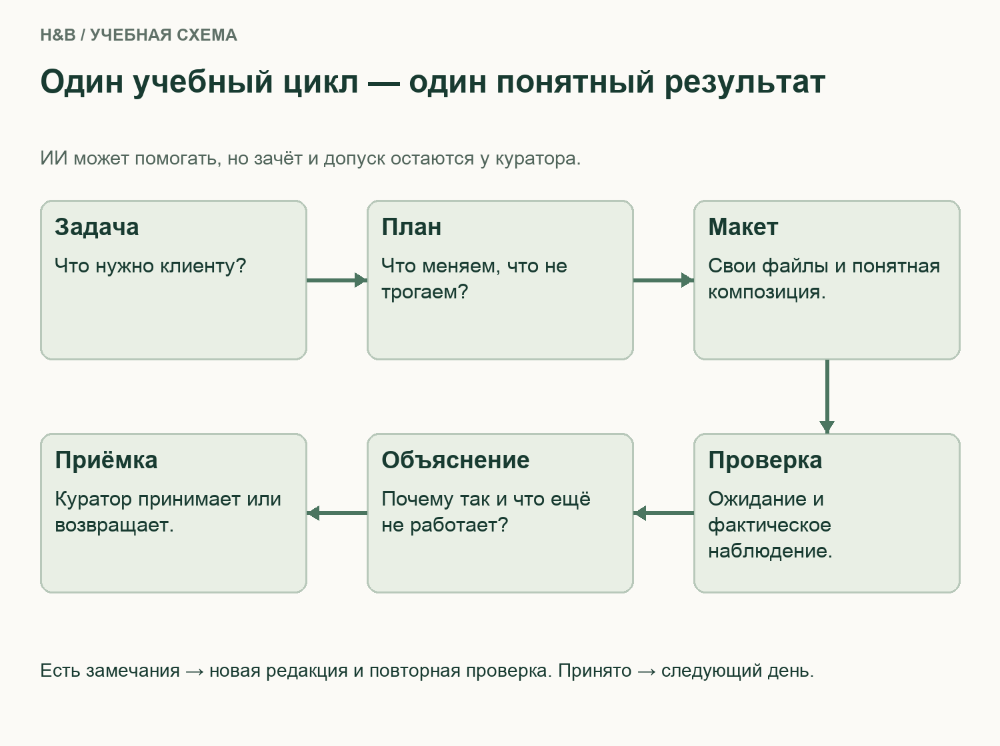

Здесь описывается фактически подготовленная локальная версия, а не будущие функции. В ней есть личный вход, уроки, диалог, один учебный проект, редактор файлов, HTML/CSS preview, подача работы и ручная приёмка. Запуск JavaScript/React, терминал, Git, публикация, внешние уведомления и live-ответы наставника пока не подключены. Это не повод имитировать результат: мы выбираем упражнения, которые уже можно выполнить, а более сложные отмечаем как разбор или следующий технический этап.

### Что ученик видит после входа

У тебя личный ключ, выданный куратором безопасным способом. Его не вставляют в учебные файлы, отчёты или общий чат. Имя профиля в шапке показывает, в чьём пространстве ты работаешь. Слева — дни курса и число принятых работ. В центре — постоянный диалог. В рабочей панели — вкладки «Урок», «Файлы» и «Приёмка».

Не путай вход куратора с входом ученика. Куратор может выбрать Тест или Матвей, чтобы просмотреть и принять работу, но остаётся куратором. Ученику такой переключатель не даёт чужой профиль: ограничения проверяет сервер. Для пробного прохождения используется отдельный тестовый ученик; реальные работы Матвея не подменяются демонстрационными записями.

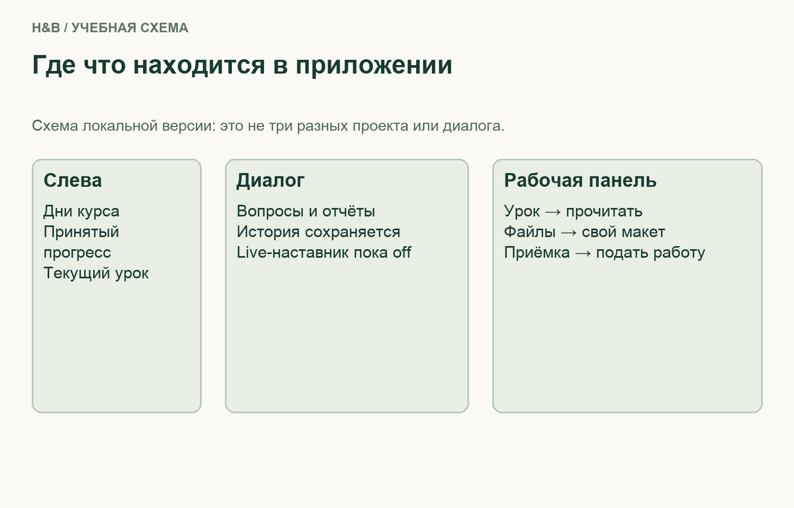

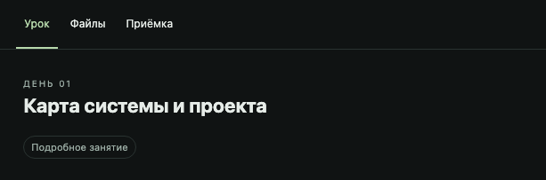

Первый день открыт сразу. Следующий открывается после принятия предыдущего куратором. Отправленное сообщение, нажатие «подать» или мнение модели сами по себе не являются зачётом. Справочную книгу и программу можно читать наперёд; это не меняет статус практических дней.

### Разобранный пример 22.1. От маленького брифа к первому экрану

Вот **полный учебный бриф**, не требующий поиска дополнительного клиента. Вымышленный бренд FORMA помогает подобрать предметы для спокойного рабочего места. Посетитель хочет убрать визуальный шум и понять, с чего начать. Главный текст — «Рабочее место без лишнего». Пояснение — «Подберём свет и предметы под ваши привычки». Основное действие — «Подобрать комплект». Характер спокойный, предметный, без яркой рекламной суеты. Пока нужен только статический первый экран; каталог, отправка заявки и оплата не входят.

Сначала разберём решение словами. Заголовок занимает главное место, потому что объясняет обещание. Пояснение отвечает, что именно предлагает бренд. Одна основная кнопка даёт следующий шаг; рядом не нужна группа одинаково громких действий. Декоративная область передаёт идею рабочего пространства, но не содержит чужой фотографии и не изображает готовую 3D-сцену. На узком экране порядок становится вертикальным: предложение → пояснение → действие → визуальный блок.

Так может выглядеть **задание будущему наставнику**, когда live-подключение будет готово:

```text
Я учусь делать прототипы в своём проекте.
Задача: статический первый экран FORMA по приведённому брифу.
Сначала объясни структуру и два возможных расположения,
не создавай весь сайт вместо меня.
Разрешены только examples/hero.html и examples/hero.css.
Нельзя менять ядро, другие проекты и добавлять интеграции.
Критерии: главное предложение понятно, один основной CTA,
читаемые строки, узкое расположение без обрезания.
Не утверждай, что проверки выполнены, пока я их не проведу.
```

**Сейчас это разобранный учебный образец задания, а не запись настоящего ответа live-ИИ.** В текущей версии сообщение сохранится в диалоге, но отключённая модель не ответит. Готовый пример кода ниже предоставлен книгой; его можно изучить и повторить без работающей модели.

### Шаг 1. Открой свой проект

Во вкладке «Файлы» посмотри, создан ли проект. Если нет, укажи название «FORMA — учебная композиция» и нажми «Создать проект». Если проект уже есть, используй его: приложение рассчитано на один проект на ученика, а не на создание нового после каждого урока. Разные примеры можно хранить в отдельных подпапках внутри своего проекта.

Слово `examples` ниже — обычная папка для учебных примеров. Путь `examples/hero.html` означает: внутри твоего проекта найти папку `examples`, а в ней файл `hero.html`. В редакторе можно ввести такой путь при сохранении — это не путь ко всему компьютеру. Не добавляй к нему домашний каталог, `.hermes` или имя студийного репозитория.

### Шаг 2. Сохрани весь HTML

В поле «Путь внутри своего проекта» введи `examples/hero.html`. В «Содержимое файла» помести код целиком и нажми «Сохранить файл».

```html
<!doctype html>
<html lang="ru">
<head><meta charset="utf-8"><title>FORMA — первый экран</title></head>
<body>
  <main class="hero" aria-labelledby="hero-title">
    <div class="hero-copy">
      <p class="eyebrow">FORMA / рабочее пространство</p>
      <h1 id="hero-title">Рабочее место без лишнего</h1>
      <p class="description">
        Подберём свет и предметы под ваши привычки.
      </p>
      <button type="button">Подобрать комплект</button>
      <p class="status">Учебный макет: отправка не подключена.</p>
    </div>
    <div class="hero-scene" aria-label="Условная сцена предметов">
      <span class="scene-label">Меньше шума. Больше внимания.</span>
    </div>
  </main>
</body>
</html>
```

Здесь две крупные части: `hero-copy` с объяснением и `hero-scene` с визуальной областью. Названия классов — наши метки, по которым CSS найдёт нужные элементы. Они не создают внешний вид автоматически. Текст `aria-label` помогает назвать декоративную область, но не является фотографией или доказательством доступности всей страницы.

### Шаг 3. Сохрани весь CSS

В том же редакторе создай `examples/hero.css`. Это второй файл, не замена HTML. Скопируй весь набор правил:

```css
* { box-sizing: border-box; }
body { margin: 0; font-family: Arial, sans-serif; }
.hero {
  display: grid;
  grid-template-columns: 3fr 2fr;
  gap: 32px;
  padding: 36px;
  background: #f5f2eb;
  color: #183b31;
}
.hero-copy { min-width: 0; }
.eyebrow { font-size: 12px; letter-spacing: 1px; }
h1 { font-size: 38px; line-height: 1.1; margin: 20px 0; }
.description { font-size: 18px; line-height: 1.5; }
button {
  padding: 14px 20px;
  background: #183b31;
  color: #ffffff;
  border: 0;
  font: inherit;
  cursor: pointer;
}
button:focus-visible { outline: 3px solid #a45a20; outline-offset: 4px; }
.status { font-size: 12px; line-height: 1.5; }
.hero-scene {
  min-height: 260px;
  padding: 24px;
  border-radius: 28px;
  background: linear-gradient(145deg, #d2d9c7, #e9e2d4);
  display: flex;
  align-items: flex-end;
}
.scene-label { max-width: 15ch; font-size: 24px; line-height: 1.2; }
@media (max-width: 640px) {
  .hero { grid-template-columns: 1fr; padding: 24px; gap: 24px; }
  h1 { font-size: 30px; }
  .hero-scene { min-height: 180px; }
}
```

`3fr 2fr` делит доступное место на две доли заданного отношения; это не фиксированные пиксели. `gap` оставляет пространство между частями. Медиаправило меняет количество колонок при небольшой ширине **самого предпросмотра**. Градиент — собственный простой фон, не загруженная картинка. В этом примере нет внешнего шрифта, видео, сети или скрытой зависимости.

### Шаг 4. Соедини файлы в preview

В блоке «Безопасный предпросмотр» укажи HTML-файл `examples/hero.html` и CSS-файл `examples/hero.css`, затем нажми «Обновить preview». В обычной веб-странице CSS часто подключается через `link`; в ограниченном текущем preview он подключается именно отдельным полем. Поэтому отсутствие `link` в примере — сознательное соответствие инструменту, а не забытая строка.

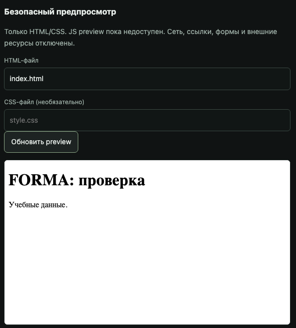

Ниже — **реально отрисованный результат кода этой главы** через ограниченный preview приложения на временном тестовом профиле. Это не результат работы ученика и не картинка вместо выполненной проверки: исходные HTML/CSS сохранены через API, затем проверены расположение колонок, отсутствие горизонтального переполнения и фокус кнопки.

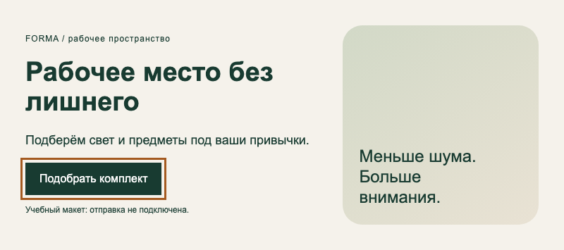

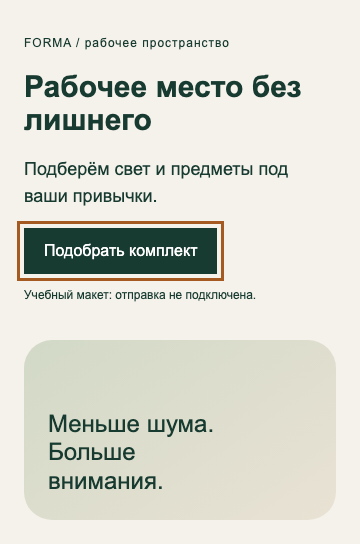

Ожидаемый вид: на широкой области текст и спокойная сцена стоят рядом, в узкой — друг под другом. Фактическая ширина iframe может отличаться от ширины всего окна: приложение само занимает место боковыми панелями. Если нужен точный числовой размер, измеряй область предпросмотра средствами браузера, а не называй ширину всей оболочки шириной макета. Для первого упражнения достаточно явно сравнить широкое и узкое расположение и записать, как ты это делал.

Если стили не видны, сначала проверь сохранение CSS, точность пути и заполнение CSS-поля. Не начинай с переустановки системы. Если файл не сохраняется из-за отказа доступа, не ищи обход через чужой каталог: сохрани безопасное описание ошибки и передай куратору.

### Шаг 5. Проверь смысл, вид и границы

Проверка не сводится к «красиво». Прочитай заголовок без пояснений: понятно ли обещание? Найди единственное основное действие. Сузь область: нет ли обрезанных строк и выхода кнопки за блок? Перейди клавишей Tab: видно ли фокус? Затем замени заголовок на заведомо более длинный и проверь переносы; это тест содержания, а не новое требование к бренду.

В этом макете кнопка не отправляет заявку и не ведёт в каталог. Её внешний вид и фокус можно проверить, получение заявки — нельзя. Статический preview не предназначен для выполнения JavaScript или подключения сервисов. Правильный результат такого задания — **проверенный статический фрагмент**, а не «полностью работающий магазин».

### Шаг 6. Объясни и подай работу

Во вкладке «Урок» заполни поля приёмки. Критерий можно назвать `HERO-01`. Способ проверки — то, что ты действительно сделал. Ожидание формулируется до наблюдения. В факте опиши свой результат, а не копируй ожидаемую фразу из книги как якобы произошедшее событие. В собственном объяснении укажи, почему выбрал такой порядок и что пока не работает.

При подаче сохраняется снимок файлов. Поздняя правка не переписывает уже поданный снимок. Если куратор вернул работу, прочитай замечание, измени нужный фрагмент, повтори проверки и подай новую попытку. Так мы учимся доводить задачу до согласованного результата, а не останавливаться на первом ответе модели.

После принятия обнови прогресс. Открытый следующий день — решение о прохождении текущей практики, не разрешение на клиентские ключи или публикацию. Отдельная итоговая аттестация остаётся у куратора.

### Упражнение 22.1. Повтори цикл для другого клиента

Полный бриф: мастерская «Тихая керамика» проводит небольшие занятия для начинающих. Заголовок «Первый предмет, сделанный своими руками», пояснение «Спокойное знакомство с глиной в небольшой группе», действие «Выбрать занятие». Характер тёплый, тактильный, без ощущения технологического магазина. Фоновая пара цветов для упражнения `#f8f0e6` и `#dfc3aa`, цвет текста и кнопки `#4b2f26`. Это заданная палитра упражнения, не универсальный стандарт.

Возьми **тот же полный пример** HTML/CSS. Сохрани новые файлы `examples/ceramics.html` и `examples/ceramics.css`, поменяй содержание и заданную палитру, сохрани смысловую иерархию и адаптивный переход. Измени подпись визуального блока на собственную короткую фразу. Покажи preview с двумя правильными путями и подготовь объяснение, какие решения действительно адаптированы под клиента. Не добавляй оплату, расписание из сети или чужие фотографии.

### Разобранный пример 22.2. Одна правка после замечания

Куратор смотрит первый экран FORMA из примера и просит немного уменьшить заголовок только в узком расположении. Мы не меняем тексты, не перестраиваем весь сайт и не добавляем новую функцию. В готовом CSS уже есть нужный медиаблок. Было:

```css
@media (max-width: 640px) {
  .hero { grid-template-columns: 1fr; padding: 24px; gap: 24px; }
  h1 { font-size: 30px; }
  .hero-scene { min-height: 180px; }
}
```

Заменяем только правило `h1` внутри этого блока:

```css
@media (max-width: 640px) {
  .hero { grid-template-columns: 1fr; padding: 24px; gap: 24px; }
  h1 { font-size: 28px; line-height: 1.2; }
  .hero-scene { min-height: 180px; }
}
```

Разбор результата: условие узкой области не меняется, порядок блоков сохраняется, размер заголовка уменьшается, высота строки задана явно. После записи снова обновляем preview и проверяем переносы и кнопку. Этот вариант отдельно прогнан на временном проекте через настоящий предпросмотр: при узкой ширине применён размер 28px, горизонтального переполнения не найдено. Это свидетельство для приведённого примера, а не автоматически заполненная проверка твоего нового макета.

### Упражнение 22.2. Доведи после замечания, не выходя за ТЗ

Дано замечание к твоему керамическому макету: «На узкой области длинный заголовок занимает слишком много места; уменьши размер и оставь основную кнопку заметной. Расписание и отправку не добавляем». Сделай одну связанную правку в CSS узкого расположения, проверь исходный и длинный заголовки и составь отчёт. Если доступа к приложению пока нет, напиши план и отметь факт как непроверенный; успешное выполнение не придумывай.

## Словарь: 100 терминов для ежедневной работы

Термины ниже объясняют смысл в контексте курса. Определение не является разрешением выполнять действие в основной системе.

1. **Файл** — именованное содержимое на диске: текст, код, изображение или другой материал.
2. **Каталог / папка** — место группировки файлов и вложенных каталогов.
3. **Путь** — описание расположения файла относительно выбранной исходной точки или корня.
4. **Абсолютный путь** — путь от корня файловой системы; на другом компьютере он может отличаться.
5. **Относительный путь** — путь от текущей папки или другого определённого источника отсчёта.
6. **Расширение** — окончание имени файла, помогающее обозначить ожидаемый вид содержимого.
7. **Исходный код** — редактируемые инструкции, из которых создаётся или запускается программа.
8. **Проект** — ограниченная система кода, данных, конфигурации, инструкций и проверок.
9. **Репозиторий** — хранилище проекта с историей изменений, если используется система контроля версий.
10. **Git** — система контроля версий для сравнения, сохранения и совместной работы с изменениями.
11. **Коммит** — зафиксированное состояние изменений с пояснением их смысла.
12. **Ветка** — именованная линия разработки; в H&B действуют собственные правила работы с ветками.
13. **Diff** — представление отличий между двумя выбранными состояниями файлов.
14. **Индекс Git** — подготовленный набор изменений для следующего коммита.
15. **Конфликт** — ситуация, когда изменения нельзя объединить без содержательного решения.
16. **README** — инструкция о назначении, запуске и использовании конкретного проекта.
17. **Зависимость** — подключённый пакет чужого кода, необходимый проекту или его разработке.
18. **Пакет** — распространяемая единица кода и связанной информации с определённой версией.
19. **Менеджер пакетов** — инструмент установки и учёта зависимостей, например npm.
20. **Lockfile** — файл, фиксирующий разрешённые версии зависимостей для воспроизводимой установки.
21. **Конфигурация** — параметры и правила работы приложения или инструментов проекта.
22. **Build / сборка** — подготовка исходников к запуску или публикации установленным способом.
23. **Runtime** — среда и этап фактического исполнения программы.
24. **CLI** — способ управления программой через команды и текстовый вывод.
25. **Терминал** — интерфейс работы с командными программами; не равен разрешению выполнять любую команду.
26. **Браузер** — клиентское приложение, получающее и отображающее веб-ресурсы.
27. **Клиент** — сторона взаимодействия, которая обращается за услугой или данными.
28. **Сервер** — программа, отвечающая на запросы; иногда так называют и машину, где она работает.
29. **Хост** — компьютер или узел, на котором размещена программа или сетевой сервис.
30. **Домен** — удобное человеку сетевое имя, используемое для обращения к ресурсу.
31. **DNS** — система разрешения доменных имён и связанных с ними записей.
32. **IP-адрес** — сетевой адрес узла; не является паролем или доказательством доступности приложения.
33. **Порт** — номер сетевой точки обслуживания на узле, например для веб-сервера.
34. **URL** — адрес ресурса с указанием схемы, узла и других частей обращения.
35. **HTTP** — протокол обмена запросами и ответами между веб-участниками.
36. **HTTPS** — HTTP поверх защищённого соединения; не гарантия честности самого сайта.
37. **Запрос** — обращение клиента с методом, адресом, заголовками и возможным телом.
38. **Ответ** — результат обработки запроса, включающий статус, заголовки и возможное содержимое.
39. **HTTP-статус** — код категории результата запроса; требует интерпретации вместе с контрактом.
40. **JSON** — текстовый формат представления данных, а не исполняемый объект JavaScript.
41. **HTML** — язык смысловой структуры и содержимого веб-страницы.
42. **Тег / элемент** — запись и структурная единица разметки, задающая часть документа.
43. **Атрибут** — дополнительное свойство HTML-элемента, например язык или подпись.
44. **Семантика** — соответствие элемента его смысловому назначению, а не только внешнему виду.
45. **DOM** — программное представление структуры документа, доступное браузерному коду.
46. **CSS** — язык правил внешнего представления и расположения элементов.
47. **Селектор** — способ выбора элементов, к которым применяется CSS-правило.
48. **Класс** — именованная метка для обращения к группе элементов, в частности из CSS.
49. **Каскад** — механизм согласования конкурирующих правил оформления.
50. **Box model** — модель содержимого, внутренних отступов, границы и внешних отступов блока.
51. **Flexbox** — механизм CSS для расположения элементов вдоль выбранного направления.
52. **Grid** — механизм CSS для организации строк и столбцов макета.
53. **Адаптивность** — перестройка интерфейса под доступное место и условия использования.
54. **Breakpoint** — условная граница, при которой правила представления меняются.
55. **JavaScript** — язык программирования, применяемый в браузере и других средах выполнения.
56. **Переменная** — именованная связь с используемым программой значением.
57. **Тип** — описание категории или допустимой формы значения.
58. **Условие** — правило выбора между вариантами выполнения программы.
59. **Функция** — именованная или передаваемая операция с входом и возможным результатом.
60. **Аргумент** — конкретное значение, переданное функции при вызове.
61. **Объект** — набор связанных свойств, описывающих сущность или состояние.
62. **Массив** — упорядоченная коллекция элементов для хранения и преобразования списков.
63. **Идентификатор** — значение, устойчиво обозначающее сущность независимо от положения на экране.
64. **Событие** — произошедшее действие, например клик, ввод или завершение операции.
65. **Promise** — представление будущего результата асинхронной операции.
66. **async / await** — синтаксис организации работы с асинхронным результатом.
67. **Ошибка / exception** — сигнал о невозможности продолжить действие обычным выбранным путём.
68. **TypeScript** — язык на основе JavaScript с описанием типов и проверкой части соответствий до выполнения.
69. **React** — библиотека построения интерфейса из компонентов.
70. **Компонент** — выделенная часть интерфейса с понятной ответственностью и входными данными.
71. **Props** — входные данные React-компонента, переданные его вызывающей стороной.
72. **State** — изменяемое состояние, от которого зависит поведение или отображение компонента.
73. **Рендер** — получение представления интерфейса из текущих данных и состояния.
74. **API** — договор и средства взаимодействия между частями программной системы.
75. **Endpoint** — конкретная точка API для согласованного действия или ресурса.
76. **Валидация** — проверка значения по формату, ограничениям и правилам конкретной границы.
77. **Аутентификация** — установление того, кто обращается к системе.
78. **Авторизация** — проверка того, какие действия этому участнику разрешены.
79. **Токен** — значение для подтверждения доступа; секретный токен нельзя публиковать или вставлять в учебный отчёт.
80. **Песочница** — реально ограниченная среда выполнения; не просто отдельная папка или кнопка с замком.
81. **База данных** — организованное хранилище с правилами чтения, изменения и сохранения информации.
82. **SQL** — язык описания и обработки данных в реляционных системах.
83. **Первичный ключ** — поле или набор полей, однозначно определяющий строку таблицы.
84. **Внешний ключ** — ограничение согласованной ссылки между связанными записями.
85. **Транзакция** — объединение связанных изменений в подтверждаемое или отменяемое действие.
86. **Миграция** — согласованное изменение схемы данных с учётом существующих записей.
87. **Идемпотентность** — свойство согласованного повтора действия не создавать нежелательный новый эффект.
88. **Webhook** — доставка события от одной системы обработчику другой по установленному договору.
89. **UI** — пользовательский интерфейс: видимые элементы и средства взаимодействия.
90. **UX** — опыт решения пользовательской задачи через продукт и его сценарии.
91. **Дизайн-токен** — согласованное именованное значение оформления, например цвет или отступ.
92. **Доступность** — возможность пользоваться продуктом при различных способностях и способах взаимодействия.
93. **Фокус** — текущий элемент управления для клавиатурного взаимодействия, который нужно ясно обозначать.
94. **ТЗ** — согласованные требования, границы и условия проверки результата.
95. **Оркестратор** — координатор последовательности работы моделей, ролей и разрешённых инструментов.
96. **QA** — деятельность по обеспечению и проверке качества относительно требований и рисков.
97. **Регрессия** — нарушение ранее работавшего поведения после изменения.
98. **Отладка** — поиск и подтверждённое устранение причины наблюдаемого дефекта.
99. **Deployment / публикация** — размещение согласованной версии в целевой среде с последующей проверкой.
100. **Production** — рабочая среда с настоящими пользователями и ответственностью; не просто разблокированный режим интерфейса.

## Sources

[1] https://developer.mozilla.org/en-US/docs/Learn_web_development/Getting_started/Environment_setup/Dealing_with_files — MDN: files and paths
[2] https://docs.npmjs.com/cli/v11/configuring-npm/package-json — npm: package.json
[3] https://developer.mozilla.org/en-US/docs/Web/HTTP/Guides/Overview — MDN: HTTP overview
[4] https://developer.mozilla.org/en-US/docs/Learn_web_development/Howto/Web_mechanics/How_does_the_Internet_work — MDN: Internet and DNS
[5] https://developer.mozilla.org/en-US/docs/Learn_web_development/Getting_started/Your_first_website/Creating_the_content — MDN: HTML basics
[6] https://developer.mozilla.org/en-US/docs/Learn_web_development/Core/Styling_basics/Box_model — MDN: CSS box model
[7] https://developer.mozilla.org/en-US/docs/Learn_web_development/Core/CSS_layout/Responsive_Design — MDN: responsive design
[8] https://developer.mozilla.org/en-US/docs/Web/API/Document_Object_Model/Introduction — MDN: DOM introduction
[9] https://developer.mozilla.org/en-US/docs/Web/JavaScript/Guide/Grammar_and_types — MDN: JavaScript grammar and types
[10] https://developer.mozilla.org/en-US/docs/Web/JavaScript/Guide/Functions — MDN: functions
[11] https://developer.mozilla.org/en-US/docs/Web/JavaScript/Guide/Indexed_collections — MDN: indexed collections
[12] https://developer.mozilla.org/en-US/docs/Web/JavaScript/Guide/Using_promises — MDN: promises
[13] https://developer.mozilla.org/en-US/docs/Web/API/Fetch_API/Using_Fetch — MDN: Fetch API
[14] https://www.typescriptlang.org/docs/handbook/2/everyday-types.html — TypeScript: everyday types
[15] https://react.dev/learn — React: Quick Start
[16] https://cheatsheetseries.owasp.org/cheatsheets/Input_Validation_Cheat_Sheet.html — OWASP: input validation
[17] https://www.postgresql.org/docs/current/ddl-basics.html — PostgreSQL: tables
[18] https://www.postgresql.org/docs/current/tutorial-transactions.html — PostgreSQL: transactions
[19] https://docs.stripe.com/webhooks — Stripe: webhooks
[20] https://www.w3.org/WAI/tutorials/page-structure — W3C WAI: page structure
[21] https://www.w3.org/WAI/tutorials/forms — W3C WAI: forms
[22] https://developer.mozilla.org/en-US/docs/Web/CSS/@media/prefers-reduced-motion — MDN: reduced motion
[23] https://playwright.dev/docs/best-practices — Playwright: best practices
[24] https://vite.dev/guide/build — Vite: production build
[25] https://git-scm.com/docs/git-diff — Git: git diff
[26] https://www.postgresql.org/docs/current/ddl-constraints.html — PostgreSQL: constraints
[27] https://www.awwwards.com — Awwwards
[28] https://recent.design/?ref=godly — Recent / бывший Godly
[29] https://www.siteinspire.com — Siteinspire
[30] https://onepagelove.com — One Page Love
[31] https://httpster.net — Httpster
[32] https://minimal.gallery — Minimal Gallery
[33] https://curated.design — Curated
[34] https://www.hoverstat.es — HOVERSTAT.ES
[35] https://gsap.com/showcase — GSAP Showcase
[36] https://community.spline.design — Spline Community
[37] https://www.youtube.com/watch?v=-8ScOuQbEoU — Композиция за 30 минут! Это изменит твой дизайн навсегда!
[38] https://www.youtube.com/watch?v=gb6jS8Kjtz4 — Как построить сетку. Графический дизайн, ч1
[39] https://www.youtube.com/watch?v=QjrYGysBKv8 — Как создаются дизайн-концепции сайтов в студии? На примере реального пресейла | Практика #10
[40] https://www.youtube.com/watch?v=0cbngt-MFsE — Понедельничные референсы #67 (Разбор сайтов, web-design, UX/UI, Figma) вайбкодинг, исследования
[41] https://www.youtube.com/watch?v=X7IBa7vZjmo — Introducing ScrollTrigger for GSAP
[42] https://www.youtube.com/watch?v=Kxz8fzU2OUE — New to Spline? Watch This First! An Introduction to Spline 3D | Beginners Tutorial
[43] https://developer.mozilla.org/en-US/docs/Web/API/WebGL_API — MDN: WebGL
[44] https://developer.mozilla.org/en-US/docs/Web/CSS/Reference/Properties/position — MDN: position and sticky
[45] https://developer.mozilla.org/en-US/docs/Web/HTML/Reference/Elements/video — MDN: video element
[46] https://gsap.com/docs/v3/Plugins/ScrollTrigger — GSAP: current ScrollTrigger documentation
[47] https://web.dev/learn/design — web.dev: Learn Responsive Design
[48] https://developer.mozilla.org/en-US/docs/Web/CSS/Guides/Transitions/Using — MDN: CSS transitions (source capture in revision-v2/design/source-notes.md)


## Ответы и разборы упражнений

Сначала выполните свою попытку, затем сверяйте ход решения. В открытых задачах оценивается связь с брифом и качество проверки. Книга не заполняет за вас фактические результаты непроведённого теста.

### Ответ 1.1. Пройти по новому дереву

В условии дерево имеет корень `forma/`. Для каждого ответа сначала фиксируем базу — папку, относительно которой считаем маршрут. Имя исходного файла не является дополнительной папкой: из `delivery.html` не требуется ещё один подъём «наружу из файла».

**1. Из папки `pages/help/` к `styles/catalog.css`: `../../styles/catalog.css`.** Первый `..` поднимает из `help` в `pages`, второй — из `pages` в корень проекта `forma`. Только затем можно спуститься в соседнюю корневую папку `styles` и выбрать `catalog.css`.

```text
forma/pages/help/
  ..  → forma/pages/
  ..  → forma/
  styles/catalog.css → forma/styles/catalog.css
```

Вариант `../styles/catalog.css` неверен для этой базы: он потребовал бы `forma/pages/styles/catalog.css`, которого в условии нет.

**2. Из папки `pages/help/` к `pages/catalog.html`: `../catalog.html`.** Поднимаемся из `help` в `pages` и выбираем файл, уже лежащий там. Повторять слово `pages` после этого подъёма не нужно: `../pages/catalog.html` означало бы вложенную папку `pages/pages`.

```text
forma/pages/help/
  .. → forma/pages/
  catalog.html → forma/pages/catalog.html
```

**3. Из папки `styles/` к `data/products.json`: `../data/products.json`.** Один подъём приводит в `forma`, откуда выбираем `data`, затем `products.json`.

```text
forma/styles/
  .. → forma/
  data/products.json → forma/data/products.json
```

**4. От корня проекта к странице доставки: `pages/help/delivery.html`.** Начинаем уже в `forma`, поэтому не пишем ни начальный подъём, ни имя `forma` повторно. Допустим также явный вариант `./pages/help/delivery.html`: начальная точка оставляет нас в той же базе. Условие просит путь без начальной `/`; это не абсолютный файловый путь и не путь от корня сайта.

**5. Относительный путь зависит от базы.** Из `forma/styles/` строка `../data/products.json` приводит к `forma/data/products.json`. Из `forma/pages/help/` та же строка приводит к `forma/pages/data/products.json`. Во втором случае такой папки нет в заданном дереве. Текст пути совпадает, но отправная точка разная, поэтому разный и итоговый адрес.

Ожидаемый результат упражнения — четыре правильно записанных пути и объяснение зависимости от базы. Загружать изображения, открывать ссылки и выполнять сетевые запросы для этой проверки не требуется.

### Ответ 1.2. Изменить только разрешённое

Чтение — открыть `practice-brief.md`, прочитать `practice-title.html`, посмотреть полученный исходник после замены. Запись при подготовке — первоначально создать два новых разрешённых файла. Запись при выполнении самой правки — заменить текст внутри `h1` в `practice-title.html`. Открытие предпросмотра не редактирует сохранённую заметку и не является разрешением её менять.

Заметку читаем как условие работы. Не добавляем её текст в страницу и не «улучшаем формулировки» в ней: это вышло бы за границы задания. Если имена файлов были заняты, первоначальное создание нельзя выполнять через перезапись чужой или прежней работы; сначала нужны согласованные свободные имена.

Итоговый `practice-title.html` целиком:

```html
<!doctype html>
<html lang="ru">
<head>
  <meta charset="utf-8">
  <title>FORMA — учебная витрина</title>
</head>
<body>
  <h1>Предметы для спокойной работы</h1>
  <p>Все товары в этом примере вымышлены.</p>
</body>
</html>
```

В предпросмотре выбран именно этот HTML-файл. Ожидаем видимый заголовок «Предметы для спокойной работы» и абзац «Все товары в этом примере вымышлены.». CSS не задан и для подтверждения текстовой замены не нужен. Не обещаем определённый шрифт, цвет или расстояние: упражнение не задаёт оформление.

Проверяем, что осталось прежним:

- `title` содержит «FORMA — учебная витрина»;
- абзац содержит исходный текст без изменений;
- структура документа, язык и кодировка не менялись;
- `practice-brief.md` содержит исходные четыре строки и не редактировался после создания;
- дополнительные файлы, настройки и подключения не создавались в ходе правки.

Если на экране старый заголовок, сначала проверяем выбор HTML-файла и факт сохранения. Это ещё не повод менять другие файлы. Если на экране всё верно, но в исходнике изменён ещё и `title`, задание выполнено не полностью: внешний результат не отменяет нарушение ограничения на запись.

### Ответ 2.1. Прочитать другой полный манифест

**1. Объявлены ровно три сценария.** Их имена и значения:

```text
dev     → vite --host 127.0.0.1
build   → vite build --outDir public-build
preview → vite preview --port 4175
```

Слева — ключи внутри `scripts`, справа — строки команд. Например, `preview` — не имя установленного пакета; в данном файле оно выбирает действие инструмента `vite`. `--port 4175` относится к команде просмотра, а не к DNS и не к имени папки.

**2. `npm run build` выбрал бы `vite build --outDir public-build`.** В подготовленной внешней среде npm прочитал бы значение ключа `build`. По учебному условию параметр `--outDir` задаёт папку результата, поэтому ответ — `public-build`. Нельзя автоматически ответить `dist` только потому, что такое имя встречалось в другом примере: здесь настройка явно другая.

Это объяснение манифеста, а не подтверждение запуска. В текущем учебном приложении терминала нет; сохранять JSON разрешено, выполнять записанную строку через него нельзя.

**3. Сценарий `test` не объявлен.** Среди ключей `scripts` его нет. Следовательно, этот файл не задаёт явного сценария `npm run test`. Но по одному манифесту нельзя утверждать «тестов вообще не существует»: могли быть файлы проверок, другой инструмент или отдельный процесс команды. Правильная формулировка: «В предоставленном манифесте тестовый сценарий отсутствует; наличие и способ выполнения других проверок неизвестны».

**4. В `dependencies` находится `dayjs` версии `1.11.13`.** По условию его использует код приложения для работы с датами. В `devDependencies` находится `vite` версии `5.4.0`, инструмент разработки и сборки. Версии относятся к соответствующим пакетам, не к версии самого проекта: у проекта отдельно задано `1.1.0`.

Разделы различаются назначением пакетов. Неправильно утверждать, что весь список `dependencies` браузер обязан скачать отдельными файлами, а `devDependencies` никогда не влияет на выходной результат. Как исходники будут обработаны и переданы посетителю, зависит от устройства проекта.

**5. `private: true` не является входом по паролю.** Эта настройка предотвращает случайную публикацию пакета средствами npm. Она не реализует страницу входа, проверку пользователя или ограничение доступа к каталогу. Для утверждения о защищённом магазине нужны отдельные механизмы и проверки. В данном упражнении таких сведений нет.

### Ответ 2.2. Отделить доказанное от обещанного

Точные соответствия из предоставленного JSON:

```text
npm run build   → vite build
npm run test    → vitest run
npm run preview → vite preview
```

Объявление третьей команды не означает, что её выполнили. Отчёт прямо говорит обратное. Нельзя заменять этот факт предположением «раз сборка есть, preview наверняка работает».

Корректный итоговый текст, например:

> По предоставленному отчёту сборка завершилась без ошибки и создала `dist`. Два теста суммы корзины прошли. В обычном браузере на адресе сервера разработки виден заголовок. Просмотр собранного результата через `preview` не запускался; добавление товара не проверялось. Приёмка всего магазина пока не подтверждена.

В реальной передаче работы полезно приложить безопасные журналы и адрес проверенной среды. Здесь мы анализируем вымышленный отчёт, поэтому не выдаём его за собственное выполнение команд.

Подтверждённые в условии факты:

1. Указанная сборка закончилась без ошибки и дала выходную папку.
2. Два конкретных теста расчёта суммы прошли.
3. В браузере открывали адрес сервера разработки, и там был виден заголовок.

Оставшиеся проверки можно сформулировать так:

1. В подготовленной внешней среде запустить просмотр собранного результата и открыть именно его адрес.
2. Проверить загрузку нужных ресурсов в этой версии, а не только существование папки `dist`.
3. Проверить действие добавления товара: изменение количества, суммы и видимого состояния корзины.
4. Проверить поведение при пустом каталоге и ошибке получения данных.
5. Проверить согласованные требования к экрану, например читаемость на узкой ширине и доступность управления клавиатурой.

Для ответа достаточно минимум трёх конкретных оставшихся проверок. Важно не подменять их общей фразой «проверить всё». Два теста суммы защищают только закодированные ожидания; они не подтверждают каждую кнопку и каждый сетевой исход.

Адрес сервера разработки связан с обработкой исходников в режиме разработки. `preview` в данном проекте предназначен для просмотра подготовленного результата. Разные источники ресурсов и режимы могут проявить разные ошибки, поэтому открытие одного адреса не служит доказательством открытия другого. Более того, кнопка HTML/CSS-предпросмотра учебного приложения не запускает ни `vite`, ни `vite preview`.

### Ответ 3.1

Подпись кнопки соответствует буквальному запросу. Правка примечания меняет обещание о работе с контактами и добавляет не согласованную клиентом рассылку; её нельзя молча принять как часть переименования. Следует остановить эту часть правки и уточнить требование у куратора. Diff показывает изменение текста, но не доказывает отправку формы, доставку подборки или заметность элемента. Хороший ответ отделяет три разных факта: изменён код, проверено поведение, согласовано бизнес-решение.

### Ответ 4.1. Прочитать создание записи

**1. Метод — `POST`, путь — `/api/demo-carts`.** По заданному контракту действие создаёт демонстрационную корзину. Это не чтение списка товаров и не платёж. Не добавляем смысл, которого нет в договорённости API.

**2. `Content-Type: application/json` относится к телу самого запроса.** Клиент сообщает: «я отправляю JSON». `Accept: application/json` относится к желаемому формату ответа: «хочу получить JSON». Совпадение значений не делает заголовки взаимозаменяемыми.

**3. Передан товар `stand-demo` в количестве `2`.** Это видно внутри массива `items` в теле запроса. В ответе сервер вернул идентификатор корзины `cart-demo-17`. Идентификатор товара и идентификатор корзины — разные сущности. Нельзя назвать корзину `stand-demo`, потому что это значение поля `productId`, а не поля `id` ответа.

**4. `201 Created` сообщает о создании ресурса.** Заголовок `Location` указывает путь `/api/demo-carts/cart-demo-17`, связанный с созданной корзиной. Этот путь в сообщении не требует от ученика нажимать ссылку и не доказывает наличие отдельного файла на диске.

Допустимое сообщение интерфейса:

> Демонстрационная корзина создана. В ней 2 единицы товара `stand-demo`. Оплата не выполнялась.

Можно использовать более короткую формулировку, если она сохраняет смысл. Недопустимы «Заказ оплачен» и «Доставка оформлена»: для них в показанном обмене нет оснований. Также не нужно обещать успешное последующее открытие корзины, если отдельный запрос ещё не проверяли.

**5. По `/api` нельзя узнать количество компьютеров.** Это часть пути в обращении к программе. Та же программа может обслуживать страницу и API; возможен и другой вариант устройства системы. Показанный запрос не сообщает, на каких физических машинах выполняется обработка.

### Ответ 4.2. Четыре независимых исхода

Во всех случаях после нажатия сначала показываем «Загружаем товары…». Дальше рассматриваем каждый исход независимо: не переносим удачный результат A в B и не сохраняем бесконечную загрузку вместо завершения.

#### A — получен корректный пустой список

`receivedHttpResponse` равно `true`, статус — `200`, тип — `application/json`, в теле есть массив `items`. Массив пуст. Все условия успешного получения списка выполнены.

Конечное состояние — **empty**, не **error**. Сообщение: «По выбранным условиям ничего не найдено». Разумное действие — изменить или сбросить фильтр. Этот ответ позволяет утверждать отсутствие совпадений в рамках данного запроса, но не отсутствие всех товаров магазина навсегда.

```text
нажатие → loading → 200 + нужный JSON + [] → empty
```

#### B — сервер сообщил временную недоступность

HTTP-ответ получен, статус — `503`. Тело содержит код ошибки, а не подтверждённый список. Не заменяем его на `items: []`: это придумало бы данные, которых сервер не передал.

Конечное состояние — **error**. Сообщение: «Сервис временно недоступен. Попробуйте позже». Разумное действие — ограниченный повтор после ожидания, а не бесконечная отправка запросов без паузы. При наличии серверного указания времени ожидания его нужно учитывать. В предоставленном JSON такого заголовка нет: конкретный срок не выдумываем.

```text
нажатие → loading → получен 503 → error
```

Наличие или отсутствие товаров по этому исходу неизвестно. Известно только, что список не был успешно получен.

#### C — HTTP-ответ отсутствует

`receivedHttpResponse` равно `false`, статус — `null`, указан сбой разрешения имени `DNS_NAME_NOT_RESOLVED`. Запрос не дошёл до стадии получения HTTP-ответа от нужной службы. Это не `404`, не `500` и не «HTTP-статус null».

Конечное состояние — **error**. Сообщение: «Не удалось связаться с сервисом». Разумно проверить правильность адреса и доступность разрешения имени, сообщить проблему куратору, затем повторить после устранения причины. Не нужно менять разметку товаров или отключать TLS: это не следует из данного признака.

```text
нажатие → loading → сбой DNS, HTTP-статуса нет → error
```

Ничего об ассортименте этот исход не доказывает. Аналогично при отказе TLS до HTTP-обмена нельзя приписывать серверу несуществующий статус; но в данном наборе явно указан именно DNS, поэтому сертификат не объявляем установленной причиной.

#### D — успешный статус, но неподходящее содержимое

HTTP-ответ получен со статусом `200`. Однако `Content-Type` равен `text/html`, а тело — HTML-строка демонстрационной страницы входа. Контракт ожидает JSON-объект с массивом `items`. Полученное представление этому контракту не соответствует.

Конечное состояние — **error**, а не **ready** и не **empty**. Сообщение: «Не удалось прочитать данные каталога: получен неожиданный формат». Разумное действие — сообщить проблему и проверить адрес, перенаправления и правила доступа в подготовленной среде. Нельзя требовать настоящие пароли в учебном упражнении или автоматически вставлять чужой HTML в страницу каталога.

```text
нажатие → loading → 200, но HTML вместо ожидаемого JSON → error
```

Отсутствие товаров не доказано. Заголовок входа в теле может подсказать направление расследования, но не доказывает конкретную причину, например «пароль истёк»: таких данных в условии нет.

#### Пример отчёта куратору

> По заданным данным A успешно вернул пустой список и требует состояния empty. B вернул HTTP 503 и требует состояния ошибки. В C HTTP-ответа нет: указан сбой DNS. В D есть HTTP 200, но пришёл HTML вместо JSON по контракту. Чтобы расследовать реальные случаи, нужны безопасный адрес без секретных параметров, метод, время попытки, наличие или отсутствие HTTP-ответа, статус при его наличии, тип содержимого и минимальный обезличенный фрагмент ответа. Для сбоя до HTTP нужно отдельное сообщение браузера о сетевой причине. Пароли, токены, cookie и реальные данные покупателей в отчёт не включаем.

Все четыре исхода завершают ожидание определённым экраном. Только A даёт основание показать отсутствие совпадений. Нельзя объединять B, C и D с A ради визуально аккуратной страницы: это скрывает проблему и сообщает пользователю неверный факт.

### Ответ 5.1

```html
<section aria-labelledby="restore-title">
  <h1 id="restore-title">Вернём любимой мебели характер</h1>
  <p>Обсудим состояние и предложим варианты восстановления.</p>
  <button type="button">Показать предмет мастеру</button>
</section>
```

ID заголовка совпадает со ссылкой в `aria-labelledby`. Фотография не отправляется: нет выбора файла, обработчика, серверного API и подтверждения доставки. Для текущего статического макета это ожидаемая граница, а не повод заявлять о готовой интеграции. Допускаются другие формулировки объяснения, но не утверждение «кнопка автоматически всё отправит».

### Ответ 6.1

```css
.card {
  display: grid;
  gap: 20px;
  padding: 32px;
  max-width: 420px;
  background: #f3f0e8;
  color: #18352b;
}
.card h2, .card p { margin: 0; }
.card button { padding: 14px 22px; }
```

Первое число в записи кнопки относится к вертикальному направлению, второе — к горизонтальному. `gap` меняет промежутки между заголовком, абзацем и кнопкой; отступ от границы задаёт `padding` карточки. Изменение параметров не доказывает качество на узком экране: нужно посмотреть, не зажалась ли полезная ширина и не возникло ли переполнение.

### Ответ 7.1

```js
function conceptLabel(status) {
  if (status === "saving") {
    return "Сохраняем концепцию…";
  }
  return "Сохранить концепцию";
}
```

Для `saving` действует первая ветка, для `draft` — вторая. Предсказание результата и реальный запуск — разные факты. Слова «не запускал, ожидаю такую строку по разбору функции» являются корректным отчётом, если исполнитель пока недоступен.

### Ответ 8.1

Обе карточки показывают заголовок «Подставка для ноутбука». Подписи различаются: «Дуб» и «Орех». Идентификаторы `stand-oak` и `stand-walnut` разные и не зависят от расположения. В этой упрощённой структуре это две отдельные записи. В более подробной модели они могут быть вариантами одного товара; для упражнения важно не молча объединить разные записи по одинаковому заголовку.

### Ответ 9.1

А — `empty`, сообщение об отсутствии подходящих результатов, предложение изменить фильтр. Б — `error`, сообщение о невозможности загрузить и повтор. В — `error`: HTTP-обмен завершился, но формат данных не соответствует договору; не показывать пользователю повреждённый технический текст как каталог. Г — `loading`, сообщение ожидания. Задержка не равна доказанному отсутствию данных. Конкретные слова могут отличаться, если сохраняется смысл и доступно понятное действие.

### Ответ 10.1

По значениям договору соответствует `first`. У `second` заголовок логический, а нужен текст; можно заменить `true` на согласованную строку. У `third` тема `violet` не разрешена; выбрать `light`/`dark` либо отдельно изменить и реализовать согласованный договор темы. Есть техническая тонкость вывода типов: при отдельном создании изменяемого объекта TypeScript может расширить литерал темы до `string`. Для однозначной проверки объявите `const first: Hero = { ... }`; упражнение проверяет прежде всего смысл полей, а не незнакомые особенности вывода типов.

### Ответ 11.1

```jsx
<FeatureCard
  title="Проект под помещение"
  description="Учтём размеры и сценарии жизни."
/>
<FeatureCard
  title="Понятный процесс"
  description="Покажем этапы до начала изготовления."
/>
```

Каркас меняется в `FeatureCard`, содержание конкретного блока — в props соответствующего вызова. Чтобы показать это уже сейчас без React-исполнителя, можно отдельно сверстать статический HTML; это не следует выдавать за запущенный React-компонент.

### Ответ 12.1

Запрос не должен включить Production или переключить пользователя на Тест. Источником полномочий остаются проверенная личность и серверные разрешения. Роль student и её прогресс не меняются. Скрытая кнопка — только удобство интерфейса: прямой запрос всё равно должен быть отклонён. Не требуются секреты и действия в чужом профиле; проверку выполняют на выделенных тестовых данных.

### Ответ 13.1

```sql
SELECT id, title
FROM works
WHERE category = 'lighting';
```

Ожидается `work-light` / «Свет для мастерской». `SELECT` выбирает данные, а не меняет CSS. Упражнение не требует доступа к клиентской или учебной базе: все исходные записи приведены в условии.

### Ответ 14.1

`oak`: «Дуб», сообщение об отсутствии, покупка недоступна. `walnut`: «Орех», доступное состояние и действие покупки. Повторяется принцип единого источника выбранного варианта: содержание и действия соответствуют одной и той же записи. Не следует оставлять блокировку от дуба после перехода к ореху или разрешать отсутствующий вариант по старому состоянию кнопки.

### Ответ 15.1

**Заголовок:** «Поможем вернуть повседневные вещи в носку».

**Уточнение:** «Ремонтируем одежду после осмотра. Принесите вещь в мастерскую: обсудим, что можно сделать, и согласуем стоимость до работы».

**Действие:** «Как подготовить вещь» — ссылка на следующий раздел.

**Вспомогательный блок:** «Сначала посмотрим ткань и повреждение. Возможность ремонта зависит от состояния вещи». Если в исходном текстовом списке услуг нет конкретной операции, не добавляйте её от себя. Адрес размещается только в том виде, который действительно предоставлен клиентом; поскольку в формулировке упражнения он не указан буквально, в сдаче допустима отметка «адрес из материалов клиента» вместо придуманной улицы.

**Следующий раздел:** «Перед визитом» с тремя пунктами: принести саму вещь; показать место, которое беспокоит; рассказать о желаемом результате. Специальные правила стирки или подготовки нельзя изобретать: их должен подтвердить клиент. Если ученик хочет их добавить, это вопрос к согласованию, не установленная инструкция.

На широком экране допустимы две колонки: основное предложение и краткие границы услуги. Однако это не обязанность. Хорошо обоснованная одноколоночная композиция тоже подходит, особенно если текста мало. На телефоне порядок такой: вид услуги, заголовок, условие осмотра, действие, подготовка, подтверждённый адрес.

Отсутствие фотографии не нужно маскировать пустой «картинкой ради картинки». Для этого задания текстовая композиция уже завершена. Если предусмотрено будущее изображение, его роль можно описать как «показать рабочее место и процесс осмотра», а не «украсить сайт». Нельзя брать чужой снимок и считать, что ссылка на автора заменяет разрешение на публикацию.

**Почему решение подходит:** услуга объяснена простыми словами, оценка не обещается до осмотра, а посетитель получает выполнимый следующий шаг. Если ваш заголовок другой, но сохраняет эти свойства, это не ошибка. Переписанная мебельная метафора без учёта одежды была бы слабее, потому что не показывает самостоятельной работы с новым брифом.

### Ответ 15.2

**Раздел первый:** название прогулки; заголовок «Посмотрите на знакомые дворы через их истории»; пояснение «Прогулка для взрослых жителей города»; группа условий «Около полутора часов», «Место встречи: требуется подтверждение», «Маршрут проходит по лестницам»; ссылка «Прочитать маршрут».

**Раздел второй:** «Что будет на маршруте». В нём обозначается место для согласованного описания остановок, повторяется ограничение о лестницах и честно указано: «Даты пока не согласованы». В исходном брифе нет адреса встречи и конкретных дворов, поэтому их нельзя выдумывать даже ради завершённого вида. Завершённый прототип может содержать явно подписанные неизвестные, но готовая публичная страница потребует их уточнить.

Предупреждение находится до действия, рядом с длительностью и местом, а не в самом низу страницы. Оно влияет на возможность участия, поэтому не является незначительной сноской. Не стоит описывать маршрут как «доступный всем»: присутствие лестниц как минимум требует отдельного обсуждения потребностей посетителей.

Роль будущего изображения — показать характер пространства или конкретный участок маршрута после согласования. Фото не должно подменять текст о лестницах. На телефоне сохраняется последовательность: предложение, условия, предупреждение, действие, подробности. Вместо оформления с жёсткой высотой, которое может обрезать длинное предупреждение, блоки растут по содержанию.

**Самопроверка:** вы не добавили даты и билеты; основное действие ведёт к описанию; условия заметны; неизвестные подписаны; мобильная версия содержит тот же смысл. Другая формулировка заголовка или порядок двух справочных строк допустимы, если важное ограничение остаётся перед решением об участии.

### Ответ 16.1

Возможная карта: первый экран → три карточки типов света → процесс подбора → контактное действие. Повторяемая часть — LightTypeCard. Задание ограничивает секцию карточек, даёт названия/описания и требования к мобильному расположению; не разрешает менять первый экран, контакты, ядро студии и добавлять оплату. Конкретные названия файлов зависят от выбранного проекта: здесь оценивается распределение ответственности, а не выдуманная структура неизвестного репозитория.

### Ответ 17.1

Корректный план включает карточку с приведённым длинным текстом, просмотр широкого и узкого расположения, переход фокуса клавишей Tab, наблюдение переносов, неперекрытия и видимого фокуса кнопки. Фактический результат нельзя получить из условия — он заполняется только после проверки своего макета. Поэтому в книге нет заранее «успешного факта» за ученика. Ответ оценивает полноту плана и честность статуса, а не совпадение субъективного вкуса.

### Ответ 18.1

Отчёт называет статический прототип двух секций, оба файла и реально выполненные проверки из условия. Кнопка обозначается демонстрационной; отправка и публикация не заявляются готовыми. Личный кабинет не записывается в выполненную работу: куратору направляется вопрос о новом объёме и необходимости отдельного согласования. Фразы «сайт полностью готов» и «добавлю кабинет бесплатно» не следуют из приведённых данных и ответственности ученика.

### Ответ 19.1

### Концепция А. «Спокойный старт сезона»

**Первый экран:** «Подготовим велосипед к городским поездкам». Пояснение: «Начнём с осмотра. Затем согласуем нужные работы и стоимость». Действие: «Как обратиться в мастерскую».

**Структура:** предложение → что смотрит мастер → как проходит согласование → какие сведения подготовить → ограничения и подтверждённые контакты. В пределах исходного брифа перечень осмотра включает тормоза, переключение передач и колёса. Электросистемы обозначены как исключение, а бесплатность и сроки не утверждаются.

**Визуальный язык:** спокойная крупная типографика, ведущая текстовая область и вспомогательная полоса с этапами. Будущее фото могло бы показать реальный осмотр велосипеда после получения собственных материалов. Сейчас достаточно подписанной области или полностью текстовой страницы. На телефоне этапы идут после предложения и перед подробными ограничениями; исключение по электросистемам остаётся заметным.

### Концепция Б. «Покажите, что вас беспокоит»

**Первый экран:** «Не знаете название детали? Опишите, как ведёт себя велосипед». Пояснение: «Для первого разговора достаточно ваших наблюдений. Перечень и стоимость ремонта согласуем после осмотра». Действие: «Что рассказать мастеру».

**Структура:** понятные бытовые категории наблюдений → подготовка обращения → осмотр и согласование → границы услуги. В карточках допустимы нейтральные подписи «При торможении», «При переключении», «При вращении колеса». Это не диагнозы и не интерактивный тест: они помогают подготовить рассказ. Нельзя утверждать причину неисправности по одной жалобе.

**Визуальный язык:** модульная схема из текстовых блоков с выразительными заголовками. Картинка не обязательна: основная идея уже показана организацией наблюдений. На телефоне каждый блок занимает полную ширину. В отличие от направления А, вход в услугу организован через язык посетителя, а не через общий рассказ мастерской.

Для статического прототипа можно выбрать Б, если рабочая гипотеза состоит в том, что посетителей останавливает незнание терминов. В сдаче это нужно назвать гипотезой, не результатом исследования. А также подходит, если автор убедительно показывает простоту и прозрачность этапов.

**Отклонённое направление:** «умный диагностический центр» с автоматическим определением поломки. Оно добавляет неподтверждённую возможность и не соответствует HTML/CSS-среде. **Вопросы клиенту:** оплачивается ли осмотр, какие велосипеды принимаются кроме городских, каков порядок обращения, какие контакты разрешены к публикации, что требуется привезти. Эти вопросы не означают, что ученик должен сам назначить условия.

**Критерий самостоятельности:** два направления различаются входом в предложение, структурой и визуальным носителем. Только другие цвета на одинаковых карточках не выполняют условие двух концепций.

### Ответ 19.2

**Концепция:** «Знакомство перед камерой». Она обещает понятную подготовку и разговор, а не роскошь как самоцель. **Заголовок:** «Семейная съёмка начинается с разговора о вашей семье». **Пояснение:** «До бронирования обсудим привычный ритм ребёнка, ваши ожидания и организацию встречи». Такое содержание остаётся в рамках предварительного обсуждения и не обещает непереданные пакеты услуг.

**Структура:** предложение → как устроена подготовка → вопросы до бронирования → что ещё предстоит согласовать → будущий контактный канал. Вопросы можно сформулировать как темы разговора: кто будет участвовать, что важно семье, какие организационные условия нужно обсудить. Стоимость, длительность, количество готовых снимков и сроки передачи не задаются без клиента.

Сдержанное оформление выражается ясной иерархией, спокойными полями, небольшим количеством акцентов и читаемым текстом. «Дорогой минимализм» не оправдывает едва заметные подписи, скрытые ограничения или отсутствие необходимого содержания. Мобильная версия не начинает с огромного пустого поля: предложение и подготовка доступны сразу, затем раскрываются подробности.

Фотографии с лицами пока не публикуются. Корректная учебная замена — текстовая область «Здесь планируется согласованная семейная фотография; разрешение на публикацию не получено» или макет вообще без изображения. Простая обрезка лиц не должна автоматически объявляться достаточным разрешением: этот вопрос требует отдельной проверки. Референсы остаются только материалом обсуждения.

**Вопросы до выпуска:** подтверждённые стоимость и длительность; фактический процесс; допустимые формулировки об условиях; контакт; права и согласия на выбранные фотографии. **Почему ответ подходит:** он превращает расплывчатый стиль в конкретный опыт подготовки, сохраняет ограничения и не приписывает клиенту несуществующие гарантии поведения ребёнка на съёмке.

### Ответ 20.1

Возможная адаптация: слева ясное обещание «Рабочее место под ваш день», короткое пояснение консультации и действие «Обсудить рабочее место». Справа — собственная простая схема зон: свет, поверхность, хранение. На узком экране сначала предложение и действие, потом схема. Переносится принцип «один главный смысл и узнаваемый предмет разговора», а не чужая мебельная сцена. Отказ: сложная вращающаяся 3D-модель, потому что в брифе нет исходных моделей и такой эффект не объясняет услугу лучше доступной схемы. Пример не доказывает рост заявок; проверяются понятность предложения и следующий шаг. Другой вариант принимается, если так же связан с задачей, не копирует чужую работу и честно учитывает ресурсы.

### Ответ 20.2

Хороший выбор сочетает источник реальных веб-страниц для структуры услуги и источник разборов/лендингов для иерархии записи. В каждом ищут не абстрактную красоту, а такие конкретные решения: как показать первый визит, фотографии рук/предметов, длительность и формат занятия, простое действие записи. Названия выбранных площадок сверяются с карточками подборки; единственной обязательной пары нет. Плохой перенос — эффектная 3D-заставка без расписания и доступного действия. У клиента нет 3D-производства, а главная задача — понятная запись, поэтому сначала защищается простая концепция с собственными фотографиями и ясными условиями. Две ссылки без объяснения поиска не выполняют задание.

### Ответ 21.1

**Ведущая мысль:** показать, где изменяется направление света и где находится выключатель. **Заголовок:** «Направьте свет на нужную часть стола». Рядом уточнение: «Концепт страницы лампы. Диапазон регулировки и характеристики требуют подтверждения». Это не обещание измеренных углов или медицинского эффекта.

| Фаза | Состояние | Привязка к странице | Сохранённый смысл |
| --- | --- | --- | --- |
| Вход | Общий вид лампы на условном столе | Начало раздела входит в окно | Название, назначение, ссылка «К характеристикам» |
| Регулировка | Два заранее согласованных положения плафона | Основная часть раздела видна | Подпись «Направление меняется поворотом плафона» |
| Управление | Крупный вид основания | Следующий блок входит в область чтения | Подпись «Отдельный выключатель на основании» |
| Выход | Спокойный общий вид | Появляется раздел условий | Перечень неподтверждённых данных |

При отсутствии согласованных положений не рисуйте произвольные технические пределы как факт. На раскадровке допустимы условные виды с пометкой «положение требуется подтвердить». Имитировать реальную световую диаграмму тоже нельзя без материалов.

**Сравнение способов:** статические виды уже объясняют устройство; короткое видео могло бы показать движение плафона по добровольному запуску. Последовательность кадров подходит для заданной траектории, но требует подготовки и загрузки; WebGL можно обсуждать при реальной потребности управлять ракурсом. Для первого выпуска разумно выбрать статические виды с возможным отдельным роликом позже. Другой выбор допустим, если он обоснован задачей и ресурсами, а не словом «современно».

**Мобильная и спокойная версии:** общий вид, положение плафона, выключатель, характеристики — обычными блоками в этом порядке. Действие не прячется до конца показа. При reduced motion вместо перемещения остаются два подписанных положения. В нынешнем приложении все виды представлены текстовыми областями: никаких роликов, изображений и вращения на самом деле нет.

**Что нужно получить:** модель или собственные фото, пределы регулировки, размеры, мощность, согласованный текст и права. **Что проверить позже:** время появления содержания, плавность на слабом устройстве, отсутствие перекрытой навигации, работу запасной версии. В статическом прототипе эти технические результаты нельзя объявлять уже измеренными.

### Ответ 21.2

**Концепция:** «Как павильон связан с двором». **Статус рядом с заголовком:** «Концептуальный проект для обсуждения. Строительство не утверждено». Это уточнение не переносится в едва заметную сноску: оно влияет на понимание всего показа.

**Кадр первый:** условный общий вид сверху под небольшим углом, на котором обозначены дорожка, вход и место отдыха. Подпись: «Схема размещения, требует согласования». Он появляется как начало истории, когда раздел входит в область просмотра. **Кадр второй:** вид с дорожки в сторону входа; подпись «Предполагаемый подход ко входу». Его положение связывается с центральной частью раздела. **Кадр третий:** вид зоны отдыха; подпись «Идея места для остановки и общения». Он завершает историю перед обычным текстом состава проекта.

При отсутствии модели это подписанные прямоугольники или простая текстовая схема, а не придуманная фотореалистичная архитектура. Нельзя дорисовывать точные размеры, материалы и высоты как согласованные. Если для обсуждения введено пространственное предположение, оно явно называется предположением и выносится в список вопросов.

**Выбор будущего способа:** начать с согласованных статических видов. Они позволяют обсуждать три пространственные связи без сложного управления. В будущем подготовленный видеопролёт может связать ракурсы, а реальное 3D — дать свободный обзор, если такая потребность подтвердится. Наличие объёмной модели само по себе не доказывает соответствие нормам или удобство входа.

**Навигация:** ссылки «Состав проекта» и «Вопросы для обсуждения» доступны независимо от сцены. Посетитель может перейти к тексту сразу, не дожидаясь условного пролёта. Прокрутка не перехватывается. На телефоне три вида идут по одному с теми же подписями; при reduced motion используется та же последовательность без движения. Если модели или изображений нет, текстовые связи «дорожка → предполагаемый вход → место отдыха» сохраняют смысл.

**Состав проекта:** на текущем уровне можно перечислить только павильон, подход от дорожки и место отдыха как элементы концепции. **Вопросы:** фактические размеры, перепады высот, доступность входа, статус согласования, материалы и ограничения участка. Проверку доступности нельзя заменить фразой «вход выглядит широким». Сроки и стоимость остаются неизвестными.

**Почему ответ подходит:** он делает пространственный замысел обсуждаемым, но не превращает концепт в обещание стройки. Технология выбирается под задачу, содержание сохраняется без движения, а границы знания видны человеку до принятия решений.

### Ответ 22.1

Ниже один полный допустимый вариант. Здесь сохраняется структура знакомого примера, но меняются обещание, характер текста и палитра. В поле HTML нужно указать `examples/ceramics.html`, в поле CSS — `examples/ceramics.css`.

```html
<!doctype html>
<html lang="ru">
<head><meta charset="utf-8"><title>Тихая керамика</title></head>
<body>
  <main class="hero" aria-labelledby="hero-title">
    <div class="hero-copy">
      <p class="eyebrow">ТИХАЯ КЕРАМИКА / первые занятия</p>
      <h1 id="hero-title">Первый предмет, сделанный своими руками</h1>
      <p class="description">
        Спокойное знакомство с глиной в небольшой группе.
      </p>
      <button type="button">Выбрать занятие</button>
      <p class="status">Учебный макет: запись не подключена.</p>
    </div>
    <div class="hero-scene" aria-label="Условная тактильная сцена">
      <span class="scene-label">Начать можно с простого.</span>
    </div>
  </main>
</body>
</html>
```

```css
* { box-sizing: border-box; }
body { margin: 0; font-family: Arial, sans-serif; }
.hero {
  display: grid;
  grid-template-columns: 3fr 2fr;
  gap: 32px;
  padding: 36px;
  background: #f8f0e6;
  color: #4b2f26;
}
.hero-copy { min-width: 0; }
.eyebrow { font-size: 12px; letter-spacing: 1px; }
h1 { font-size: 38px; line-height: 1.1; margin: 20px 0; }
.description { font-size: 18px; line-height: 1.5; }
button {
  padding: 14px 20px;
  background: #4b2f26;
  color: #ffffff;
  border: 0;
  font: inherit;
  cursor: pointer;
}
button:focus-visible { outline: 3px solid #a45a20; outline-offset: 4px; }
.status { font-size: 12px; line-height: 1.5; }
.hero-scene {
  min-height: 260px;
  padding: 24px;
  border-radius: 28px;
  background: linear-gradient(145deg, #dfc3aa, #f8f0e6);
  display: flex;
  align-items: flex-end;
}
.scene-label { max-width: 15ch; font-size: 24px; line-height: 1.2; }
@media (max-width: 640px) {
  .hero { grid-template-columns: 1fr; padding: 24px; gap: 24px; }
  h1 { font-size: 30px; }
  .hero-scene { min-height: 180px; }
}
```

Отличается не только цвет: заголовок обещает первый опыт, пояснение снижает страх новичка, кнопка связана с выбором занятия. Строка статуса не выдаёт демонстрационную кнопку за готовую запись. Визуальная область — заглушка, а не чужая фотография глины. Приёмка всё равно требует просмотра собственного результата: этот образец не является фактом проверки ученического файла.

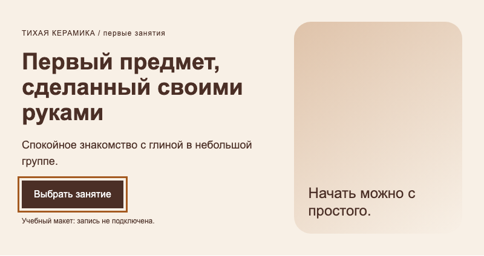

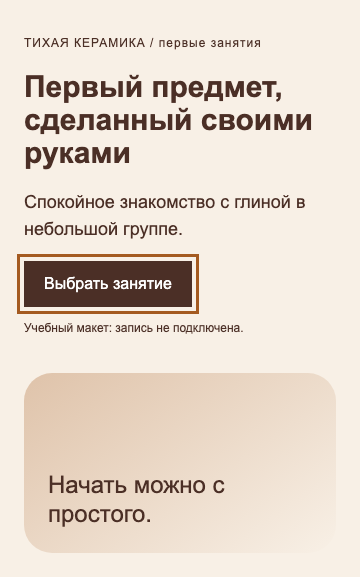

### Ответ 22.2

Возможная небольшая правка — заменить только правило заголовка внутри уже существующего медиаблока, например на `h1 { font-size: 26px; line-height: 1.15; }`. Остальные части брифа не требуют добавления расписания или формы. Нужно снова посмотреть узкую область с исходным и длинным текстом, убедиться в читаемости, расположении кнопки и отсутствии обрезания. Не существует честного заранее заполненного фактического результата для любого ученического экрана: в отчёт подставляются свои наблюдения. Если после изменения строка всё ещё неудобна, размер не считается автоматически правильным только потому, что он совпал с числом в ответе. Сдача содержит изменённый CSS, объяснение решения и свежую проверку.
