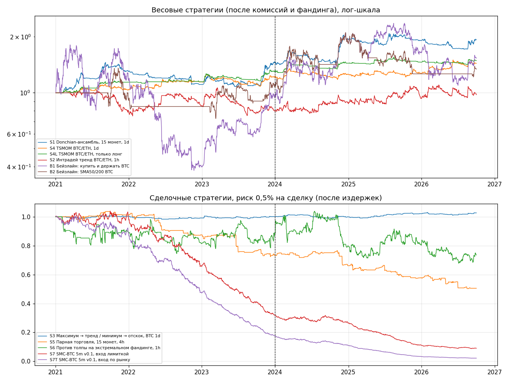

# Бэктесты prop-agents — 2026-10-14

Данные: Binance USDⓈ-M фьючерсы, 2021-01 — 2026-09 (data.binance.vision). Издержки: taker 0,05% + проскальзывание 0,02% на сторону (рыночный круг 0,14%), maker 0,02%; фандинг у весовых стратегий. Параметры взяты из источников (STRATEGIES.md), под нашу историю НЕ подгонялись. Проверка устойчивости: отдельно 2021–2023 и 2024–2026.09.

Критерий «проходит»: Sharpe после издержек ≥ 0,5 в обоих периодах; для сделочных ещё средний R после издержек > 0 и PF ≥ 1,2 в 2024–2026.09. «Доход/год при DD 4%» — годовая доходность, если урезать размер так, чтобы историческая просадка была 4% и худший день ≤ 2,5% (половина типичных лимитов пропа).

## Выводы (первый прогон, 14.10)

1. **Проходят только трендовые на дневках:** S4L TSMOM только лонг (Sharpe 0,95, просадка −8,8%), S1 Donchian (0,81, −25,9%), S4 TSMOM лонг/шорт (0,61, −14,1%). Результат держится в обоих периодах.
2. **На грани:** S3 — в 2021–2023 Sharpe 0,02, в 2024–2026 — 0,56; это неустойчиво.
3. **Не проходят:** S2 (до комиссий Sharpe 0,62, после — 0,07: оборот 147× капитала в год съедает всё), S5 (убыток каждый год, кроме 2021), S6 (около нуля до издержек, минус после).
4. **SMC-BTC 5m v0.1 не имеет преимущества даже до комиссий:** 1710 сделок за 5,75 года, winrate 32,4% при RR 1:2 (точка безубыточности 33,3%), средний R до издержек −0,03, после −0,28. +6R за 14 дней в октябре — случайность. Оговорки: данные Binance, а не MEXC; v0.1 — моя формализация, не карточка Германа; лимитка «по касанию» даже завышает результат.
5. **Главное для пропов:** если урезать даже лучшие стратегии до половины лимитов пропа (просадка 4%, худший день ≤2,5%), они дают ~2–3% в год. Челлендж требует +8–10% при лимите просадки 8–10%. С безопасным размером трендовые стратегии будут проходить челлендж годами. Варианты: портфель из нескольких некоррелированных стратегий (выше Sharpe), осознанно больший риск на дешёвом челлендже с расчётом вероятности прохождения, трендовые — на свои счета, поиск стратегий с высоким отношением доходности к просадке для пропов.

Ограничения: S1 — корзина выбрана сегодня (ошибка выжившего); реализации упрощены по описанию источников; параметры не подбирались.

## Итог

| Код | Стратегия | Вердикт | Sharpe 21–23 | Sharpe 24–26 | Sharpe весь | MaxDD % | Доход/год при DD 4% |
|---|---|---|---|---|---|---|---|
| S1 | Donchian-ансамбль, 15 монет, 1d | ✅ проходит | 0.87 | 0.75 | 0.81 | -25.9 | 1.9 |
| S2 | Интрадей тренд BTC/ETH, 1h | ❌ не проходит | -0.33 | 0.47 | 0.07 | -29.2 | 0.2 |
| S3 | Максимум → тренд / минимум → отскок, BTC 1d | 🟡 на грани | 0.02 | 0.56 | 0.28 | -2.4 | 0.8 |
| S4 | TSMOM BTC/ETH, 1d | ✅ проходит | 0.63 | 0.59 | 0.61 | -14.1 | 2 |
| S4L | TSMOM BTC/ETH, только лонг | ✅ проходит | 1.16 | 0.72 | 0.95 | -8.8 | 3.3 |
| S5 | Парная торговля, 15 монет, 4h | ❌ не проходит | -1.12 | -1.18 | -1.15 | -51.5 | -0.9 |
| S6 | Против толпы на экстремальном фандинге, 1h | ❌ не проходит | -0.08 | -0.23 | -0.15 | -34.7 | -0.4 |
| S7 | SMC-BTC 5m v0.1, вход лимиткой | ❌ не проходит | -2.9 | -3.08 | -2.99 | -91.5 | -1.8 |
| S7T | SMC-BTC 5m v0.1, вход по рынку | ❌ не проходит | -4.27 | -5.03 | -4.64 | -97.9 | -2.7 |
| B1 | Бейзлайн: купить и держать BTC | 🟡 на грани | 0.29 | 0.61 | 0.42 | -78.9 | 1.2 |
| B2 | Бейзлайн: SMA50/200 BTC | 🟡 на грани | 0.23 | 0.4 | 0.32 | -46.5 | 0.9 |

## По стратегиям

### S1. Donchian-ансамбль, 15 монет, 1d — ✅ проходит

Правила: Каналы (20, 40, 80, 160), лонг/вне рынка, цель вол 15%, плечо ≤2.0, полоса ребаланса 25%.

| Метрика | 2021–2023 | 2024–2026.09 | Весь период |
|---|---|---|---|
| Sharpe | 0.87 | 0.75 | 0.81 |
| CAGR % | 13.3 | 10.8 | 12.1 |
| MaxDD % | -25.9 | -17.7 | -25.9 |
| Худший день % | -5.19 | -3.86 | -5.19 |
| Доход/год при DD 4% % | 2.1 | 2.6 | 1.9 |

Дополнительно: Оборот/год (x капитала): 4.2; Комиссии % за период: 1.7; Фандинг % за период: -11; В рынке % времени: 97.6; Sharpe до комиссий: 0.83

По годам, %: 2021: 30.3, 2022: -15, 2023: 31.2, 2024: 33.2, 2025: -1.2, 2026: 0.7

### S2. Интрадей тренд BTC/ETH, 1h — ❌ не проходит

Правила: Пробой max/min за (12, 24, 48) ч, лонг и шорт, цель вол 20%.

| Метрика | 2021–2023 | 2024–2026.09 | Весь период |
|---|---|---|---|
| Sharpe | -0.33 | 0.47 | 0.07 |
| CAGR % | -7.3 | 7.7 | -0.4 |
| MaxDD % | -29.2 | -14.6 | -29.2 |
| Худший день % | -3.85 | -5.87 | -5.87 |
| Доход/год при DD 4% % | -0.8 | 2.6 | 0.2 |

Дополнительно: Оборот/год (x капитала): 147.3; Комиссии % за период: 59.3; Фандинг % за период: -5; В рынке % времени: 67.1; Sharpe до комиссий: 0.62

По годам, %: 2021: -21, 2022: 7.6, 2023: -6.3, 2024: 9.6, 2025: 6.6, 2026: 4.9

### S3. Максимум → тренд / минимум → отскок, BTC 1d — 🟡 на грани

Правила: N=20, стоп 2.0×ATR20, удержание 1 дн. (max) / 3 дн. (min), только лонг.

| Метрика | 2021–2023 | 2024–2026.09 | Весь период |
|---|---|---|---|
| Sharpe | 0.02 | 0.56 | 0.28 |
| CAGR % | 0 | 0.9 | 0.5 |
| MaxDD % | -2.4 | -2.3 | -2.4 |
| Худший день % | -0.52 | -0.51 | -0.52 |
| Доход/год при DD 4% % | 0.1 | 1.6 | 0.8 |
| Сделок | 151 | 148 | 299 |
| Winrate % | 45.7 | 51.4 | 48.5 |
| Ср. R до изд. | 0.019 | 0.057 | 0.038 |
| Ср. R после изд. | 0.002 | 0.035 | 0.018 |
| PF (сделки) | 1.01 | 1.24 | 1.12 |

Дополнительно: Риск на сделку %: 0.5; Ср. стоп %: 8.27; Худшая сделка R: -1.04

По годам, %: 2021: 0.3, 2022: -1.2, 2023: 1, 2024: -0.2, 2025: 2.3, 2026: 0.5

### S4. TSMOM BTC/ETH, 1d — ✅ проходит

Правила: Знак доходности за (7, 14, 28) дн., лонг и шорт, цель вол 15%.

| Метрика | 2021–2023 | 2024–2026.09 | Весь период |
|---|---|---|---|
| Sharpe | 0.63 | 0.59 | 0.61 |
| CAGR % | 6.8 | 6.3 | 6.5 |
| MaxDD % | -14.1 | -12.7 | -14.1 |
| Худший день % | -3.83 | -3.83 | -3.83 |
| Доход/год при DD 4% % | 2.1 | 2.1 | 2 |

Дополнительно: Оборот/год (x капитала): 24.1; Комиссии % за период: 9.7; Фандинг % за период: -5.6; В рынке % времени: 83.5; Sharpe до комиссий: 0.76

По годам, %: 2021: 3.8, 2022: 10.2, 2023: 6.4, 2024: 3.4, 2025: 1.4, 2026: 12.8

### S4L. TSMOM BTC/ETH, только лонг — ✅ проходит

Правила: Знак доходности за (7, 14, 28) дн., только лонг, цель вол 15%.

| Метрика | 2021–2023 | 2024–2026.09 | Весь период |
|---|---|---|---|
| Sharpe | 1.16 | 0.72 | 0.95 |
| CAGR % | 9.3 | 5 | 7.2 |
| MaxDD % | -8.4 | -8.8 | -8.8 |
| Худший день % | -2.37 | -1.9 | -2.37 |
| Доход/год при DD 4% % | 4.4 | 2.3 | 3.3 |

Дополнительно: Оборот/год (x капитала): 11.7; Комиссии % за период: 4.7; Фандинг % за период: -7.7; В рынке % времени: 46.6; Sharpe до комиссий: 1.06

По годам, %: 2021: 14.1, 2022: 0.5, 2023: 13.7, 2024: 10.7, 2025: 1.4, 2026: 1.9

### S5. Парная торговля, 15 монет, 4h — ❌ не проходит

Правила: Топ-5 пар по p-value коинтеграции за 90 дн., z вход 2.0, выход 0.5, стоп 4.0, закрытие в конце месяца.

| Метрика | 2021–2023 | 2024–2026.09 | Весь период |
|---|---|---|---|
| Sharpe | -1.12 | -1.18 | -1.15 |
| CAGR % | -9.8 | -12.7 | -11.2 |
| MaxDD % | -30.2 | -34.3 | -51.5 |
| Худший день % | -8.51 | -7.72 | -8.51 |
| Доход/год при DD 4% % | -1.3 | -1.5 | -0.9 |
| Сделок | 175 | 220 | 393 |
| Winrate % | 54.3 | 55.5 | 55 |
| Ср. R до изд. | -0.279 | -0.251 | -0.263 |
| Ср. R после изд. | -0.343 | -0.324 | -0.333 |
| PF (сделки) | 0.62 | 0.63 | 0.63 |

Дополнительно: Риск на сделку %: 0.5; Ср. стоп %: 5.05; Худшая сделка R: -8.57

По годам, %: 2021: 1.2, 2022: -13.6, 2023: -16.1, 2024: -9.9, 2025: -12.5, 2026: -12.7

### S6. Против толпы на экстремальном фандинге, 1h — ❌ не проходит

Правила: z фандинга (окно 90 начислений) за ±2.0 → против толпы после пробоя 4-часового экстремума; стоп за экстремум 24ч, тейк 2.0R, выход через 48 ч.

| Метрика | 2021–2023 | 2024–2026.09 | Весь период |
|---|---|---|---|
| Sharpe | -0.08 | -0.23 | -0.15 |
| CAGR % | -3.8 | -6.6 | -5.2 |
| MaxDD % | -25.6 | -34.7 | -34.7 |
| Худший день % | -4.2 | -6.11 | -6.11 |
| Доход/год при DD 4% % | -0.3 | -0.5 | -0.4 |
| Сделок | 1383 | 1373 | 2756 |
| Winrate % | 40.4 | 41.2 | 40.8 |
| Ср. R до изд. | 0.035 | 0.04 | 0.038 |
| Ср. R после изд. | -0.007 | -0.019 | -0.013 |
| PF (сделки) | 0.99 | 0.97 | 0.98 |

Дополнительно: Риск на сделку %: 0.5; Ср. стоп %: 3.48; Худшая сделка R: -1.48

По годам, %: 2021: -10.8, 2022: -8.7, 2023: 9.4, 2024: -10.3, 2025: 0.6, 2026: -8.4

### S7. SMC-BTC 5m v0.1, вход лимиткой — ❌ не проходит

Правила: Детектор v0.1 как в бою (config.json), вход лимиткой (maker), тейк лимиткой, стоп по рынку; сетапов всего 2802.

| Метрика | 2021–2023 | 2024–2026.09 | Весь период |
|---|---|---|---|
| Sharpe | -2.9 | -3.08 | -2.99 |
| CAGR % | -31.7 | -36.8 | -34.2 |
| MaxDD % | -69.3 | -72.6 | -91.5 |
| Худший день % | -2.42 | -3.18 | -3.18 |
| Доход/год при DD 4% % | -2.2 | -2.5 | -1.8 |
| Сделок | 765 | 945 | 1710 |
| Winrate % | 31.4 | 33.2 | 32.4 |
| Ср. R до изд. | -0.059 | -0.003 | -0.028 |
| Ср. R после изд. | -0.293 | -0.261 | -0.275 |
| PF (сделки) | 0.67 | 0.7 | 0.69 |

Дополнительно: Риск на сделку %: 0.5; Ср. стоп %: 0.37; Худшая сделка R: -1.87

По годам, %: 2021: -1, 2022: -33.8, 2023: -51.3, 2024: -17.3, 2025: -58.4, 2026: -17.7

### S7T. SMC-BTC 5m v0.1, вход по рынку — ❌ не проходит

Правила: Детектор v0.1 как в бою (config.json), вход по рынку (taker), тейк лимиткой, стоп по рынку; сетапов всего 2802.

| Метрика | 2021–2023 | 2024–2026.09 | Весь период |
|---|---|---|---|
| Sharpe | -4.27 | -5.03 | -4.64 |
| CAGR % | -44 | -53.3 | -48.7 |
| MaxDD % | -82.5 | -87.9 | -97.9 |
| Худший день % | -2.94 | -3.55 | -3.55 |
| Доход/год при DD 4% % | -2.8 | -3.4 | -2.7 |
| Сделок | 765 | 945 | 1710 |
| Winrate % | 31.4 | 33.2 | 32.4 |
| Ср. R до изд. | -0.059 | -0.003 | -0.028 |
| Ср. R после изд. | -0.448 | -0.436 | -0.442 |
| PF (сделки) | 0.55 | 0.56 | 0.56 |

Дополнительно: Риск на сделку %: 0.5; Ср. стоп %: 0.37; Худшая сделка R: -2.35

По годам, %: 2021: -11.9, 2022: -46.4, 2023: -62.7, 2024: -37.9, 2025: -70.2, 2026: -33.6

### B1. Бейзлайн: купить и держать BTC — 🟡 на грани

Правила: Купить и держать BTC (перп, плечо 1).

| Метрика | 2021–2023 | 2024–2026.09 | Весь период |
|---|---|---|---|
| Sharpe | 0.29 | 0.61 | 0.42 |
| CAGR % | -2 | 19.6 | 7.8 |
| MaxDD % | -78.9 | -53.7 | -78.9 |
| Худший день % | -15.41 | -14.03 | -15.41 |
| Доход/год при DD 4% % | 1 | 2.2 | 1.2 |

Дополнительно: Оборот/год (x капитала): 0.2; Комиссии % за период: 0.1; Фандинг % за период: -61.8; В рынке % времени: 100; Sharpe до комиссий: 0.42

По годам, %: 2021: 18.4, 2022: -66.2, 2023: 135, 2024: 95.1, 2025: -9.4, 2026: -7.6

### B2. Бейзлайн: SMA50/200 BTC — 🟡 на грани

Правила: SMA50 > SMA200 → лонг BTC, иначе вне рынка.

| Метрика | 2021–2023 | 2024–2026.09 | Весь период |
|---|---|---|---|
| Sharpe | 0.23 | 0.4 | 0.32 |
| CAGR % | 2.4 | 8.5 | 5.3 |
| MaxDD % | -46.5 | -42.2 | -46.5 |
| Худший день % | -8.98 | -8.53 | -8.98 |
| Доход/год при DD 4% % | 0.6 | 1.4 | 0.9 |

Дополнительно: Оборот/год (x капитала): 1.9; Комиссии % за период: 0.8; Фандинг % за период: -27.9; В рынке % времени: 46.9; Sharpe до комиссий: 0.32

По годам, %: 2021: -7.3, 2022: -9, 2023: 27.3, 2024: 70.9, 2025: -31.1, 2026: 6.2
